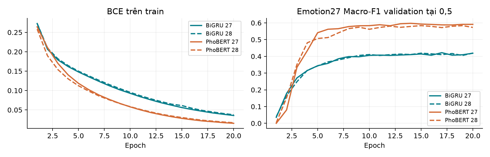

# ViGoEmotions
# Cẩm nang ba mô hình

**Đọc mã nguồn • Hiểu quá trình học • Bảo vệ giữa kỳ**

Tài liệu tiếng Việt dành cho sinh viên mới học ML/NLP.

**Cập nhật midterm 04/11/2026:** Study mới đã có 28 nhãn, gồm Neutral; PhoBERT Macro-F1 28 = 0,574653, Neutral F1 = 0,4400, chọn epoch 11/12. Các chương bên dưới vẫn giảng pipeline và artifact baseline 27 nhãn gốc (PhoBERT 4 epoch, 0,439320), nên không dùng chúng như kết quả mới. Đọc thêm [kết quả 28 nhãn và giới hạn so sánh](../reports/midterm_2026-11-04/neutral28_results.md), [lời dẫn 20 slide/Q&A](midterm_presentation_2026-11-04.md). Test chưa chấm; sweep learning rate chưa hoàn tất.

```flow
01  TF-IDF unigram/bigram → 27 Logistic Regression theo OvR
02  Chuỗi token → embedding học từ đầu → BiGRU → 27 logits
03  Tách từ → PhoBERT-base-v2 pretrained → full fine-tuning
```

**Hoàn thiện 05/11:** Notebook 07 đã có audit split; report có phụ lục F1 mọi nhãn và chín ca PhoBERT đọc định tính hỗ trợ AI. Profile 27/4 epoch và Neutral 12 epoch được tách riêng; xem [lệnh tái lập](reproducibility_profiles.md) và [trạng thái trước nộp](midterm_readiness_2026-11-05.md).

**Workflow huấn luyện mới:** Kaggle notebook 08 (27 nhãn) và 09 (28 nhãn) chạy độc lập, BiGRU/PhoBERT cùng 20 epoch, chọn checkpoint chung trên 27 cảm xúc; chưa có điểm GPU mới. Các chương giải thích kết quả lịch sử vẫn giữ nguyên. Xem [giao thức Kaggle](kaggle_equal_epochs.md).

### Bạn cần trả lời được điều gì?

Một bình luận được biến thành số như thế nào? Mô hình học điều gì từ nhãn? Trọng số thay đổi ở dòng mã nào? Điểm validation nói được và chưa nói được điều gì?

**Bản đối chiếu: 23/10/2026.** Mã nền ở commit `ed6b7ed313404e2e6b883dc201cc2e319419a5b6`. Các vị trí dòng trong tài liệu được kiểm tra với bản mã hiện tại.

> Ba baseline đã có kết quả validation. Khảo sát learning rate PhoBERT mới có thiết kế và cấu hình, trạng thái `prepared`; chưa có kết quả để tuyên bố learning rate thắng cuộc. Không có điểm test được dùng trong bảng so sánh này.

### Quy ước đọc bằng chứng

**[MÃ]** là hành vi có thể đọc trực tiếp trong repository. **[KẾT QUẢ]** là số đo có artifact hỗ trợ. **[GIẢI THÍCH]** là kiến thức hoặc diễn giải thiết kế. **[MINH HỌA]** là ví dụ tự tạo để học, không phải bình luận hay kết quả của dataset.

Mọi câu ví dụ trong tài liệu đều được tự tạo. Không trích bình luận gốc, từ vựng riêng của dataset, ID người dùng hoặc ca lỗi có thể khôi phục nội dung.

<!-- page -->
## Mục lục và cách sử dụng

<!-- toc -->

### Lộ trình ôn tập

**Lượt 1 — hiểu ý chính:** đọc Chương 1, sơ đồ đầu mỗi mô hình và bảng Chương 8. Hiểu bài toán trước khi thuộc tên lớp Python.

**Lượt 2 — đọc mã:** mở repository song song với Chương 2–5. Với mỗi đoạn mã, tự nói: đầu vào là gì, đầu ra có kích thước nào và dòng nào thực sự cập nhật tham số.

**Lượt 3 — luyện bảo vệ:** tự tính lại ví dụ Chương 6; nói bài ba phút; trả lời câu hỏi Chương 9 mà không đọc đáp án. Dùng tờ tra cứu cuối tài liệu trước buổi trình bày.

### Tài liệu này có thể và không thể chứng minh

Các xác suất lưu tại `reports/predictions/*_val.npz` đã được tính lại metric và đối chiếu với CSV, thứ tự 27 nhãn, ID validation và checksum dữ liệu trong run JSON. Đây là xác minh artifact, không phải huấn luyện lại. Không suy ra khả năng tổng quát trên test, ý nghĩa thống kê hoặc quan hệ nhân quả của pretraining chỉ từ một lượt chạy.

Để tái tạo PDF sau khi sửa Markdown: `.venv/bin/python scripts/build_study_guide.py`. Cần `reportlab`, `matplotlib`, `pypdf`, `pygments` (bản dùng dựng: 5.0.1 / 3.11.2 / 6.20.1 / 2.21.0). Script kiểm tra trích mã nguyên văn; nếu mã nguồn đổi, cần cập nhật trích dẫn.

<!-- page -->
## 1. Hiểu bài toán trước khi học mô hình

### 1.1. NLP và phân loại cảm xúc

**NLP** là xử lý ngôn ngữ tự nhiên: giúp máy tính làm việc với ngôn ngữ con người. Ở đây, đầu vào là một bình luận tiếng Việt; đầu ra là những cảm xúc mà bình luận thể hiện. Đây là phân loại cảm xúc chi tiết, không chỉ chia thành tích cực và tiêu cực.

**Multi-label** nghĩa là một mẫu có thể mang nhiều nhãn. [MINH HỌA] “Mình vui và biết ơn vì được giúp đỡ” có thể chứa `joy` và `gratitude`. Hai cảm xúc cùng tồn tại; không cần ép máy chọn đúng một.

Hãy hình dung 27 công tắc trên một bảng điện: mỗi công tắc ứng với một cảm xúc. Một câu có thể bật nhiều công tắc hoặc không bật công tắc nào. Đây khác với một nút xoay chỉ được chọn một chế độ.

```flow
Bình luận tiếng Việt [MINH HỌA]: “Mình vui và biết ơn”
↓ Tiền xử lý và biểu diễn số theo từng mô hình
↓ 27 điểm số → 27 xác suất độc lập theo đầu ra
↓ So sánh mỗi xác suất với 0,5 → tập nhãn dự đoán
```

### 1.2. Vì sao 27 đầu ra? Neutral ở đâu?

[MÃ] `scripts/common.py:16–20` liệt kê đúng 27 nhãn cảm xúc, ID 0–26. Dữ liệu còn có ID 27 cho Neutral. Đây là **không gian nhãn nguồn** 27 cảm xúc + Neutral; mô hình dự án chỉ có **27 đầu ra cảm xúc**.

Nguồn [MÃ]: `scripts/common.py:32–37`.

<!-- source:scripts/common.py:32:37 -->
```python
def multihot(labels):
    # Project convention: neutral alone -> zero; mixed neutral -> retain emotions.
    result = np.zeros(27, dtype=np.int64)
    for label in set(parse_labels(labels)) - {27}:
        result[label] = 1
    return result
```

Dòng 34 tạo vector 27 số 0. Dòng 35 loại ID 27 và loại ID cảm xúc trùng nhau bằng phép tập hợp. Dòng 36 bật các vị trí cảm xúc. Dòng 37 trả kết quả. Vì thế `[27]` thành vector toàn 0; `[2,9,27]` giữ `joy` và `gratitude`.

**Multi-hot** là vector có thể có nhiều số 1. [MINH HỌA] Chỉ xét ba cột `[joy, sadness, gratitude]`, câu trên có nhãn `[1,0,1]`. Trong dự án thật vector có 27 cột. Không nhầm multi-hot với one-hot chỉ có một số 1.

> Dự đoán không có nhãn cảm xúc nghĩa là không đầu ra nào vượt ngưỡng. Có thể diễn giải như trạng thái không phát hiện cảm xúc theo quy ước dự án; mã không học một bộ phân loại Neutral riêng và không tự thêm chuỗi “neutral”. Quy ước này không được mặc nhiên coi là giao thức của paper.

<!-- page -->
### 1.3. Sigmoid, softmax và cách chia dữ liệu

**Sigmoid** biến mỗi logit z thành xác suất `p = 1/(1+exp(−z))`. Mỗi đầu ra được xét riêng. [MINH HỌA] `p(joy)=0,8` và `p(gratitude)=0,7` cùng hợp lệ; tổng xác suất 27 nhãn không buộc bằng 1. Softmax buộc các đầu ra cạnh tranh để tổng bằng 1, thường phù hợp khi phải chọn một lớp trong các lớp loại trừ nhau.

“Độc lập” ở đây nói về quyết định nhị phân và hàm mất mát từng nhãn. Các cảm xúc thật vẫn có thể liên quan nhau; hai mô hình neural còn dùng chung biểu diễn trước lớp đầu ra.

| Tập | Vai trò trong dự án |
| --- | --- |
| Train | 16.530 mẫu sau loại trùng; học vocabulary/IDF và trọng số. |
| Validation | 2.066 mẫu; đo metric, chọn epoch neural tốt nhất; phân tích ngưỡng thăm dò. |
| Test | 2.067 mẫu; giữ cho đánh giá Final, không dùng metric để chọn baseline hay learning rate. |

[KẾT QUẢ] Nguồn đếm: `reports/tables/dataset_summary.csv`, các dòng train/val/test. Train nguồn có 16.531 mẫu, loại 1 mẫu trùng văn bản chuẩn hóa với held-out nên train dùng thực tế là 16.530. Không chia lại dữ liệu.

### 1.4. Tiền xử lý chung và tránh data leakage

Nguồn [MÃ]: `scripts/common.py:40–41`.

<!-- source:scripts/common.py:40:41 -->
```python
def normalize(text):
    return re.sub(r'\s+', ' ', unicodedata.normalize('NFC', text)).strip()
```

[MÃ] `normalize` chuẩn hóa Unicode NFC, gộp mọi cụm khoảng trắng thành một dấu cách và bỏ khoảng trắng ở đầu/cuối. Hàm này không bỏ dấu tiếng Việt, không chuyển emoji thành chữ và không sửa teencode. Mỗi mô hình còn có cách tokenize riêng ở các chương sau.

**Data leakage** là thông tin đáng lẽ chưa được biết lại lọt vào bước học hoặc chọn mô hình, làm điểm đo lạc quan. Ví dụ: học IDF trên cả validation; xây vocabulary từ test; thử nhiều learning rate rồi chọn bằng test.

[MÃ] `scripts/common.py:44–64`, hàm `load_data`, kiểm tra schema, văn bản rỗng, ID trùng; loại train có văn bản NFC trùng val/test; báo lỗi nếu val và test trùng văn bản. Test được đọc để kiểm tra hợp đồng và trùng lặp, không đưa target test vào tối ưu trọng số hay chọn checkpoint. So trùng văn bản sau NFC không phát hiện mọi câu diễn đạt lại.

```flow
Train → fit đặc trưng / cập nhật trọng số
Validation → đo Macro-F1 / chọn checkpoint và cấu hình
Test → đánh giá sau khi chốt toàn bộ quyết định ở Final
```

[GIẢI THÍCH] Giữ split được cấp chưa chứng minh split có multilabel stratification. Paper chỉ nêu tỷ lệ 8:1:1 tại §5.1, trang PDF 6. `docs/label_mapping.md` ghi rõ giới hạn xác minh này.

<!-- page -->
## 2. TF-IDF + One-vs-Rest Logistic Regression

### 2.1. Từ văn bản thành vector số

Máy tính cần số để nhân ma trận và tối ưu hàm mất mát. TF-IDF biểu diễn bình luận bằng độ quan trọng của token/ngram trong tập văn bản, thay vì hiểu trực tiếp câu chữ như người đọc.

**Unigram** là một token. **Bigram** là hai token đứng cạnh nhau. [MINH HỌA] “không vui” tạo unigram `không`, `vui` và bigram `không vui`. Bigram giúp phân biệt một số cụm phủ định, nhưng không xử lý được mọi quan hệ ngữ nghĩa dài.

[MÃ] `configs/baseline27_4ep.json:22–31` dùng `lowercase=true`, `token_pattern=(?u)\b\w+\b`, `ngram_range=[1,2]`. Tokenizer regex nhận chuỗi ký tự từ Unicode, kể cả token một ký tự. Đây không phải tách từ VnCoreNLP; nhiều từ tiếng Việt gồm nhiều tiếng vẫn bị tách theo ranh giới regex. Emoji và dấu câu không thuộc `\w` nên không thành đặc trưng riêng ở cấu hình này. Không có bước loại stopword được cấu hình.

### 2.2. TF, IDF và ví dụ tính tay

**TF** đo token xuất hiện bao nhiêu lần trong một văn bản. Cấu hình dùng `sublinear_tf=true`: với số lần xuất hiện f > 0, TF = `1 + ln(f)`; nếu f = 0 thì trọng số bằng 0. Token lặp nhiều không tăng trọng số tuyến tính mãi.

**IDF** giảm trọng số token phổ biến trong nhiều tài liệu. Theo mặc định `smooth_idf=True` của scikit-learn: `IDF(t) = ln((1+N)/(1+df(t))) + 1`. N là số văn bản train; df(t) là số văn bản train chứa token t.

**TF-IDF** trước chuẩn hóa bằng TF × IDF. Mặc định `norm='l2'` chia vector cho độ dài Euclid. Các mặc định này không viết trong JSON; được đối chiếu với [tài liệu TF-IDF scikit-learn](https://scikit-learn.org/stable/modules/feature_extraction.html).

[MINH HỌA] Ba tài liệu tự tạo: D1 “vui vui”, D2 “vui buồn”, D3 “buồn”. Chỉ giữ hai unigram để tính tay; đây không phải chạy đầy đủ ngram của dự án. N=3; cả hai token có df=2 nên IDF=`ln(4/3)+1≈1,2877`.

| Văn bản | TF hai cột [vui, buồn] | TF-IDF trước L2 | Sau L2 |
| --- | --- | --- | --- |
| D1 | [1,6931; 0] | [2,1802; 0] | [1; 0] |
| D2 | [1; 1] | [1,2877; 1,2877] | [0,7071; 0,7071] |
| D3 | [0; 1] | [0; 1,2877] | [0; 1] |

**Sparse vector** chỉ lưu các phần tử khác 0 và vị trí của chúng. Một bình luận ngắn thường chỉ chứa rất ít trong hàng chục nghìn đặc trưng, nên biểu diễn thưa tiết kiệm bộ nhớ. [KẾT QUẢ] Vocabulary đã fit có 34.837 đặc trưng, không phải lúc nào cũng đủ mức trần 40.000 (`reports/tfidf_lr_run.json`, khóa `features`).

<!-- page -->
### 2.3. Đọc hàm huấn luyện thật, từng dòng

Không có `train_baselines.py` trong bản này. Điểm vào thực tế là `scripts/train_tfidf.py::main`.

Nguồn [MÃ]: `scripts/train_tfidf.py:17–27`.

<!-- source:scripts/train_tfidf.py:17:27 -->
```python
    config = config or json.loads((ROOT/'configs/baseline27_4ep.json').read_text())
    out = ROOT/'reports' if output_dir is None else output_dir
    if output_dir is not None:
        out.mkdir(parents=True, exist_ok=False)
    frames, _ = load_data()
    params = config['tfidf'].copy()
    params['ngram_range'] = tuple(params['ngram_range'])
    vectorizer = TfidfVectorizer(**params)
    started = time.perf_counter()
    x = vectorizer.fit_transform(frames['train'].normalized)
    model = OneVsRestClassifier(LogisticRegression(**config['logistic_regression']), n_jobs=1)
```

**Dòng 17:** nhận config được truyền vào hoặc đọc profile baseline gốc. **18–20:** chọn namespace output; output riêng phải mới để không ghi đè. **21:** nhận các tập đã kiểm tra/lọc trùng. **22:** sao chép tham số TF-IDF. **23:** đổi danh sách `[1,2]` thành tuple `(1,2)`.

**24:** khởi tạo `TfidfVectorizer`; chưa học vocabulary. **25:** bắt đầu đồng hồ. **26:** `fit_transform` vừa học vocabulary/IDF **chỉ từ train**, vừa chuyển train thành ma trận X thưa. **27:** tạo Logistic Regression từ config rồi bọc bằng `OneVsRestClassifier`, chạy từng nhãn với `n_jobs=1`.

| Tham số | Giá trị và ý nghĩa |
| --- | --- |
| `max_features` | 40.000: trần số đặc trưng được giữ. |
| `ngram_range` | (1,2): cả unigram lẫn bigram. |
| `min_df` | 2: phải có trong ít nhất hai tài liệu train. |
| `sublinear_tf`, `lowercase` | Cùng là true: log TF và viết thường. |
| `C` | 1,0: nghịch đảo cường độ regularization; C lớn thường phạt yếu hơn. |
| `solver`, `max_iter` | `liblinear`, 1.000: thuật toán tối ưu và giới hạn số vòng lặp solver. |
| `random_state` | 42, trùng seed cấu hình chung. |

Nguồn tham số: `configs/baseline27_4ep.json:22–38`. Regularization L2 và `class_weight=None` là mặc định của Logistic Regression phiên bản 1.6.1 ghi trong run; JSON không bật cân bằng lớp tự động.

### 2.4. Logistic Regression và OvR là gì?

Dù tên có chữ Regression, ở đây thuật toán làm **phân loại**. Mỗi nhãn c có vector trọng số w và bias b: `z_c = w_c·x + b_c`; sigmoid biến z thành xác suất nhãn hiện diện. Huấn luyện tìm w,b để các nhãn thật có xác suất phù hợp, với hàm log-loss nhị phân và regularization. `liblinear` thực hiện tối ưu bên trong `fit`; không dùng vòng lặp AdamW của neural.

**OvR** trong multi-label có nghĩa: với mỗi cảm xúc, tạo bài toán “có cảm xúc này hay không”. Một mẫu mang ba cảm xúc là positive cho ba bộ phân loại và negative cho các bộ còn lại. Mỗi cột target multi-hot là một bài toán nhị phân; 27 cột dẫn đến 27 classifier. Không phải “nhãn này đối đầu với đúng một nhãn khác”.

Theo [API OneVsRestClassifier 1.6.1](https://scikit-learn.org/1.6/modules/generated/sklearn.multiclass.OneVsRestClassifier.html), `predict_proba` ở multi-label trả xác suất biên từng nhãn; không chuẩn hóa cả hàng thành tổng 1. Phù hợp với nhiều công tắc có thể bật cùng lúc.

<!-- page -->
### 2.5. Fit, dự đoán và đánh giá

Nguồn [MÃ]: `scripts/train_tfidf.py:28–35`.

<!-- source:scripts/train_tfidf.py:28:35 -->
```python
    with warnings.catch_warnings(), threadpool_limits(limits=1):
        warnings.simplefilter('error', ConvergenceWarning)
        model.fit(x, targets(frames['train']))
    seconds = time.perf_counter()-started
    val = model.predict_proba(vectorizer.transform(frames['val'].normalized))
    parameters = sum(est.coef_.size + est.intercept_.size for est in model.estimators_)
    metadata = {'parameter_count':parameters, 'train_seconds':seconds}
    save_evaluation('tfidf_lr',frames,{'val':val},metadata,output_dir=out)
```

**28:** giữ cảnh báo trong phạm vi fit và giới hạn thread của thư viện số xuống 1. **29:** biến `ConvergenceWarning` thành lỗi để không im lặng nhận mô hình chưa hội tụ trong hạn mức solver. **30:** fit toàn bộ OvR trên X và target `(16.530,27)`.

**31:** dừng đồng hồ sau TF-IDF fit + classifier fit. **32:** chỉ `transform` validation bằng vocabulary/IDF đã học, rồi dự đoán xác suất; không fit lại. **33:** đếm hệ số và bias của các classifier. **34:** gom metadata. **35:** gửi xác suất validation cho `save_evaluation`.

[MÃ] Ngưỡng thực sự được áp dụng trong `scripts/common.py:71–78`: `probabilities >= 0.5`. Ví dụ tự tạo `[0,7; 0,2; 0,5]` thành `[1;0;1]`; dấu bằng được tính là có nhãn. Một hàng không có đầu ra ≥0,5 giữ vector toàn 0, không có fallback “lấy nhãn cao nhất”.

[KẾT QUẢ] 27×(34.837+1)=**940.626** tham số classifier, không gồm IDF. Macro-F1 validation **0,238825**, Micro-F1 **0,271238** tại ngưỡng 0,5 (`reports/tables/tfidf_lr_metrics.csv`).

### 2.6. Ưu điểm, giới hạn và vai trò baseline

[GIẢI THÍCH] Mô hình dễ triển khai, làm việc hiệu quả với vector thưa; có thể xem hệ số của ngram để hiểu liên hệ với từng nhãn. Tuy nhiên repository không cung cấp một nghiên cứu hệ số, nên không tuyên bố đã tìm được những từ quyết định thực tế.

Nó phụ thuộc ngram quan sát được, không có embedding ngữ cảnh pretrained, khó nhận ra diễn đạt đồng nghĩa và quan hệ dài. OvR cũng không có cơ chế học trực tiếp tương tác đầu ra nhãn. Đây là mốc truyền thống hợp lý để kiểm tra các mô hình phức tạp có đem lại cải thiện hay không; đây là diễn giải thiết kế của nhóm, không phải trích lời paper.

> **Bài nói khoảng một phút:** “Mô hình đầu tiên biến bình luận thành vector TF-IDF của unigram và bigram. Vocabulary và IDF chỉ được học từ train để tránh leakage. Sau đó nhóm huấn luyện 27 Logistic Regression theo One-vs-Rest, mỗi mô hình trả lời có hay không một cảm xúc. Xác suất từng nhãn được so với ngưỡng 0,5 nên một câu có thể nhận nhiều nhãn. Cấu hình dùng tối đa 40.000 đặc trưng, thực tế có 34.837. Macro-F1 validation đạt khoảng 0,2388. Baseline này đơn giản và giúp kiểm tra lợi ích của việc học biểu diễn chuỗi và pretrained, nhưng khó hiểu ngữ cảnh dài hoặc từ ngữ khác cách viết đã gặp.”

**Năm câu hỏi nhanh:** (1) Vì sao dùng bigram? Để thêm tín hiệu cụm hai token, ví dụ phủ định. (2) Fit IDF ở đâu? Train, dòng 26. (3) Vì sao OvR? Vì target có 27 cột nhị phân. (4) Dùng AdamW không? Không, LR dùng solver `liblinear`. (5) Có đủ 40.000 feature không? Không, run lưu 34.837.

**Ba ngộ nhận:** tên Regression không có nghĩa dự đoán giá trị liên tục ở bài này; TF-IDF không phải embedding có ngữ cảnh; `max_iter=1000` không phải 1.000 epoch neural.

<!-- page -->
## 3. BiGRU học từ đầu

### 3.1. Mạng neural, embedding và chuỗi

**Mạng neural** là chuỗi phép biến đổi có tham số học được. Trong mô hình này: bảng embedding biến token ID thành vector; GRU đọc chuỗi vector; head chuyển biểu diễn câu thành 27 logits. Trọng số được điều chỉnh từ lỗi dự đoán trên train.

**Vocabulary** là ánh xạ token → số nguyên. ID chỉ là địa chỉ tra bảng, không phải mức độ cảm xúc. **Embedding** là vector số thực tại địa chỉ đó; embedding của cùng token được dùng chung khi token xuất hiện ở nhiều vị trí. Trong BiGRU này, bảng embedding được khởi tạo mới và học cùng mạng, không nạp pretrained word vectors.

[MÃ] Token hóa BiGRU là `NFC + lower + whitespace`, tức chuẩn hóa chung, viết thường, rồi `split()` theo khoảng trắng. Không dùng VnCoreNLP. Ví dụ tự tạo “rất vui” tạo hai token; từ tiếng Việt nhiều tiếng có thể bị tách thành nhiều token.

**PAD=0** dùng lấp cuối chuỗi ngắn. **UNK=1** đại diện token không có trong vocabulary. Token thật bắt đầu ID 2. Vocabulary chỉ được xây từ train nên gặp token mới ở validation là bình thường, không được thêm từ validation để né UNK.

### 3.2. Padding, truncation và kích thước tensor

**Sequence length** là số token trong chuỗi theo tokenizer của mô hình, không phải số ký tự. `max_length=128`: chuỗi dài bị cắt lấy 128 token đầu; chuỗi ngắn được đệm 0 tới 128.

[MINH HỌA] Vocabulary giả lập `rất→2`, `vui→3`, `buồn→4`; hai câu “rất vui” và “buồn lắm” thành `[2,3]`, `[4,1]` nếu `lắm` chưa có trong từ điển. Để vẽ gọn, chỉ minh họa độ dài đệm 4 thay vì cấu hình thật 128.

| Bước | Kích thước với B=2, L=4 | Ý nghĩa |
| --- | --- | --- |
| `ids` | (2,4) | [[2,3,0,0],[4,1,0,0]]. |
| `mask` | (2,4) | [[1,1,0,0],[1,1,0,0]]. |
| Embedding | (2,4,128) | Mỗi token thành vector 128 chiều. |
| `hidden` | (2,2,128) | 2 hướng × batch 2 × hidden 128; GRU một tầng. |
| Ghép hai hướng | (2,256) | Mỗi câu có 256 đặc trưng. |
| Logits và sigmoid | (2,27) | 27 điểm và 27 xác suất mỗi câu. |

Với batch thật đủ 64 và L=128: `ids` là `(64,128)`, embedding `(64,128,128)`, hidden `(2,64,128)`, logits `(64,27)`. Batch cuối có thể nhỏ hơn 64.

<!-- page -->
### 3.3. GRU hai hướng và lớp đầu ra trong mã

**GRU** là mạng hồi quy có các cổng học được để giữ, thay và kết hợp thông tin qua từng bước chuỗi. **Hidden state** là vector trạng thái tóm tắt thông tin tại một bước. Không cần thuộc toàn bộ công thức cổng để giải thích: cổng giúp mạng điều chỉnh lượng thông tin cũ mang sang bước mới.

**Bidirectional** nghĩa là một GRU đọc xuôi và một GRU đọc ngược. Từ cùng câu, ta có hai tóm tắt theo hai chiều. Vì cả bình luận đã có sẵn trước khi phân loại, đọc ngược không dùng nhãn tương lai hay dữ liệu từ tập khác.

Nguồn [MÃ]: `scripts/train_neural.py:19–31`.

<!-- source:scripts/train_neural.py:19:31 -->
```python
class BiGRU(nn.Module):
    def __init__(self, vocab_size, embedding_dim, hidden_dim, dropout):
        super().__init__()
        self.embedding = nn.Embedding(vocab_size, embedding_dim, padding_idx=0)
        self.gru = nn.GRU(embedding_dim, hidden_dim, batch_first=True, bidirectional=True)
        self.dropout = nn.Dropout(dropout)
        self.head = nn.Linear(2*hidden_dim, 27)

    def forward(self, ids, mask):
        packed = pack_padded_sequence(self.embedding(ids), mask.sum(1).cpu(),
                                      batch_first=True, enforce_sorted=False)
        _, hidden = self.gru(packed)
        return self.head(self.dropout(torch.cat((hidden[-2],hidden[-1]),dim=1)))
```

**19–21:** khai báo mô hình và khởi tạo lớp cha. **22:** bảng embedding, ID 0 là padding nên hàng padding không nhận gradient học như token thường. **23:** GRU nhận embedding; `batch_first=True` đặt batch ở trục đầu; `bidirectional=True` bật hai hướng. `num_layers` không truyền nên mặc định một tầng.

**24:** dropout 0,3 khi train. **25:** head tuyến tính 256→27. **27–29:** embedding được đóng gói bằng `pack_padded_sequence`, độ dài thật tính từ tổng mask; PAD cuối câu không bị coi là dữ liệu thật. `enforce_sorted=False` cho phép batch không sắp theo độ dài.

**30:** lấy hidden cuối của GRU, không dùng toàn bộ output theo từng token. **31:** `hidden[-2]` là hướng xuôi và `hidden[-1]` hướng ngược của tầng cuối; ghép theo trục đặc trưng, áp dropout rồi head. Không dùng mean/max pooling. Hàm trả **logits**, sigmoid chỉ xuất hiện khi dự đoán.

### 3.4. Vocabulary và đổi token thành ID

Nguồn [MÃ]: `scripts/train_neural.py:48–49`.

<!-- source:scripts/train_neural.py:48:49 -->
```python
        words = Counter(word for text in frames['train'].normalized for word in text.lower().split())
        vocab = {word:i+2 for i,(word,_) in enumerate(words.most_common(settings['max_vocab']-2))}
```

Dòng 48 đếm token chỉ trong train sau lowercase/whitespace. Dòng 49 lấy nhiều nhất `max_vocab−2` token thường gặp, đánh số từ 2 để dành PAD/UNK. Tập huấn luyện thực tế tạo **15.025** mục gồm hai token đặc biệt (`reports/gru_run.json`, `preprocessing.vocab_size`), thấp hơn trần 30.000. `scripts/train_neural.py:50–52` lưu vocabulary riêng trong `data/derived/` và khởi tạo `BiGRU`; tài liệu này không công bố nội dung vocabulary.

Nguồn [MÃ]: `scripts/train_neural.py:54–59`.

<!-- source:scripts/train_neural.py:54:59 -->
```python
            seqs = [[vocab.get(w,1) for w in text.lower().split()][:max_length]
                    for text in frames[split].normalized]
            ids = torch.zeros((len(seqs),max_length),dtype=torch.long)
            for i,seq in enumerate(seqs):
                ids[i,:len(seq)] = torch.tensor(seq,dtype=torch.long)
            features[split] = (ids,ids.ne(0).long())
```

**54–55:** token → ID, token lạ →1, cắt độ dài. **56:** cấp phát toàn số 0. **57–58:** chép chuỗi thật vào đầu hàng. **59:** mask bằng 1 tại mọi ID khác 0. Đây là cách giữ riêng PAD và UNK: UNK=1 vẫn là token có thật trong chuỗi.

<!-- page -->
### 3.5. Cấu hình và cách học

| Thiết lập | Giá trị thực tế |
| --- | --- |
| Vocabulary tối đa / thực tế | 30.000 / 15.025 (gồm PAD, UNK). |
| Embedding / hidden mỗi hướng | 128 / 128; ghép hai hướng thành 256. |
| Dropout | 0,3 ở sau khi ghép hidden, trước head. |
| Max length / batch size | 128 token / 64 mẫu. |
| Epoch / learning rate | 10 / 0,001. |
| Loss / optimizer | `BCEWithLogitsLoss` / AdamW. |
| Weight decay / gradient clipping | 0,0 do fallback của code / norm tối đa 1,0. |

Nguồn: `configs/baseline27_4ep.json:39–48`; optimizer/loss/clipping ở `scripts/train_neural.py:135–150`. Đừng nhầm dropout ở đây với dropout bên trong nhiều tầng GRU: mã chỉ tạo `nn.Dropout` bên ngoài, không truyền tham số `dropout` vào `nn.GRU`.

[MÃ] `prepare` tạo `TensorDataset(ids,mask,target_float32)` rồi `DataLoader`, train có shuffle và val không shuffle (`scripts/train_neural.py:81–85`). Vòng lặp neural được dùng chung cho BiGRU và PhoBERT; Chương 4–5 trích đầy đủ đoạn cập nhật trọng số. Với BiGRU, `logits` gọi `model(ids,mask)` tại `scripts/train_neural.py:89–92`.

Nguồn [MÃ]: `scripts/train_neural.py:95–102`.

<!-- source:scripts/train_neural.py:95:102 -->
```python
def predict(model, model_name, loader, device):
    model.eval()
    results = []
    with torch.no_grad():
        for ids,mask,_ in loader:
            output = logits(model,model_name,ids.to(device),mask.to(device))
            results.append(torch.sigmoid(output).cpu().numpy())
    return np.concatenate(results)
```

**96:** chuyển sang chế độ đánh giá, dropout bị tắt. **98:** không ghi graph gradient. **99–100:** đưa batch lên thiết bị, lấy logits. **101:** sigmoid từng logit, đưa xác suất về CPU/NumPy. **102:** nối batch thành ma trận xác suất toàn tập. Hàm không gọi `backward` hoặc `optimizer.step`.

[KẾT QUẢ] `reports/gru_run.json` có 10 epoch, checkpoint tốt nhất ở epoch 10; Macro-F1 validation **0,406002**, Micro-F1 **0,452609**. Không suy ra phải dừng ở 10 vì mạng đã hội tụ; đó là số epoch cố định của thiết kế.

### 3.6. Vai trò và luyện nói

[GIẢI THÍCH] BiGRU là baseline neural ở giữa: có thứ tự chuỗi và biểu diễn học được, nhưng chưa có tri thức từ corpus pretraining bên ngoài. Nó giúp đặt câu hỏi học biểu diễn từ 16.530 mẫu train có ích đến đâu. Ưu điểm là kiến trúc gọn hơn PhoBERT; giới hạn là dữ liệu dự án hữu hạn, UNK và việc xử lý chuỗi hồi quy.

> **Bài nói khoảng một phút:** “BiGRU của nhóm được huấn luyện từ đầu. Nhóm xây vocabulary chỉ từ train, đổi token thành ID, đệm PAD và dùng UNK cho token lạ. Embedding 128 chiều được học cùng GRU. Hai hướng đọc xuôi và ngược tạo hai hidden state 128 chiều; ghép thành 256, qua dropout 0,3 và head 27 đầu ra. Mạng trả logits, dùng BCEWithLogitsLoss và AdamW với learning rate 0,001, batch 64 trong 10 epoch. Khi đánh giá, sigmoid chuyển logits thành xác suất. Macro-F1 validation tốt nhất khoảng 0,4060. Đây là phép so sánh với neural học biểu diễn từ dữ liệu dự án, chưa phải fine-tuning pretrained model.”

**Năm câu hỏi:** (1) Đã fine-tune BiGRU chưa? Không nạp pretrained nên là from scratch. (2) Vì sao hidden 256? Ghép hai hướng 128. (3) PAD có được đọc như từ không? Chuỗi được pack theo mask. (4) UNK khác PAD? UNK là token thật chưa biết, PAD là đệm. (5) Vocabulary lấy từ đâu? Chỉ train.

**Ba ngộ nhận:** token ID không phải embedding; hai hướng không phải hai mô hình phân loại riêng; embedding không tự có nghĩa tốt ngay trước khi học.

<!-- page -->
## 4. PhoBERT-base-v2 và full fine-tuning

### 4.1. Pretraining, Transformer và self-attention

**Pretrained language model** là mô hình đã học cấu trúc ngôn ngữ từ corpus lớn trước bài toán hiện tại. PhoBERT dựa trên RoBERTa, được pretrained cho tiếng Việt. **Pretraining** học biểu diễn ngôn ngữ tổng quát, chẳng hạn khôi phục token bị che; **fine-tuning** tiếp tục điều chỉnh tham số theo nhãn cảm xúc của dự án.

**Transformer** là kiến trúc dùng nhiều khối xử lý vector token và self-attention. Hiểu đơn giản: để tạo biểu diễn cho một token, self-attention học cách tổng hợp thông tin từ các token khác trong câu. Biểu diễn vì vậy có thể phụ thuộc ngữ cảnh. Đây là cơ chế tính toán, không phải bằng chứng mô hình đã hiểu cảm xúc như con người.

Theo [model card PhoBERT-base-v2](https://huggingface.co/vinai/phobert-base-v2), bản v2 thuộc cỡ base, khoảng 135 triệu tham số, độ dài tối đa 256 token và có corpus pretraining mở rộng bằng OSCAR-2301 ngoài Wikipedia/News. Dùng mô hình tiếng Việt là lựa chọn hợp lý để tận dụng biểu diễn ngôn ngữ sẵn có; không bảo đảm phù hợp mọi teencode hay mỉa mai.

### 4.2. VnCoreNLP làm gì trong pipeline này?

Nguồn [MÃ]: `scripts/train_neural.py:34–40`.

<!-- source:scripts/train_neural.py:34:40 -->
```python
def segmented_texts(frames, model_dir):
    import py_vncorenlp
    segmenter = py_vncorenlp.VnCoreNLP(annotators=['wseg'], save_dir=str(model_dir.resolve()))
    result = {}
    for split in ('train','val'):
        result[split] = [' '.join(segmenter.word_segment(text)) for text in frames[split].normalized]
    return result
```

**35:** import thư viện. **36:** nạp bộ tách từ với duy nhất annotator `wseg`. **37:** tạo kết quả. **38:** chỉ chạy train/val. **39:** nhận văn bản NFC, tách từ/câu và ghép các câu đã tách bằng dấu cách. **40:** trả văn bản cho tokenizer PhoBERT.

VnCoreNLP ở đây **không pretrain PhoBERT**, không học nhãn cảm xúc và không cập nhật trọng số mạng trong vòng lặp PyTorch. Nó là công cụ tiền xử lý tách từ. Các tiếng thuộc một từ có thể được nối bằng dấu gạch dưới. [MINH HỌA] “học sinh” có thể được biểu diễn thành `học_sinh`; đây không phải output đã chạy đo từ dataset.

```flow
Văn bản → NFC và gộp khoảng trắng
↓ VnCoreNLP wseg: xác định ranh giới từ tiếng Việt
↓ PhoBERT BPE: tách tiếp thành đơn vị con, đổi thành token ID
↓ Backbone pretrained → head cảm xúc → 27 logits
```

Tách từ và BPE là hai tầng khác nhau. BPE dùng vocabulary và quy tắc ghép đã học trước, có thể tách từ thành subword khi cần. Không huấn luyện lại tokenizer bằng train dự án. [Hướng dẫn chính thức PhoBERT](https://github.com/VinAIResearch/PhoBERT) yêu cầu đầu vào đã tách từ; dự án làm theo pipeline đó. Không áp lowercase toàn bộ văn bản ở nhánh PhoBERT như BiGRU.

<!-- page -->
### 4.3. Nạp tokenizer, backbone và head 27 đầu ra

Nguồn [MÃ]: `scripts/train_neural.py:64–70`.

<!-- source:scripts/train_neural.py:64:70 -->
```python
        from transformers import AutoTokenizer, AutoModelForSequenceClassification
        text = segmented_texts(frames,vncorenlp_dir)
        model_args = dict(revision=settings['revision'])
        tokenizer = AutoTokenizer.from_pretrained(settings['checkpoint'],use_fast=False,**model_args)
        model = AutoModelForSequenceClassification.from_pretrained(settings['checkpoint'],
            num_labels=27,problem_type='multi_label_classification',
            id2label=dict(enumerate(LABELS)),label2id={l:i for i,l in enumerate(LABELS)},**model_args)
```

**64:** dùng các lớp Auto chọn đúng loại tokenizer/model từ checkpoint. **65:** tách từ trước. **66:** giữ `revision` để cố định phiên bản pretrained. **67:** nạp tokenizer từ checkpoint, `use_fast=False` chọn triển khai tokenizer chậm của thư viện, không phải giảm learning rate.

**68:** nạp mô hình phân loại chuỗi có backbone pretrained. **69:** head có 27 đầu ra, khai báo bài toán multi-label. **70:** gắn mapping ID↔tên nhãn từ `LABELS`, cố định thứ tự cột. Head cảm xúc cho 27 nhãn được khởi tạo cho tác vụ, không phải tri thức cảm xúc ViGoEmotions có sẵn trong checkpoint ngôn ngữ.

**Backbone** là phần học biểu diễn ngôn ngữ. **Classification head** chuyển biểu diễn cấp chuỗi sang 27 logits. Repository dùng head do `AutoModelForSequenceClassification` cung cấp, không tự viết head PhoBERT trong `train_neural.py`. Vì `logits(...)` không truyền `labels`, loss được tính tường minh ở ngoài bằng `BCEWithLogitsLoss`, không lấy `outputs.loss`.

### 4.4. Token IDs, attention mask và DataLoader

Nguồn [MÃ]: `scripts/train_neural.py:73–77`.

<!-- source:scripts/train_neural.py:73:77 -->
```python
            lengths = [len(tokenizer.encode(t, truncation=False)) for t in text[split]]
            truncation[split] = float(np.mean(np.array(lengths)>max_length))
            encoded = tokenizer(text[split],padding='max_length',truncation=True,
                                max_length=max_length,return_tensors='pt')
            features[split] = (encoded['input_ids'],encoded['attention_mask'])
```

**73:** đo độ dài token trước khi cắt để kiểm tra truncation. **74:** tỷ lệ chuỗi dài hơn giới hạn. **75–76:** tokenize, đệm tới `max_length=256`, cắt chuỗi dài, trả tensor PyTorch. Độ dài bao gồm token đặc biệt do tokenizer thêm; không đồng nhất với 256 từ tiếng Việt. **77:** lưu ID và mask. Attention mask cho biết vị trí hợp lệ và vị trí padding; không phải ma trận trọng số self-attention đã học.

Nguồn [MÃ]: `scripts/train_neural.py:81–85`.

<!-- source:scripts/train_neural.py:81:85 -->
```python
    loaders = {}
    for split,(ids,mask) in features.items():
        dataset = TensorDataset(ids,mask,torch.tensor(targets(frames[split]),dtype=torch.float32))
        loaders[split] = DataLoader(dataset,batch_size=settings['batch_size'],
            shuffle=split=='train',num_workers=0,generator=torch.Generator().manual_seed(config['seed']))
```

**81–82:** tạo loader cho từng split. **83:** mỗi mẫu gồm IDs, mask và vector multi-hot float32. **84:** kích thước batch theo cấu hình. **85:** chỉ shuffle train, không tạo worker phụ; generator cố định seed. Với batch đủ 16: IDs/mask `(16,256)`, target/logits `(16,27)`. Khi dự đoán, `scripts/train_neural.py:92` truyền `input_ids` và `attention_mask`, lấy `.logits`.

| Thiết lập PhoBERT | Giá trị từ config |
| --- | --- |
| Checkpoint / revision | `vinai/phobert-base-v2` / `86cd7fd4c148980922ac11a2cf5e257f2ba639e1`. |
| Max length / batch / epoch | 256 / 16 / 4. |
| AdamW learning rate / weight decay | 0,00002 = 2e-5 / 0,01. |
| Loss / gradient clipping | BCEWithLogitsLoss / max norm 1,0. |

Nguồn: `configs/baseline27_4ep.json:49–57`, `scripts/train_neural.py:135–150`. Mã không tự đặt scheduler, warmup, gradient accumulation hoặc mixed precision; không thêm chúng vào phần mô tả thí nghiệm.

<!-- page -->
### 4.5. Fine-tuning thực sự xảy ra ở đâu?

Nguồn [MÃ]: `scripts/train_neural.py:134–138`.

<!-- source:scripts/train_neural.py:134:138 -->
```python
    model.to(device)
    optimizer = torch.optim.AdamW(model.parameters(),lr=settings['learning_rate'],
                                 weight_decay=settings.get('weight_decay',0.0))
    loss_fn = nn.BCEWithLogitsLoss()
    history,best_score = [],-1.0
```

**134:** chuyển model lên GPU nếu có, ngược lại CPU. **135–136:** đưa **toàn bộ `model.parameters()`** cho AdamW, dùng learning rate và weight decay cấu hình. Nhánh PhoBERT không đặt `requires_grad=False` hay chỉ chọn `model.classifier.parameters()`. **137:** tạo BCE nhận logits. **138:** khởi tạo lịch sử và điểm tốt nhất.

Nguồn [MÃ]: `scripts/train_neural.py:142–154`.

<!-- source:scripts/train_neural.py:142:154 -->
```python
    for epoch in range(1,settings['epochs']+1):
        model.train();total_loss = 0.0
        for ids,mask,y in loaders['train']:
            ids,mask,y = ids.to(device),mask.to(device),y.to(device)
            optimizer.zero_grad(set_to_none=True)
            loss = loss_fn(logits(model,args.model,ids,mask),y)
            loss.backward()
            torch.nn.utils.clip_grad_norm_(model.parameters(),1.0)
            optimizer.step()
            total_loss += loss.item()*len(y)
        p = predict(model,args.model,loaders['val'],device)
        metrics = scores(targets(frames['val']),p)
        history.append(dict(epoch=epoch,loss=total_loss/len(frames['train']),**metrics))
```

**142:** lặp đủ số epoch. **143:** bật chế độ train và reset tổng loss thống kê. **144–145:** lấy batch, đưa dữ liệu lên thiết bị. **146:** xóa gradient cũ, không xóa trọng số. **147:** forward qua backbone và head, tính BCE với target multi-hot. **148:** backprop tính gradient cho graph. **149:** cắt norm gradient ở mức 1. **150:** AdamW cập nhật tham số. **151:** cộng loss theo số mẫu. **152–153:** dự đoán val và tính metric. **154:** lưu lịch sử epoch.

> **Vị trí fine-tuning: dòng 135–150.** Nạp pretrained chỉ là khởi đầu; `backward()` và `optimizer.step()` mới tạo quá trình học tiếp cho backbone và head.

### 4.6. Lưu và nạp checkpoint tốt nhất

Nguồn [MÃ]: `scripts/train_neural.py:156–159`.

<!-- source:scripts/train_neural.py:156:159 -->
```python
        if metrics['macro_f1'] > best_score:
            best_score = metrics['macro_f1']
            torch.save(model.state_dict(),checkpoint)
            best_epoch = epoch
```

Điểm val tăng thì lưu `state_dict`; dấu `>` giữ epoch sớm khi hòa. Dòng 163 nạp best: `model.load_state_dict(torch.load(checkpoint,map_location=device,weights_only=True))`; sau đó đánh giá val (`scripts/train_neural.py:163–166`). Checkpoint mặc định: `data/checkpoints/phobert_best.pt` (`scripts/train_neural.py:139`). Tài liệu kiểm tra xác suất/lịch sử, chưa nạp trọng số riêng tư.

> **Bài nói khoảng một phút:** “Nhóm dùng PhoBERT-base-v2 đã pretrained cho tiếng Việt. Bình luận được chuẩn hóa, tách từ VnCoreNLP rồi BPE tokenize. Model có backbone pretrained và head 27 logits. Nhóm full fine-tuning: AdamW nhận toàn bộ tham số; mỗi batch tính BCEWithLogitsLoss, backward, clip gradient và step. Cấu hình là batch 16, learning rate 2e-5, weight decay 0,01, bốn epoch. Cuối mỗi epoch chỉ đo validation và lưu checkpoint khi Macro-F1 tăng. Baseline đạt Macro-F1 validation khoảng 0,4393; chưa kết luận learning rate 2e-5 tối ưu vì sweep ba mức mới được chuẩn bị.”

**Năm câu hỏi:** (1) VnCoreNLP học cảm xúc? Không, chỉ wseg. (2) Nạp pretrained đã là fine-tune? Chưa; cần học bằng nhãn tác vụ. (3) Freeze backbone? Giữ backbone cố định, chỉ head học. (4) Ai tính loss? Mã này tính BCE bên ngoài. (5) Logits là xác suất? Chưa; cần sigmoid.

**Ba ngộ nhận:** pretrained không đồng nghĩa đã học nhãn dự án; word segmentation không phải BPE; full fine-tuning không phải huấn luyện PhoBERT từ số 0.

<!-- page -->
## 5. Hiểu sâu vòng lặp huấn luyện

### 5.1. Batch, epoch và trọng số

**Trọng số** là các số mô hình học được: embedding, ma trận GRU, tham số Transformer, head và bias. **Hyperparameter** do người thiết kế chọn, ví dụ batch size hoặc learning rate; chúng không phải các trọng số được `backward()` trực tiếp học.

**Batch size** là số mẫu dùng chung cho một lần tính gradient. **Epoch** là một lượt duyệt hết train. [MÃ] DataLoader không đặt `drop_last=True`, nên giữ batch cuối chưa đủ kích thước (`scripts/train_neural.py:83–85`).

Với 16.530 mẫu train: BiGRU batch 64 có `ceil(16.530/64)=259` batch/epoch; 258 batch đủ và batch cuối 18 mẫu. PhoBERT batch 16 có `ceil(16.530/16)=1.034` batch/epoch; 1.033 batch đủ và batch cuối 2 mẫu. Đây là phép tính từ số mẫu/cấu hình, không phải đo thông lượng GPU.

Ở cấu hình hiện tại không có gradient accumulation và mỗi batch gọi `optimizer.step()` một lần: BiGRU 10 epoch có **2.590** lần step; PhoBERT 4 epoch có **4.136** lần step nếu chạy đủ không lỗi.

### 5.2. Dòng thời gian PhoBERT thực tế

Ký hiệu W0 là toàn bộ tham số lúc bắt đầu: backbone pretrained và head mới. W1, W2... là các bộ tham số sau từng lần step; đây là ký hiệu giải thích, không phải tên biến trong code.

```flow
EPOCH 1 — bắt đầu từ W0, batch size 16
Batch 1 → forward → BCE → backward → clip → AdamW → W1
Batch 2 → forward bằng W1 → BCE → backward → clip → AdamW → W2
... Batch 1.034 (2 mẫu) → W1034
Validation: eval + no_grad → sigmoid → Macro-F1 → lưu nếu tốt nhất
EPOCH 2 — tiếp tục từ W1034, không khởi tạo lại model
1.034 batch tiếp → W2068 → validation → xét checkpoint
EPOCH 3 — từ W2068 → W3102 → validation → xét checkpoint
EPOCH 4 — từ W3102 → W4136 → validation → xét checkpoint
Kết thúc: nạp checkpoint có Macro-F1 validation cao nhất
```

[MÃ] `prepare(...)` và optimizer được tạo **trước** vòng `for epoch` (`scripts/train_neural.py:132–142`). Vì vậy model và trạng thái AdamW tiếp tục từ batch/epoch trước. `total_loss=0.0` chỉ reset biến thống kê; `zero_grad` chỉ xóa gradient. Không có dòng khởi tạo lại model trong mỗi epoch.

[KẾT QUẢ] Run PhoBERT lưu Macro-F1 qua bốn epoch lần lượt **0,009093; 0,114433; 0,366679; 0,439320**. Checkpoint được chọn ở epoch 4 trong lượt này (`reports/phobert_run.json`, `history`, `best_epoch`). Việc epoch cuối thắng trong run này không phải quy tắc bắt buộc cho run khác.

<!-- page -->
### 5.3. Forward, loss, gradient và AdamW

**Forward pass** dùng trọng số hiện tại để tính logits. **Loss** đo độ không phù hợp với target; thấp hơn nghĩa là dự đoán phù hợp target hơn theo hàm mất mát trên dữ liệu đang xét. **Backpropagation** dùng quy tắc đạo hàm để tính gradient: mỗi tham số ảnh hưởng loss theo hướng và độ lớn nào.

Với một nhãn, BCE=`−[y ln(p)+(1−y) ln(1−p)]`, p là sigmoid(z). Neural dùng `BCEWithLogitsLoss` nhận **z trực tiếp**, kết hợp sigmoid+BCE theo cách ổn định số. Không sigmoid rồi đưa vào BCEWithLogitsLoss lần nữa. Mặc định reduction lấy trung bình các phần tử batch×27; mã không bật `pos_weight` hay class weighting.

[MINH HỌA] Nhãn y=1: p=0,2 có loss `−ln(0,2)≈1,609`; p=0,8 có loss `≈0,223`. Với y=0, p=0,8 bị phạt `−ln(0,2)≈1,609`. Đây là một nhãn, không phải loss trung bình thực nghiệm.

**Optimizer** dùng gradient để thay đổi trọng số. **Learning rate** điều chỉnh độ lớn bước cập nhật. Để hiểu hướng đi, ví dụ SGD giả lập `w_mới=w_cũ−lr×gradient`: w=0,4, gradient=0,2, lr=0,001 cho w mới=0,3998. Đây không phải công thức cập nhật AdamW thực tế.

**AdamW** theo dõi trung bình động gradient và bình phương gradient để điều chỉnh bước theo từng tham số; còn có **weight decay** tách khỏi bước thích nghi, hướng tham số về nhỏ hơn. Trong code, PhoBERT dùng lr=2e-5 và decay=0,01; BiGRU lr=0,001 và decay=0,0 từ `settings.get('weight_decay',0.0)` (`scripts/train_neural.py:135–136`). Không dùng mặc định decay của thư viện để suy ra decay BiGRU.

**Gradient clipping** hạn chế norm chung của gradient, không cắt trực tiếp trọng số về [−1,1]. [MINH HỌA] Vector gradient [3,4] có norm 5; giới hạn 1 sẽ co về xấp xỉ [0,6;0,8]. Mã gọi clipping sau backward, trước step (`scripts/train_neural.py:148–150`). Clipping không phải early stopping.

### 5.4. Validation, checkpoint và điều kiện dừng

“Full” nghĩa là không đóng băng backbone; không bảo đảm mọi phần tử tham số đều thay đổi ở mọi batch.

Validation gọi `model.eval()` và `torch.no_grad()`; không gọi backward/step (`scripts/train_neural.py:95–102`). Nhãn val được dùng tính metric để **chọn** checkpoint, không trực tiếp tính gradient huấn luyện. `eval()` đổi hành vi dropout; tự nó không đồng nghĩa tắt autograd, nên code dùng thêm `no_grad()`.

**Checkpoint** lưu trạng thái trọng số tại một thời điểm. Mã lưu `model.state_dict()`, không lưu optimizer state; đủ để nạp đánh giá tốt nhất, không phải một gói resume huấn luyện đầy đủ (`scripts/train_neural.py:156–163`).

**Fixed epochs:** chạy đủ 10 epoch BiGRU hoặc 4 PhoBERT. **Early stopping:** dừng sớm theo quy tắc như không cải thiện sau k epoch; mã hiện tại không có quy tắc đó. Checkpoint tốt nhất có thể ở giữa vì học tiếp có thể giảm chất lượng val. Trong quá trình train, epoch sau vẫn bắt đầu từ trọng số cuối epoch trước; chỉ nạp best sau toàn bộ vòng lặp.

> **0,5 là ngưỡng giải mã xác suất, không phải lệnh dừng cập nhật trọng số.** Mạng tối ưu BCE trên logits của mọi batch, dù một xác suất đã vượt 0,5. F1 tại ngưỡng 0,5 dùng đánh giá/chọn checkpoint, không phải loss để đạo hàm trong code.

<!-- page -->
## 6. Hiểu và tự tính các metric

### 6.1. Một nhãn có bốn trường hợp

Xét riêng nhãn `joy`. **TP**: thật có, dự đoán có. **FP**: thật không, dự đoán có. **FN**: thật có, dự đoán không. **TN**: thật không, dự đoán không. Với multi-label, cùng một bình luận có thể là TP ở nhãn này và FN ở nhãn khác.

| Nhãn joy [MINH HỌA] | Dự đoán có (1) | Dự đoán không (0) |
| --- | --- | --- |
| Thật có (1) | TP = 2 | FN = 0 |
| Thật không (0) | FP = 1 | TN = 1 |

**Precision**=`TP/(TP+FP)`: trong những lần báo có cảm xúc, đúng bao nhiêu? **Recall**=`TP/(TP+FN)`: trong những mẫu thật có cảm xúc, tìm ra bao nhiêu? **F1**=`2PR/(P+R)=2TP/(2TP+FP+FN)`: cân bằng precision và recall. TN không xuất hiện trong công thức F1.

### 6.2. Ví dụ đủ ba nhãn, bốn mẫu

Tất cả dữ liệu dưới đây được tự tạo. Chỉ xét `[joy, sadness, gratitude]` để tính tay; dự án thật tính trên 27 nhãn.

| Mẫu | Nhãn thật [J,S,G] | Xác suất [J,S,G] | Dự đoán tại ≥0,5 |
| --- | --- | --- | --- |
| A | [1,0,1] | [0,8;0,2;0,4] | [1,0,0] |
| B | [0,1,0] | [0,6;0,7;0,1] | [1,1,0] |
| C | [1,1,0] | [0,7;0,3;0,2] | [1,0,0] |
| D | [0,0,1] | [0,1;0,2;0,8] | [0,0,1] |

| Nhãn | TP / FP / FN / TN | Precision | Recall | F1 |
| --- | --- | --- | --- | --- |
| Joy | 2 / 1 / 0 / 1 | 2/3 | 1 | 4/5 = 0,8 |
| Sadness | 1 / 0 / 1 / 2 | 1 | 1/2 | 2/3 ≈ 0,6667 |
| Gratitude | 1 / 0 / 1 / 2 | 1 | 1/2 | 2/3 ≈ 0,6667 |

Hai ma trận còn lại đều có hàng thật có `[TP=1,FN=1]` và hàng thật không `[FP=0,TN=2]`. Mỗi ma trận đếm đúng 4 mẫu; không gộp các cảm xúc thành một bài toán chọn một lớp.

**Macro-F1** là trung bình F1 từng nhãn: `(0,8+2/3+2/3)/3 = 32/45 ≈ 0,7111`. Không phải tính trung bình precision/recall trước rồi lấy F1; hai cách nói chung khác nhau.

**Micro-F1:** gộp TP=4, FP=1, FN=2 trên tất cả nhãn; `2×4/(2×4+1+2)=8/11≈0,7273`. **Hamming Loss:** có 3 quyết định sai trong 4×3=12 quyết định, nên `3/12=0,25`; càng thấp càng tốt.

<!-- page -->
### 6.3. Macro, Micro, Accuracy và mất cân bằng

Macro cho mỗi nhãn một phiếu bằng nhau, kể cả nhãn ít gặp. Micro cộng toàn bộ quyết định nên nhãn có nhiều mẫu dương ảnh hưởng mạnh hơn. Khi các cảm xúc mất cân bằng, Macro-F1 giúp nhìn thấy nhãn bị bỏ quên. Macro cao không bảo đảm mọi nhãn đều tốt; cần xem bảng per-label.

Macro-F1 **không phải accuracy**. Ở ví dụ trang trước, **subset accuracy** chỉ có mẫu D đúng trọn vẹn ba nhãn, nên 1/4=0,25; **label-wise accuracy** là 9/12=0,75; Macro-F1 là 0,7111. Khi phần lớn cặp mẫu–nhãn là 0, chỉ nhìn accuracy/Hamming có thể che giấu việc bỏ sót nhãn dương. TN nhiều không làm F1 tăng trực tiếp.

[MÃ] Chính sách khi không có mẫu số hợp lệ được đặt bằng `zero_division=0`: trường hợp F1 không xác định được gán 0, thay vì bỏ nhãn khỏi trung bình theo ý người viết báo cáo.

### 6.4. LRAP: xếp nhãn đúng lên cao

**Label Ranking Average Precision (LRAP)** đánh giá thứ tự xác suất: các nhãn thật có được xếp cao hơn nhãn không đúng không? Không cần ngưỡng 0,5. Với mỗi nhãn đúng, tính tỷ lệ nhãn đúng trong nhóm có score ≥score nhãn đó, rồi trung bình trên nhãn đúng và trên mẫu.

[MINH HỌA] Nhãn đúng J,G; điểm J=0,9, S=0,8, G=0,7: J có precision ở hạng của nó là 1/1; G là 2/3. LRAP mẫu=`(1+2/3)/2=5/6`. Ở bảng bốn mẫu trang trước: A=1; B=1; C=1; D=1, nên LRAP=1 dù Hamming=0,25. Nhãn đúng vẫn xếp trước nhãn sai, nhưng vài xác suất chưa vượt ngưỡng. Vì vậy LRAP và F1 trả lời câu hỏi khác nhau.

[GIẢI THÍCH THƯ VIỆN] scikit-learn xử lý mẫu không có nhãn dương với LRAP=1. Đã kiểm tra bằng ví dụ vector toàn 0; cần nhớ quy ước này vì Neutral-only thành toàn 0. LRAP cao không tự chứng minh phát hiện Neutral tốt. Xem [API LRAP 1.6.1](https://scikit-learn.org/1.6/modules/generated/sklearn.metrics.label_ranking_average_precision_score.html).

### 6.5. Nối mọi metric với mã

Nguồn [MÃ]: `scripts/common.py:71–78`.

<!-- source:scripts/common.py:71:78 -->
```python
def scores(y, probabilities, threshold=0.5):
    pred = probabilities >= threshold
    return dict(macro_f1=float(f1_score(y, pred, average='macro', zero_division=0)),
                micro_f1=float(f1_score(y, pred, average='micro', zero_division=0)),
                hamming_loss=float(hamming_loss(y, pred)),
                # Accumulate ranking precision in float64 across sklearn/SciPy versions.
                # Casting preserves the ordering/ties of saved float32 probabilities.
                lrap=float(label_ranking_average_precision_score(y, np.asarray(probabilities, dtype=np.float64))))
```

**72:** chuyển xác suất thành boolean bằng ≥threshold, mặc định 0,5. **73:** tính trung bình F1 trên 27 nhãn. **74:** tính F1 gộp. **75:** tỷ lệ cặp mẫu–nhãn sai. **76–78:** LRAP dùng xác suất chưa threshold, ép float64 để ổn định tính toán thứ hạng giữa các phiên bản thư viện.

`save_evaluation` ghi bảng metric tại 0,5 và precision/recall/F1/support từng nhãn (`scripts/evaluate.py:31–41`). Threshold sweep 0,05→0,80, bước 0,05 chỉ phân tích validation (`scripts/evaluate.py:43–53`). Đây là giải mã lại cùng xác suất, không huấn luyện thêm và không đổi điểm baseline ở ngưỡng 0,5.

<!-- page -->
## 7. Tuning và bằng chứng thí nghiệm

### 7.1. Bốn việc cần phân biệt

| Thuật ngữ | Thao tác trong dự án |
| --- | --- |
| Training from scratch | Khởi tạo mới BiGRU rồi học trọng số trên train. |
| Fine-tuning | Khởi đầu từ PhoBERT pretrained và học tiếp backbone/head trên train. |
| Hyperparameter tuning | Chạy các cấu hình riêng, ví dụ đổi learning rate, chọn bằng validation. |
| Best checkpoint | Trong một lượt chạy, chọn epoch có Macro-F1 val tốt nhất. |

Fine-tuning có thể diễn ra mà chưa tuning hyperparameter; baseline PhoBERT hiện có là trường hợp đó. Chọn learning rate khác với chọn epoch, và cả hai khác chọn threshold.

### 7.2. Thiết kế so sánh ba learning rate

Nguồn [MÃ]: `scripts/tune_phobert.py:19–19`.

<!-- source:scripts/tune_phobert.py:19:19 -->
```python
RATES = {'lr_1e-5': 1e-5, 'lr_2e-5': 2e-5, 'lr_3e-5': 3e-5}
```

[MÃ] Các ứng viên cố định là **1e-5, 2e-5, 3e-5**, tương ứng 0,00001; 0,00002; 0,00003. 2e-5 là đối chứng trùng learning rate baseline. `scripts/tune_phobert.py:23–33` sao chép config và chỉ thay `phobert.learning_rate`; `load_plan` kiểm tra lại điều đó ở `scripts/tune_phobert.py:36–45`.

[GIẢI THÍCH] Đây là lưới nhỏ quanh mức đối chứng: thấp hơn, bằng và cao hơn. Với pretrained model, bước nhỏ là cách thận trọng để điều chỉnh biểu diễn có sẵn. Mã chỉ định lưới; không cung cấp bằng chứng ba mức này là lý thuyết tối ưu hay bao phủ mọi lựa chọn tốt.

Giữ cố định: seed 42; train/val; target/mapping; tokenizer và pretrained revision; max length 256; 4 epoch; batch 16; AdamW decay 0,01; BCE; clipping 1,0; ngưỡng chọn 0,5. Bộ kiểm tra còn đối chiếu checksum dữ liệu, package, phần cứng và ID/target val giữa các lượt (`scripts/tune_phobert.py:48–142`). Cùng seed không bảo đảm kết quả bit-for-bit trên mọi GPU.

Mỗi lượt bắt đầu lại từ checkpoint pretrained gốc và head tác vụ được khởi tạo, không tiếp tục từ lượt learning rate trước. Điều này được thực hiện bằng subprocess mới gọi `train_neural.py --model phobert` với config/output/checkpoint riêng (`scripts/tune_phobert.py:270–275`). Đối chứng 2e-5 cần chạy trong cùng sweep/runtime; không thay bằng số baseline cũ chỉ vì learning rate trùng.

### 7.3. Hai cấp chọn “tốt nhất”

Trong mỗi lượt, lấy epoch có validation Macro-F1 cao nhất tại 0,5; hòa giữ epoch sớm (`scripts/train_neural.py:156–159`). Sau đó so các checkpoint thắng của ba lượt:

Nguồn [MÃ]: `scripts/tune_phobert.py:175–179`.

<!-- source:scripts/tune_phobert.py:175:179 -->
```python
    comparison = pd.DataFrame(rows)
    control = comparison.set_index('run').loc['lr_2e-5']
    comparison['delta_macro_f1_vs_control'] = comparison.macro_f1 - control.macro_f1
    winner = comparison.sort_values(['macro_f1', 'learning_rate'], ascending=[False, True]).iloc[0]
    comparison.to_csv(output/'comparison.csv', index=False)
```

**175:** gom kết quả đã qua kiểm tra. **176:** lấy lượt đối chứng. **177:** tính delta so đối chứng. **178:** F1 giảm dần, learning rate tăng dần; nếu hòa F1 thì chọn learning rate nhỏ hơn. **179:** ghi CSV. Không dùng test hoặc điểm sau threshold sweep để chọn learning rate.

<!-- page -->
### 7.4. Trạng thái thật tại lần đối chiếu này

| Artifact khảo sát PhoBERT | Tình trạng |
| --- | --- |
| `reports/phobert_tuning/study.json` | `status=prepared`, `test_evaluated=false`. |
| `configs/lr_1e-5.json`, `lr_2e-5.json`, `lr_3e-5.json` dưới thư mục study | Có đủ; đã kiểm tra chỉ khác learning rate PhoBERT. |
| Thư mục kết quả từng lượt | Chưa có trong study hiện tại. |
| `reports/phobert_tuning/comparison.csv` | Chưa tồn tại; chưa thể so sánh ba mức. |
| `reports/phobert_tuning/learning_curves.png` | Chưa tồn tại; chưa có đường học của sweep. |
| Learning rate thắng cuộc | Chưa xác định bằng thực nghiệm. |

`reports/ablation_mixed_neutral/comparison.csv` có tồn tại, nhưng thuộc thí nghiệm mixed-neutral khác. Không dùng tên file giống nhau để coi đó là kết quả learning-rate sweep. Notebook 05 chưa có ô được thực thi trong bản lưu; thiết kế notebook không thay thế artifact chạy thành công.

### 7.5. Đường học baseline đã có, không phải đường học sweep



[KẾT QUẢ] PhoBERT train BCE giảm **0,2610→0,1343**, Macro-F1 val tăng **0,0091→0,4393** trong 4 epoch. BiGRU BCE giảm **0,2727→0,0927**, Macro-F1 tăng **0,0356→0,4060** trong 10 epoch, có giảm nhẹ từ epoch 8 sang 9 rồi tăng ở 10. Nguồn là `history` của hai run JSON; trục epoch khác số vòng giữa hai mô hình.

Có thể nói hai lượt này cải thiện nhiều so với epoch đầu. Không có validation loss được ghi, và chỉ thấy một seed; chưa đủ kết luận đã hội tụ hoặc chẩn đoán chắc chắn overfitting. Không ngoại suy điểm ở epoch 5 PhoBERT hay 11 BiGRU.

### 7.6. Những cách đọc kết quả còn chờ kiểm chứng

**Giả thuyết minh họa, chưa phải phát hiện của sweep:** learning rate quá nhỏ có thể cải thiện chậm trong bốn epoch; quá lớn có thể làm metric dao động hoặc giảm. Underfitting có thể gợi ra khi mô hình còn học kém ngay trên train; overfitting có thể gợi ra khi train tốt lên nhưng val giảm kéo dài. Ở đây chưa có train F1, val loss hoặc ba đường learning rate để xác nhận các mô tả đó.

[KẾT QUẢ] Bảng per-label PhoBERT đã cho thấy `disapproval` F1=0, `desire`≈0,0192 và `excitement`≈0,0638 tại 0,5 (`reports/tables/phobert_per_label.csv`). Đó là nhãn dự đoán kém trong lượt cụ thể, không tự chứng minh nguyên nhân là mỉa mai, sai nhãn hoặc thiếu dữ liệu. Cần audit nội dung riêng tư trong môi trường phù hợp để tìm nguyên nhân; không công bố bình luận trong tài liệu này.

<!-- page -->
## 8. So sánh ba mô hình một cách công bằng

### 8.1. Biểu diễn và kiến trúc

| Khía cạnh | TF-IDF + OvR LR | BiGRU | PhoBERT |
| --- | --- | --- | --- |
| Đầu vào số | Vector thưa ngram. | Chuỗi ID → embedding. | Chuỗi BPE ID + attention mask. |
| Tokenization | NFC, lowercase, regex; unigram/bigram. | NFC, lowercase, whitespace. | NFC, VnCoreNLP wseg rồi BPE. |
| Kiến trúc | 27 classifier tuyến tính + sigmoid. | Embedding → GRU hai hướng → dropout → Linear. | Transformer backbone pretrained + head chuỗi. |
| Pretrained | Không. | Không. | Có: PhoBERT-base-v2 cố định revision. |
| Cách học | Fit vocabulary/IDF rồi fit OvR. | Toàn mạng học từ đầu. | Full fine-tuning backbone và head. |
| Loss / optimizer | Log-loss nhị phân + regularization; liblinear. | BCEWithLogitsLoss / AdamW. | BCEWithLogitsLoss / AdamW. |
| Độ dài / đặc trưng | Trần 40.000; thực 34.837. | Max length 128; embedding/hidden 128. | Max length 256 BPE gồm special token. |
| Epoch / batch / lr | Solver max_iter=1.000; không dùng neural batch/lr. | 10 / 64 / 0,001. | 4 / 16 / 2e-5. |
| Regularization | L2; C=1. | Dropout 0,3; decay=0,0. | Decay=0,01; dropout bên trong model thư viện. |
| Quyết định nhãn | Xác suất ≥0,5. | Sigmoid(logits) ≥0,5. | Sigmoid(logits) ≥0,5. |

Nguồn thực thi: `scripts/train_tfidf.py:17–32`, `scripts/train_neural.py:19–85`, `scripts/train_neural.py:89–163`; cấu hình: `configs/baseline27_4ep.json:22–58`. Các mặc định thư viện như L2 được phân biệt với tham số viết tường minh trong config. Không tự gán dropout=0,3 của BiGRU cho PhoBERT.

### 8.2. Độ phức tạp và chi phí nên hiểu thế nào?

[GIẢI THÍCH] TF-IDF tính trên phần tử khác 0; classifier tuyến tính có thể tận dụng tính thưa. BiGRU xử lý chuỗi theo bước ở hai hướng, có trạng thái hồi quy. Transformer dùng self-attention giữa token; chi phí attention tăng xấp xỉ theo bình phương độ dài chuỗi trong kiến trúc attention đầy đủ, bên cạnh các phép biến đổi khác. Đây là khác biệt cấu trúc, không phải benchmark tốc độ mới.

[KẾT QUẢ] Số tham số: **940.626 / 2.128.283 / 135.019.035** theo thứ tự ba mô hình. Với TF-IDF, chỉ đếm hệ số+bias, không tính IDF; neural đếm `sum(v.numel() for v in model.parameters())` (`scripts/train_neural.py:165`). Vì định nghĩa khác nhau, số đếm giúp hiểu quy mô chứ không đo toàn bộ bộ nhớ hoặc FLOPs.

[GIẢI THÍCH] TF-IDF hợp làm mốc dễ diễn giải; BiGRU kiểm tra học chuỗi từ train; PhoBERT kiểm tra biểu diễn pretrained tiếng Việt cùng full fine-tuning. Đây là ba lựa chọn thiết kế thí nghiệm của nhóm, không phải ba kết quả được trích từ paper gốc.

<!-- page -->
### 8.3. Kết quả validation đã được kiểm tra lại

Tất cả điểm dưới đây dùng **cùng validation 2.066 mẫu, 27 nhãn, threshold 0,5**. Không phải test. Đã tính lại từ NPZ và đối chiếu các CSV metric; làm tròn sáu chữ số ở bảng.

| Metric | TF-IDF + OvR LR | BiGRU | PhoBERT 2e-5 |
| --- | --- | --- | --- |
| Macro-F1 ↑ | 0,238825 | 0,406002 | 0,439320 |
| Micro-F1 ↑ | 0,271238 | 0,452609 | 0,516045 |
| Hamming Loss ↓ | 0,060593 | 0,060360 | 0,053261 |
| LRAP ↑ | 0,640745 | 0,632236 | 0,715767 |
| Best epoch | Không áp dụng. | 10/10. | 4/4. |
| Thời gian ghi nhận (giây) | 2,5210 | 37,4955 | 3.047,1092 |

Nguồn: `reports/tables/{tfidf_lr,gru,phobert}_metrics.csv`; `reports/{tfidf_lr,gru,phobert}_run.json`. Thư mục/đường dẫn gộp bằng dấu ngoặc nhọn trong câu này là cách viết rút gọn cho ba file thật, không phải tên file có ngoặc nhọn.

[KẾT QUẢ] PhoBERT hơn BiGRU khoảng **0,033317 Macro-F1**, tức **3,33 điểm phần trăm** khi biểu diễn F1 theo phần trăm. Không phải tăng tương đối 3,33%. TF-IDF có LRAP nhỉnh hơn BiGRU dù F1 thấp hơn: thứ hạng nhãn và quyết định tại 0,5 không trùng một tiêu chí.

### 8.4. Thận trọng với nguyên nhân và tốc độ

Thời gian TF-IDF gồm fit vectorizer+OvR, loại tải dữ liệu/đánh giá (`scripts/train_tfidf.py:25–42`). Neural gồm vòng train, validation mỗi epoch và ghi checkpoint, loại preprocessing/download (`scripts/train_neural.py:141–172`). Hai run neural ghi GPU **Tesla T4**; thời gian trên không gồm 0,9664 giây chuẩn bị BiGRU hay 46,4202 giây chuẩn bị PhoBERT ghi trong JSON.

Có thể báo lại thời gian đo với phạm vi như trên; không gọi đây là tỷ lệ tăng tốc công bằng giữa các thuật toán, hay suy ra thời gian trên máy khác. Thời gian tổng còn phụ thuộc tokenizer, phần cứng, số epoch và batch; package trong run JSON phản ánh môi trường đo, có thể khác `requirements.txt` hiện tại.

PhoBERT tốt hơn trên phần lớn metric tổng hợp trong lượt này, nhưng không tốt nhất cho mọi nhãn. Ví dụ `disapproval` F1=0 trong PhoBERT, còn TF-IDF F1=0,016 (`reports/tables/phobert_per_label.csv`, `reports/tables/tfidf_lr_per_label.csv`). Không dùng một metric trung bình để tuyên bố thắng tuyệt đối.

### 8.5. Phân biệt dự án với paper

[NGUỒN GỐC] [Hung và cộng sự, EACL 2026](https://aclanthology.org/2026.eacl-long.129/) giới thiệu corpus ViGoEmotions và khảo sát các Transformer cùng chiến lược tiền xử lý. Paper §5.1 nêu split 8:1:1; không dùng điều đó để khẳng định thuật toán stratification của split cấp cho nhóm. Tài liệu lớp `docs/02-vigoemotions-vietnamese-emotion.pdf` là **đề bài 5 trang**, không phải PDF paper gốc 27 trang trên ACL.

[ĐÓNG GÓP NHÓM] Pipeline 27 đầu ra có quy ước Neutral, kiểm tra trùng, triển khai ba baseline, lưu xác suất/metadata, phân tích metric/nhãn/phong cách/ngưỡng; thiết kế sweep PhoBERT đã có nhưng chưa chạy hoàn tất. Đây là thực nghiệm sinh viên trên dataset có sẵn; không tuyên bố nhóm tạo dataset hay phát minh PhoBERT/BiGRU.

<!-- page -->
## 9. Chuẩn bị bảo vệ giữa kỳ

### 9.1. Kịch bản một phút cho từng mô hình

Ba bài nói một phút đã được đặt cuối Chương 2, 3 và 4 để học ngay sau mã nguồn. Khi luyện, giữ khung bốn ý: **đầu vào → cách học → giải mã → kết quả và giới hạn**. Đọc thử bằng đồng hồ và rút câu phụ nếu vượt một phút; thời lượng phụ thuộc tốc độ nói.

| Mô hình | Những từ khóa phải xuất hiện trong 60 giây |
| --- | --- |
| TF-IDF + OvR LR | Unigram/bigram; fit chỉ train; 27 nhị phân; liblinear; threshold 0,5; Macro-F1 0,2388. |
| BiGRU | From scratch; vocab train; PAD/UNK; embedding 128; hai hidden 128; BCE/AdamW; Macro-F1 0,4060. |
| PhoBERT | Pretrained; VnCoreNLP+BPE; full fine-tuning; batch 16, 4 epoch, lr 2e-5; best val; Macro-F1 0,4393. |

### 9.2. Bài nói so sánh khoảng ba phút

**0:00–0:35 — Bài toán.** “Nhóm phân loại cảm xúc đa nhãn trên bình luận tiếng Việt. Một câu có thể vừa vui vừa biết ơn nên không ép chọn một lớp. Mô hình dự đoán 27 cảm xúc; Neutral-only được mã hóa thành vector toàn 0, còn mixed-neutral giữ nhãn cảm xúc. Nhóm giữ validation và test được cấp, loại một mẫu train trùng văn bản held-out.”

**0:35–1:10 — Baseline truyền thống.** “TF-IDF dùng unigram và bigram để chuyển văn bản thành vector thưa, vocabulary và IDF chỉ học từ train. 27 Logistic Regression theo OvR tạo các xác suất riêng, giải mã tại 0,5. Cách này cho mốc đơn giản để kiểm tra lợi ích của mô hình phức tạp; Macro-F1 validation khoảng 0,2388.”

**1:10–1:45 — Baseline neural.** “BiGRU học embedding và trọng số từ đầu. Sau token ID và padding, hai hướng GRU đọc xuôi/ngược; ghép hidden thành 256 chiều rồi head ra 27 logits. Nhóm dùng BCEWithLogitsLoss, AdamW, batch 64 và mười epoch. Macro-F1 validation khoảng 0,4060. Đây là học chuỗi từ dữ liệu dự án, không phải fine-tuning một BiGRU pretrained.”

**1:45–2:25 — PhoBERT.** “PhoBERT-base-v2 mang biểu diễn tiếng Việt pretrained. Nhóm tách từ bằng VnCoreNLP, BPE tokenize và full fine-tuning backbone lẫn head. Mỗi batch forward, BCE, backward, clip gradient rồi AdamW step. Cấu hình batch 16, learning rate 2e-5, decay 0,01 và bốn epoch. Validation chọn checkpoint tốt nhất, không cập nhật trọng số. Macro-F1 khoảng 0,4393.”

**2:25–3:00 — Kết luận đúng phạm vi.** “Trên cùng validation và ngưỡng 0,5, PhoBERT cao hơn BiGRU khoảng 3,33 điểm Macro-F1 phần trăm. Chưa thể quy toàn bộ chênh lệch cho pretraining vì tokenizer và kiến trúc cũng khác. Nhóm đã thiết kế sweep 1e-5, 2e-5, 3e-5 nhưng chưa có kết quả, nên chưa chọn learning rate tối ưu. Test được giữ cho Final. Đóng góp là pipeline, kiểm tra dữ liệu, thực nghiệm và phân tích có thể truy vết.”

### 9.3. Vì sao phân tích PhoBERT kỹ hơn?

PhoBERT có nhiều tầng dễ nhầm: pretrained khác fine-tuning, segmentation khác BPE, backbone khác head, chọn epoch khác chọn learning rate. Dự án còn dành một study riêng cho learning rate PhoBERT. Phân tích sâu giúp chứng minh nhóm thực sự hiểu dòng cập nhật tham số; không hàm ý hai baseline còn lại ít quan trọng hoặc đã tuning chúng đầy đủ.

<!-- page -->
### 9.4. Câu hỏi giảng viên có thể hỏi — phần 1

**1. Multi-label khác multi-class thế nào?** Multi-label cho phép nhiều cảm xúc cùng dương; multi-class một nhãn buộc chọn một lớp. Target dự án là 27 cột multi-hot (`scripts/common.py:32–37`).

**2. Vì sao không dùng softmax?** Các nhãn không loại trừ nhau. Sigmoid từng logit không buộc tổng xác suất bằng 1 (`scripts/train_neural.py:100–101`).

**3. Dataset có Neutral sao model chỉ có 27 đầu ra?** Đây là quy ước dự án: loại ID 27 khỏi target; Neutral-only thành toàn 0, mixed-neutral giữ cảm xúc (`scripts/common.py:32–37`).

**4. Không nhãn nào vượt 0,5 thì sao?** Giữ vector dự đoán toàn 0; mã không ép một nhãn top-1 (`scripts/common.py:71–72`). Không được gọi đó là xác suất Neutral đã học riêng.

**5. Tại sao cần OvR?** Mỗi cột cảm xúc là một bài toán có/không; OvR huấn luyện một Logistic Regression cho mỗi cột (`scripts/train_tfidf.py:27–30`).

**6. TF-IDF có dùng tách từ VnCoreNLP không?** Không. Vectorizer dùng regex từ config; nhánh VnCoreNLP chỉ phục vụ PhoBERT (`configs/baseline27_4ep.json:22–31`, `scripts/train_neural.py:63–67`).

**7. Vì sao chỉ fit vocabulary trên train?** Để vocabulary/IDF không học thông tin phân bố từ val/test. Validation chỉ transform; BiGRU xây Counter trên train (`scripts/train_tfidf.py:26–32`, `scripts/train_neural.py:48–49`).

**8. BiGRU có được fine-tune không?** Trong dự án, nó được khởi tạo mới, không nạp pretrained weights: training from scratch (`scripts/train_neural.py:19–25`, `scripts/train_neural.py:52`).

**9. Hidden của BiGRU có kích thước nào?** GRU một tầng hai hướng có hidden `(2,B,128)`; ghép hai hidden thành `(B,256)` rồi head `(B,27)` (`scripts/train_neural.py:23–31`, config GRU).

**10. PAD và UNK khác nhau thế nào?** PAD=0 là đệm bị bỏ qua khi pack; UNK=1 là token lạ vẫn có mask=1 (`scripts/train_neural.py:54–59`, `scripts/train_neural.py:28–29`).

**11. Fine-tuning chính xác là gì?** Tiếp tục điều chỉnh tham số pretrained bằng loss của tác vụ. Ở đây AdamW nhận toàn model; backward tính gradient, step cập nhật (`scripts/train_neural.py:135–150`).

**12. Full fine-tuning khác freeze backbone thế nào?** Full cho backbone và head học; freeze giữ backbone cố định. Nhánh hiện tại không khóa `requires_grad` và không giới hạn optimizer vào head (`scripts/train_neural.py:64–70`, `scripts/train_neural.py:135–136`).

**13. VnCoreNLP có pretrain PhoBERT cho nhóm không?** Không. Code chỉ nạp `wseg` để tách từ; PhoBERT được nạp riêng bằng from_pretrained (`scripts/train_neural.py:34–40`, `scripts/train_neural.py:67–70`).

**14. Segmentation khác BPE ra sao?** Segmentation xác định từ tiếng Việt; BPE dùng vocabulary/quy tắc pretrained để chia thành đơn vị con, rồi đổi ID. Pipeline có hai bước nối tiếp (`scripts/train_neural.py:65–77`).

<!-- page -->
### 9.5. Câu hỏi giảng viên có thể hỏi — phần 2

**15. Trọng số cập nhật ở đâu và lúc nào?** Mỗi batch train tại `optimizer.step()` sau BCE, backward và clip (`scripts/train_neural.py:146–150`). Forward chỉ tính đầu ra, backward chỉ tính gradient.

**16. Mỗi epoch có reset trọng số không?** Không. Model và optimizer được tạo trước vòng epoch; chỉ gradient/tổng loss được reset theo phạm vi phù hợp (`scripts/train_neural.py:132–146`).

**17. Validation có cập nhật trọng số không?** Không. Hàm predict dùng eval+no_grad, chỉ xuất xác suất; sau đó tính metric để chọn checkpoint (`scripts/train_neural.py:95–102`, `scripts/train_neural.py:152–159`).

**18. Xác suất vượt 0,5 có dừng học không?** Không. 0,5 là ngưỡng giải mã metric; loop vẫn học đủ epoch với BCE trên logits (`scripts/common.py:71–78`, `scripts/train_neural.py:142–150`).

**19. Tại sao chọn Macro-F1 thay vì accuracy?** Mỗi nhãn có trọng số ngang nhau trong Macro, hữu ích khi mất cân bằng. Accuracy có thể cao do nhiều nhãn âm. Code dùng macro để chọn checkpoint (`scripts/common.py:73`, `scripts/train_neural.py:156`).

**20. Tại sao nạp best checkpoint thay vì dùng epoch cuối?** Validation có thể giảm sau khi train thêm. Best giữ epoch có Macro-F1 tốt nhất; run này PhoBERT tình cờ tốt nhất ở epoch 4 (`scripts/train_neural.py:156–164`, `reports/phobert_run.json`).

**21. Có early stopping không?** Không, code chạy fixed epochs rồi nạp best. Không có patience hay break khi val xấu (`scripts/train_neural.py:142–163`).

**22. Tại sao so ba learning rate? Đã có mức tốt nhất chưa?** Để kiểm tra độ nhạy quanh đối chứng 2e-5 khi giữ phần khác cố định. Chưa có winner vì study còn `prepared` (`scripts/tune_phobert.py:19–33`, `reports/phobert_tuning/study.json`).

**23. Chọn best epoch và learning rate có giống nhau không?** Không. Một cấp chọn trong lịch sử một run; cấp kia so checkpoint tốt nhất của ba run. Hòa epoch giữ sớm, hòa learning rate chọn nhỏ (`scripts/train_neural.py:156–159`, `scripts/tune_phobert.py:175–178`).

**24. Nhóm đóng góp gì nếu không tạo mô hình mới?** Triển khai và đối chiếu ba baseline trên một hợp đồng 27 nhãn; kiểm tra dữ liệu/trùng; lưu xác suất và metadata; đánh giá nhãn/ngưỡng/phong cách; thiết kế tuning. Chưa nhận phần tuning hoàn tất (`scripts/common.py`, `scripts/evaluate.py`, các run JSON và study).

**25. Có thể nói pretraining gây tăng 3,33 điểm F1 không?** Chưa thể kết luận nhân quả: PhoBERT và BiGRU còn khác tokenizer, kiến trúc và cấu hình. Đây là chênh lệch baseline quan sát trên validation, chưa phải ablation riêng pretraining (Chương 8).

**26. Code clipping làm gì?** Giới hạn norm gradient 1,0 trước bước optimizer, không giới hạn trực tiếp trọng số và không dừng sớm (`scripts/train_neural.py:148–150`).

**27. Điểm test của nhóm bao nhiêu?** Chưa có trong các artifact baseline đang dùng. Train scripts chỉ truyền xác suất `val` vào đánh giá; không tự lấy điểm validation gọi là test (`scripts/train_tfidf.py:35`, `scripts/train_neural.py:166`).

**28. F1 thấp một nhãn có nghĩa nhãn đó sai không?** Không. Có thể do ngưỡng, tín hiệu yếu, dữ liệu, biểu diễn hay tối ưu; bảng per-label không tự xác định nguyên nhân. Cần kiểm tra thêm trước khi kết luận.

<!-- page -->
## 10. Tờ tra cứu và nguồn đối chiếu

### 10.1. Thuật ngữ, công thức và cấu hình bỏ túi

| Mục cần nhớ | Nhắc nhanh |
| --- | --- |
| Token / embedding / logit | Đơn vị đầu vào / vector biểu diễn / điểm trước sigmoid. |
| Batch / epoch / checkpoint | Nhóm mẫu cho một step / một lượt train / trạng thái trọng số đã lưu. |
| Sigmoid / nhị phân | p=1/(1+exp(−z)); dự đoán dương khi p≥0,5. |
| BCE / F1 | BCE=−[y ln p+(1−y)ln(1−p)]; F1=2TP/(2TP+FP+FN). |
| Macro / Micro / Hamming | Trung bình F1 nhãn / gộp TP,FP,FN / (FP+FN)/(N×27). |
| TF-IDF | TF=1+ln f khi f>0; IDF=ln((1+N)/(1+df))+1; L2 normalize. |
| Chung | Seed 42; 27 cảm xúc; Neutral ID 27 loại khỏi target; chọn val tại 0,5. |
| TF-IDF/LR | Trần 40k, thực 34.837; ngram (1,2); min_df 2; C=1; liblinear. |
| BiGRU | Embed/hidden 128; head 256→27; dropout 0,3; L128; B64; 10 epoch; lr=0,001. |
| PhoBERT | base-v2; L256; B16; 4 epoch; lr=2e-5; decay=0,01; full fine-tuning. |
| Chọn và dừng | Fixed epochs; best Macro-F1 val; không early stopping; 0,5 không dừng học. |
| Kết quả / sweep | Macro-F1 val 0,2388 / 0,4060 / 0,4393; sweep 3 LR chưa hoàn tất. |

### 10.2. Địa chỉ mã để mở khi được hỏi

`common.py::multihot` ở `scripts/common.py:32–37`; `normalize/load_data` ở `scripts/common.py:40–64`; `scores` ở `scripts/common.py:71–78`.

`train_tfidf.py::main` ở `scripts/train_tfidf.py:16–43`; `train_neural.py::BiGRU` ở `scripts/train_neural.py:19–31`; `segmented_texts/prepare` ở `scripts/train_neural.py:34–86`; `predict` ở `scripts/train_neural.py:95–102`; full fine-tuning và checkpoint ở `scripts/train_neural.py:134–166`.

`evaluate.py::save_evaluation` ở `scripts/evaluate.py:15–53`; `tune_phobert.py::prepare/load_plan` ở `scripts/tune_phobert.py:23–45`; kiểm tra/chọn study ở `scripts/tune_phobert.py:48–142` và `scripts/tune_phobert.py:172–179`. `scripts/build_report.py:236–538` (`main`) tổng hợp báo cáo, không huấn luyện mô hình; notebook 03/04/05 gọi các script tương ứng.

### 10.3. Tài liệu tham khảo

**[1]** Hung, Nam, Luu và Nguyen (2026), [bài báo ViGoEmotions, EACL](https://aclanthology.org/2026.eacl-long.129/), DOI 10.18653/v1/2026.eacl-long.129; §5.1 ở trang PDF 6. **[2]** Nguyen và Nguyen (2020), [PhoBERT, EMNLP Findings](https://aclanthology.org/2020.findings-emnlp.92/); thông tin v2 và yêu cầu segmentation: [VinAIResearch/PhoBERT](https://github.com/VinAIResearch/PhoBERT) và [model card v2](https://huggingface.co/vinai/phobert-base-v2).

**[3]** scikit-learn: [TF-IDF](https://scikit-learn.org/stable/modules/feature_extraction.html), [OvR 1.6.1](https://scikit-learn.org/1.6/modules/generated/sklearn.multiclass.OneVsRestClassifier.html), [Logistic Regression 1.6.1](https://scikit-learn.org/1.6/modules/generated/sklearn.linear_model.LogisticRegression.html), [LRAP](https://scikit-learn.org/1.6/modules/generated/sklearn.metrics.label_ranking_average_precision_score.html). **[4]** PyTorch: [BCEWithLogitsLoss](https://docs.pytorch.org/docs/stable/generated/torch.nn.BCEWithLogitsLoss.html), [AdamW](https://docs.pytorch.org/docs/stable/generated/torch.optim.AdamW.html), [GRU](https://docs.pytorch.org/docs/stable/generated/torch.nn.GRU.html).

**[5]** Nguồn nội bộ: `configs/baseline27_4ep.json`, ba run JSON, ba NPZ validation, các bảng metric/per-label trong `reports/tables/`, `reports/phobert_tuning/study.json`, `docs/label_mapping.md`, đề bài `docs/02-vigoemotions-vietnamese-emotion.pdf`. Tài liệu thư viện được tra qua Context7 và nguồn chính thức; hành vi triển khai và số đo lấy từ repository, không thay bằng ví dụ trên mạng.
