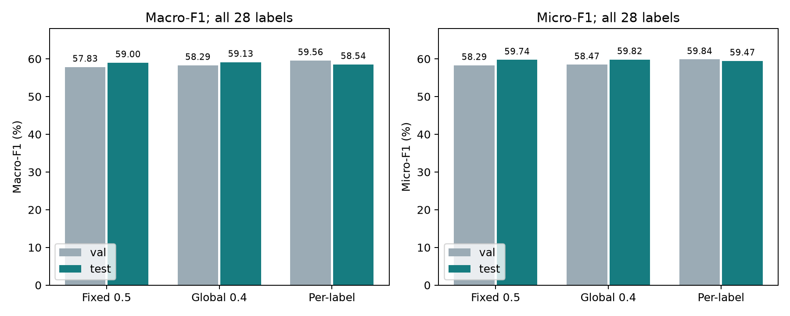
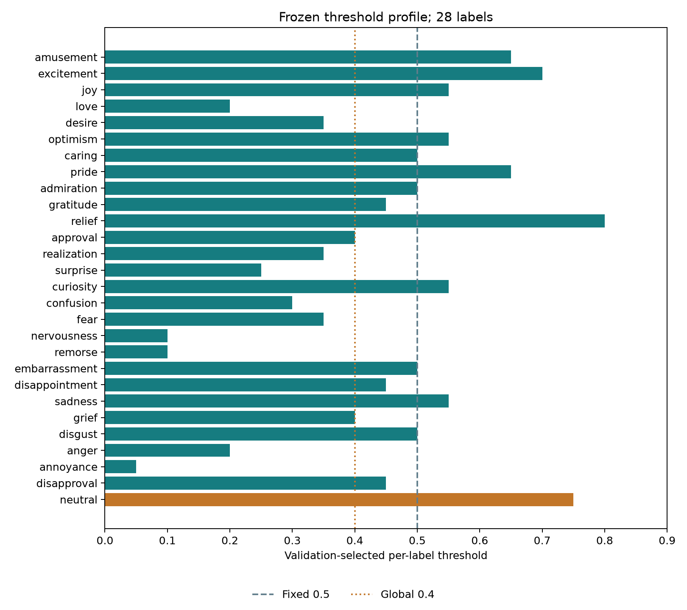
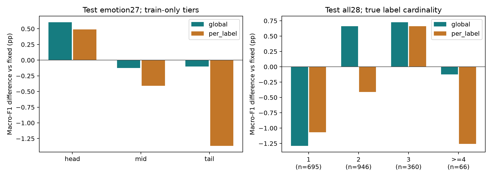
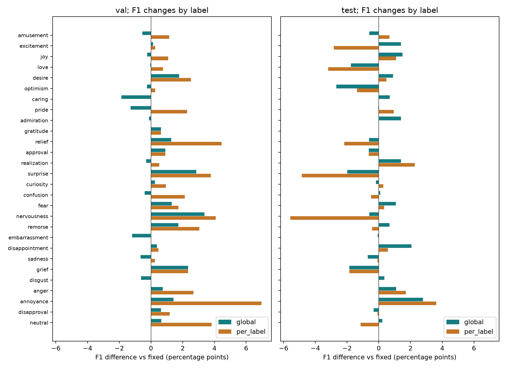

# Results and Discussion — Final RQ1, PhoBERT 28

Bản phân tích tiếng Việt cho báo cáo Final. **Paper tiếng Anh đầy đủ ngày 18/11:** [PDF](../final_report.pdf) / [Markdown](../final_report.md). Các bảng/hình dùng artifacts test đã hoàn tất; audit 62 ca là AI-assisted theo lựa chọn của nhóm, không có independent human adjudication. Tài liệu này giữ phần giải thích chi tiết bằng tiếng Việt.

## 1. Thiết kế và phạm vi diễn giải

Nghiên cứu so sánh fixed 0,5, global tuned và per-label tuned trên cùng checkpoint PhoBERT 28 outputs, gồm Neutral. Weights giữ nguyên ở epoch 15 của lượt midterm 20 epoch, seed 42. Tiêu chí chọn checkpoint gốc là validation emotion27 Macro-F1 tại 0,5; tiêu chí chọn threshold Final là validation Macro-F1 trên đủ 28 nhãn. Hai quyết định này được phân biệt trong [protocol đóng băng](../../docs/final_protocol.md).

Retained train có 16.530 mẫu, validation 2.066 mẫu, test 2.067 mẫu. Global và 28 per-label thresholds được chọn chỉ từ validation trên lưới 0,05–0,80 bước 0,05; hòa chọn threshold cao hơn. Global được chọn là **0,4**. Tất cả nhãn đều có positive validation, nên không dùng fallback. Mọi decoder dùng cùng continuous scores và cùng quy tắc `p >= threshold`; không retrain hoặc chọn lại threshold bằng test.

[Đề học phần](../../docs/02-vigoemotions-vietnamese-emotion.pdf), trang 2–3, đặt RQ1 trên 27 cảm xúc; nhóm mở rộng đầu ra và objective thành 28 theo quyết định trước test. Báo cáo chính dùng **all28**. Bảng **emotion27** bỏ cột Neutral từ cùng scores và thresholds đã chọn, không phải một lượt train hoặc tối ưu ngưỡng 27 nhãn độc lập. Neutral-only và mixed annotations được giữ nguyên.

## 2. Kết quả chính trên 28 nhãn

Nguồn: [validation comparison](tables/val_comparison.csv), [test comparison](tables/test_comparison.csv). F1 trong bảng là tỷ lệ 0–1; cột delta tính bằng **điểm phần trăm** so với fixed trên test. Hamming Loss thấp hơn là tốt hơn.

| Decoder | Val Macro-F1 | Test Macro-F1 | Test Micro-F1 | Test Hamming Loss | Test LRAP | Δ test Macro-F1 (pp) |
| --- | ---: | ---: | ---: | ---: | ---: | ---: |
| Fixed 0,5 | 0,578341 | 0,589964 | 0,597350 | **0,055135** | 0,719074 | 0,0000 |
| Global 0,4 | 0,582941 | **0,591254** | **0,598233** | 0,057347 | 0,719074 | +0,1289 |
| Per-label | **0,595555** | 0,585415 | 0,594666 | 0,058297 | 0,719074 | −0,4549 |

Global có test Macro-F1 cao nhất trong ba decoder được đo, tăng 0,1289 điểm phần trăm so với fixed. Micro-F1 tăng 0,0883 điểm. Hamming Loss tăng từ 0,055135 lên 0,057347: mức tăng F1 đi kèm nhiều quyết định nhãn sai hơn theo metric này. Do đó không có một decoder thắng mọi metric.

Per-label tăng validation Macro-F1 1,7214 điểm phần trăm so với fixed, nhưng giảm test Macro-F1 0,4549 điểm và Micro-F1 0,2684 điểm. Kết quả không ủng hộ giả thuyết per-label luôn cải thiện held-out performance trong thiết lập này. LRAP giữ nguyên giữa ba decoder vì xác suất và thứ hạng nhãn không đổi.



Các kết quả là so sánh mô tả trên một checkpoint/split. Chưa thực hiện kiểm định hoặc ước lượng bất định; không gọi chênh lệch nhỏ của global là có ý nghĩa thống kê. Việc báo global cao nhất trong bảng không phải chọn lại decoder theo test để thay protocol.

## 3. Threshold profile và khoảng cách validation–test

Ngưỡng từng nhãn trải từ 0,05 (annoyance) đến 0,80 (relief); Neutral dùng 0,75. Profile đủ 28 nhãn, train count, validation support và fallback nằm ở [threshold profile](tables/threshold_profile.csv). Mỗi nhãn đều được chọn bằng objective riêng trên validation, không có luật threshold theo tần suất được suy ra từ test.



Nguồn: [generalization gap](tables/generalization_gap.csv). Gap được định nghĩa là **validation − test** của cùng decoder, scope và metric.

| Decoder | All28 Macro-F1 gap (pp) | All28 Micro-F1 gap (pp) |
| --- | ---: | ---: |
| Fixed | −1,1623 | −1,4456 |
| Global | −0,8312 | −1,3577 |
| Per-label | +1,0140 | +0,3769 |

Fixed và global có test F1 cao hơn validation; per-label có test F1 thấp hơn validation. Đây là bằng chứng mô tả về mức độ chuyển giao của thresholds giữa hai split. Việc validation của per-label cao hơn fixed/global là hệ quả của không gian tìm kiếm: mỗi nhãn có thể chọn tối ưu riêng và lưới chứa 0,5. Ưu thế trên validation tự nó không chứng minh khả năng tổng quát hóa.

Mẫu kết quả phù hợp với giả thuyết threshold overfitting, nhưng chưa xác định được nguyên nhân từ một split và một seed. Biến thiên mẫu, độ ổn định của ước lượng F1 từng nhãn và sự khác biệt giữa các split đều cần nghiên cứu riêng để phân biệt. Không mở lại grid hoặc chọn thresholds bằng các số test đã quan sát.

## 4. Head/mid/tail và cardinality

Tiers được chốt bằng positive counts của retained train, chín **emotion labels** mỗi tier. Neutral được báo riêng, nên bảng tier có scope emotion27. Nguồn: [test frequency tiers](tables/test_frequency_tiers.csv).

| Tier | Fixed Macro-F1 | Global Macro-F1 | Per-label Macro-F1 | Δ global (pp) | Δ per-label (pp) |
| --- | ---: | ---: | ---: | ---: | ---: |
| Head | 0,578569 | 0,584597 | 0,583454 | +0,6029 | +0,4885 |
| Mid | 0,644118 | 0,642867 | 0,640013 | −0,1251 | −0,4105 |
| Tail | 0,564577 | 0,563558 | 0,550923 | −0,1019 | −1,3654 |

Per-label cải thiện nhóm head nhưng giảm nhóm mid và tail; mức giảm lớn nhất nằm ở tail. Điều này không chứng minh tần suất là nguyên nhân gây giảm F1 hoặc mọi nhãn tail đều giảm. Ví dụ realization thuộc tail vẫn tăng 2,2604 điểm F1.

Cardinality chính là tổng 28 ground-truth labels, gồm Neutral. Macro-F1 dưới đây vẫn tính trên đủ 28 cột trong từng nhóm. Nguồn: [test cardinality](tables/test_cardinality.csv).

| True label cardinality | n | Fixed Macro-F1 | Global Macro-F1 | Per-label Macro-F1 |
| --- | ---: | ---: | ---: | ---: |
| 0 | 0 | N/A | N/A | N/A |
| 1 | 695 | 0,459668 | 0,446783 | 0,449004 |
| 2 | 946 | 0,597258 | 0,603888 | 0,593143 |
| 3 | 360 | 0,603230 | 0,610477 | 0,609866 |
| ≥4 | 66 | 0,584676 | 0,583418 | 0,572108 |

Global cải thiện Macro-F1 ở nhóm hai và ba nhãn, nhưng giảm ở nhóm một nhãn. Per-label giảm ở nhóm một, hai và ≥4 nhãn. Nhóm ≥4 chỉ có 66 mẫu; không khái quát kết quả nhóm nhỏ thành quy luật chung.



View bổ sung `emotion_cardinality` bỏ Neutral trước khi đếm và đánh giá trên 27 cảm xúc. Trong test, nhóm emotion cardinality 0 có **80 mẫu Neutral-only**, khác với nhóm label cardinality 0 rỗng. Các F1 bằng 0 trên nhóm không có positive emotion không có nghĩa model thất bại trong dự đoán Neutral; việc đó phải đọc ở bảng Neutral riêng. Mixed annotations không bị sửa để ép loại trừ.

## 5. Phân tích lỗi định lượng theo nhãn

Nguồn: [test per-label](tables/test_per_label.csv), [validation per-label](tables/val_per_label.csv) và [bảng delta đủ 28 nhãn](analysis/label_deltas.csv). Các nhãn dưới đây được chọn hậu nghiệm để mô tả biến động F1, không dùng để điều chỉnh decoder hoặc thay mẫu human audit đã quy định.

| Nhãn | Threshold per-label | Test support | Fixed F1 | Per-label F1 | Δ val (pp) | Δ test (pp) |
| --- | ---: | ---: | ---: | ---: | ---: | ---: |
| Nervousness | 0,10 | 96 | 0,503067 | 0,447368 | +4,0741 | −5,5699 |
| Surprise | 0,25 | 85 | 0,582418 | 0,533937 | +3,7713 | −4,8481 |
| Love | 0,20 | 143 | 0,646465 | 0,614525 | +0,7524 | −3,1940 |
| Excitement | 0,70 | 98 | 0,483516 | 0,455090 | +0,2607 | −2,8427 |
| Relief | 0,80 | 60 | 0,573529 | 0,551724 | +4,4517 | −2,1805 |
| Annoyance | 0,05 | 343 | 0,538071 | 0,574333 | +6,9576 | +3,6262 |

Nervousness giảm threshold từ 0,5 xuống 0,1: TP tăng 41→51 và FN giảm 55→45, trong khi FP tăng 26→81. Với Surprise, TP tăng 53→59 nhưng FP tăng 44→77. Những số này cho thấy đánh đổi precision/recall ở hai nhãn; chúng chưa giải thích đặc điểm ngôn ngữ nào gây lỗi.

Love có TP tăng 96→110, nhưng FP tăng 58→105 nên F1 giảm. Relief tăng threshold lên 0,8 giúp FP giảm 37→24, đồng thời TP giảm 39→32 và FN tăng 21→28; F1 vẫn giảm. Annoyance là chiều ngược lại: TP tăng 159→226 và FP tăng 89→218, nhưng F1 tăng. Vì vậy không thể kết luận threshold thấp luôn tốt hoặc luôn gây hại.



Đây là phân tích confusion counts và F1 từ saved predictions. Phần AI-assisted bên dưới ghi nhận các đặc điểm ngôn ngữ nhưng chưa xác định nguyên nhân model tạo lỗi. Cần phân biệt quan sát, giả thuyết và xác nhận của người.

### 5.1. AI-assisted qualitative review, chưa có human adjudication

Ngày 17/11, AI assistant đã đọc 62 bình luận private trong packet theo yêu cầu nhóm; xem [bản review](human_audit/ai_assisted_review.md), [62 nhận xét](human_audit/ai_assisted_review.csv) và [provenance](human_audit/ai_assisted_provenance.json). 40 cặp chính gồm 20 FN và 20 FP của per-label. Cả 20 FN và 15 FP đã có ở fixed; năm FP mới so với fixed tập trung ở annoyance, nervousness và love trong mẫu này. Không suy các số này thành tỷ lệ toàn test.

Các nhận xét gợi ý ba hướng: giao thoa giữa các nhãn gần nghĩa hoặc thiếu nhãn phụ; cảm xúc hàm ý/mỉa mai và emoji đa nghĩa; phạm vi phủ định, điều kiện hoặc cảm xúc được nhắc thay vì đang trải nghiệm. Ví dụ `you003220` chỉ thêm annoyance ở cutoff 0,05 dù nội dung thiên về hài; `tik017852` có lời tự khích lệ giả vờ nhưng pride được model giữ rất mạnh. Đây là quan sát và giả thuyết về các ca, chưa có ablation chứng minh nguyên nhân.

Một số FP theo reference có thể hợp nghĩa, chẳng hạn sadness ở `you001985` hoặc caring ở `x000137`; chúng cần adjudication về tính đầy đủ của annotation, không được tự sửa reference bằng nhận xét AI. Các ca đối chiếu `3351` và `743` giữ đúng cả bộ nhãn ở cả ba decoder. Trạng thái human confirmation vẫn là 0/62; phần này phải được gọi là AI-assisted khi dùng trong báo cáo.

## 6. Neutral và emotion27 bổ sung

Neutral có 116 positive test samples. F1 dưới đây là F1 của **positive Neutral**, không trung bình thêm negative class. Nguồn: [test Neutral](tables/test_neutral.csv).

| Decoder | Threshold | TP | FP | FN | Precision | Recall | F1 |
| --- | ---: | ---: | ---: | ---: | ---: | ---: | ---: |
| Fixed | 0,50 | 49 | 61 | 67 | 0,445455 | 0,422414 | 0,433628 |
| Global | 0,40 | 51 | 67 | 65 | 0,432203 | 0,439655 | 0,435897 |
| Per-label | 0,75 | 42 | 41 | 74 | 0,506024 | 0,362069 | 0,422111 |

Per-label tăng Neutral precision nhưng giảm recall và F1 so với fixed. Trên validation, Neutral F1 tăng từ 0,436893 lên 0,475138; hiệu quả đó không giữ được trên test.

| Decoder | Emotion27 test Macro-F1 | Emotion27 test Micro-F1 |
| --- | ---: | ---: |
| Fixed | 0,595755 | 0,602156 |
| Global | 0,597007 | 0,602965 |
| Per-label | 0,591463 | 0,598892 |

Thứ tự Macro-F1 giữa ba decoder giống all28. Bảng bổ sung này không cho phép kết luận model train 28 tốt hơn hoặc kém hơn một model train 27 trên test, vì không có test comparison giữa hai checkpoint trong nghiên cứu Final này.

## 7. Bằng chứng thực thi và tái lập

[Execution verification](execution_verification.json) ghi source ZIP SHA-256, 21 imported member hashes và kết quả đối chiếu. Validation reproduction có sai lệch xác suất tối đa **0**, fixed decisions giống nguồn. Test có cùng checkpoint/tokenizer/VnCoreNLP assets, device `cuda` và package metadata như validation: Python 3.13.16, torch 2.11.0+cu130, transformers 4.57.3, py-vncorenlp 0.1.4, numpy 2.1.3, safetensors 0.8.0.

`test_attempt.json` ghi `completed` và bind cả raw continuous scores lẫn decoded outputs. Review local tính lại 11 bảng validation/test/gap từ saved scores, kiểm IDs/targets/checksum CSV và cả hai cardinality fields; không gọi model. ZIP ghi một completed attempt; các file ZIP không độc lập chứng minh mọi hoạt động trong các session trước đó.

So với ZIP validation đã review trước đây, các ngưỡng và reproduction report giống nguyên byte. `val.npz` có cùng bytes của từng mảng `.npy`, nhưng thứ tự lưu member khác; vì thế hash NPZ và hash phụ thuộc trong lock khác. Lock hiện tại khớp NPZ hiện tại và test attempt. Không mô tả hai phiên bản lock là byte-identical, và không đổi protocol/config để cập nhật nhãn trạng thái lịch sử.

Tái sinh hình và bảng delta định lượng, không cần GPU hoặc raw text:

```bash
.venv/bin/python scripts/build_final_figures.py
```

Builder kiểm imported hashes và completed-test bindings trước khi ghi vào `analysis/` và `figures/`; xuất mỗi hình thành PNG và vector PDF. [Figure provenance](analysis/figure_provenance.json) ghi hash builder, execution verification và từng output. Để tái sinh các bảng metric bằng pipeline gốc khi có private train/val CSVs:

```bash
.venv/bin/python scripts/final_thresholds.py report
```

## 8. Giới hạn và phần còn phải hoàn thành

- Một checkpoint, một seed và một fixed split; chưa có khoảng tin cậy, kiểm định hoặc lặp nhiều seed. Không suy quan hệ nhân quả từ bảng theo tier.
- Validation đã được dùng chọn checkpoint và thăm dò ở midterm trước khi chốt protocol Final. Threshold grid hữu hạn; kết quả không chứng minh tối ưu trên mọi threshold thực.
- Bản mở rộng 28 khác phạm vi RQ27 của đề; cần trình bày rõ và giữ bảng projection bổ sung. Model 28 không phải tái lập nguyên cấu hình training của paper gốc.
- Human error audit theo protocol vẫn **chưa hoàn tất: 0 cặp FN/FP đã được ghi nhận xác nhận bởi người**. [Packet và hướng dẫn](human_audit/README.md) đã chuẩn bị 20 core FN + 20 core FP và 22 ca bổ sung/context, tổng 62 bình luận khác nhau. Reviewer cần đọc private text, ghi nhận xét trừu tượng và không công khai raw comments; danh sách tự sinh không được tính là human audit đã hoàn thành.
- Các nhãn giảm mạnh được mô tả từ thống kê hậu nghiệm; chưa có bằng chứng về cơ chế ngôn ngữ gây lỗi. Không dùng kết quả này để tune lại trên test.
- Paper tiếng Anh và PDF đã có; còn bổ sung thông tin nhóm, gói nộp và oral defence. Phần phân tích tiếng Việt này không thay thế paper tiếng Anh hoàn chỉnh.

## 9. Trả lời RQ trong phạm vi thí nghiệm

Ngưỡng 0,5 không đạt validation Macro-F1 cao nhất trên lưới khảo sát. Tuy nhiên, tối ưu validation không bảo đảm tăng test F1: global 0,4 chỉ tăng test Macro-F1 0,1289 điểm phần trăm, còn per-label giảm 0,4549 điểm. Fixed có Hamming Loss thấp nhất. Kết quả ủng hộ việc đánh giá thresholds bằng held-out data và báo cáo đầy đủ đánh đổi giữa các metric; chưa hỗ trợ kết luận per-label là lựa chọn tốt hơn một cách ổn định.
