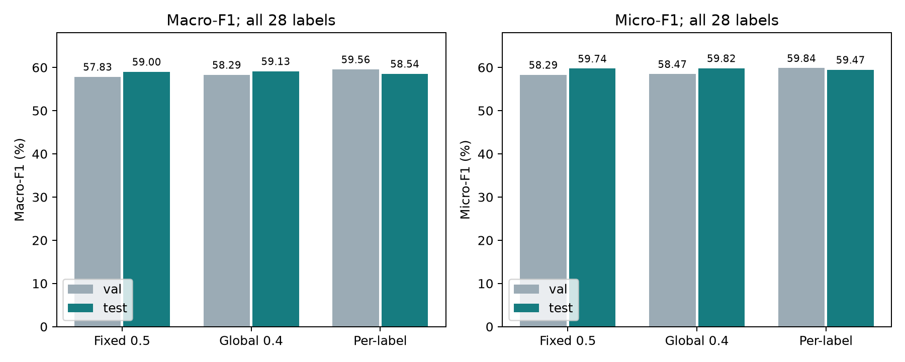
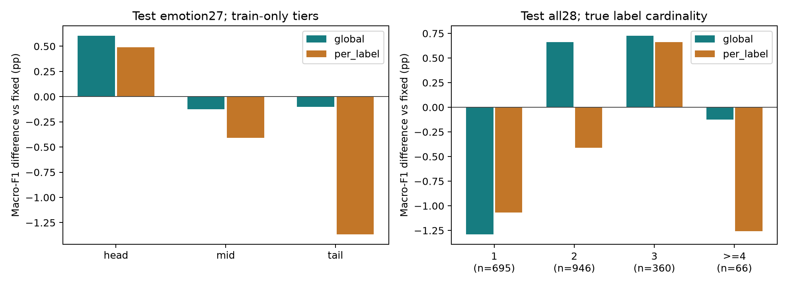
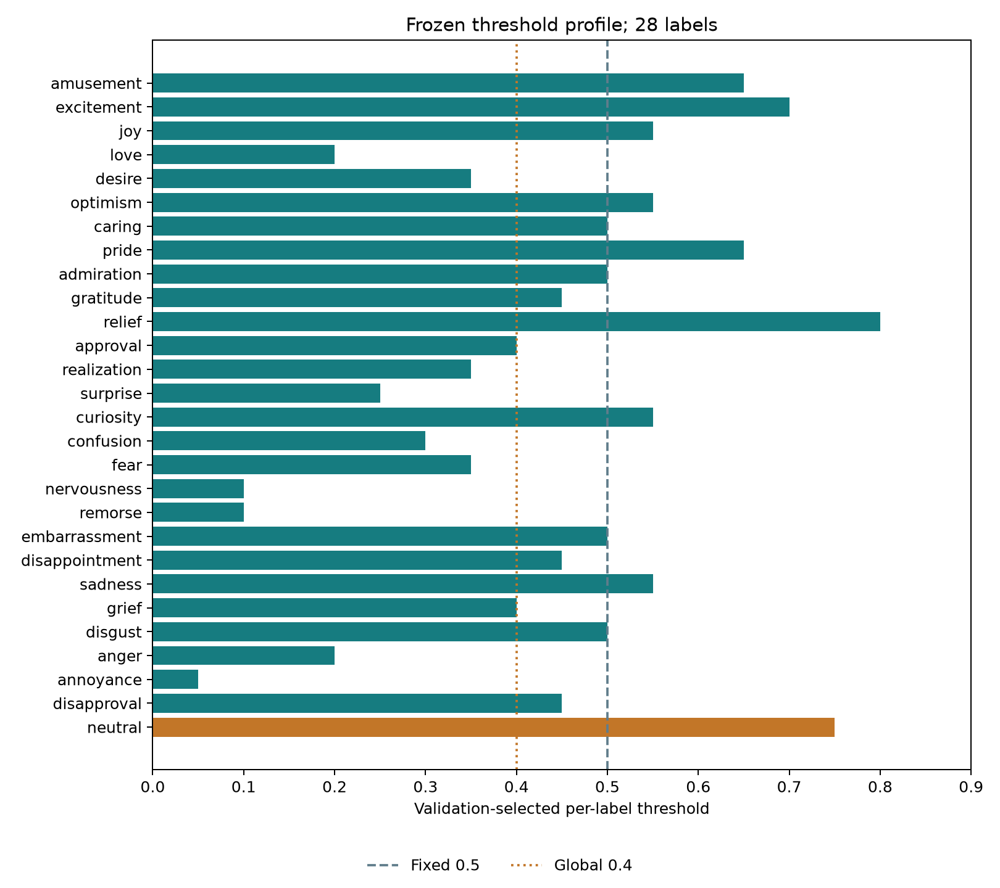

# Evaluating Threshold Transfer in 28-Label Vietnamese Emotion Recognition with PhoBERT

ATI Course Project 2026 · Final Report · 18 November 2026

## Abstract

Decision thresholds can change a multi-label classifier's F1 without changing its learned representation. We evaluate whether validation-tuned thresholds transfer to held-out Vietnamese emotion recognition using one frozen PhoBERT checkpoint with 28 independent outputs, including Neutral. Fixed 0.5, a single global threshold, and per-label thresholds are compared on the same validation and test probability matrices. Thresholds are selected from a prespecified grid using 2,066 validation comments; evaluation uses 2,067 test comments. Global tuning selects 0.4 and increases test Macro-F1 from 0.589964 to 0.591254, a gain of 0.1289 percentage points. Per-label tuning achieves the highest validation Macro-F1, 0.595555, but decreases test Macro-F1 to 0.585415, while fixed thresholding yields the lowest Hamming Loss. Frequency-tier analysis localizes the largest per-label decline to tail emotions. An exploratory qualitative review of 62 selected comments suggests label-boundary ambiguity, implicit affect, and context-sensitive language as directions for further investigation. These observations concern one checkpoint, seed and split, without significance testing or independent adjudication. The results show that improved validation F1 does not guarantee improved test F1 and support reporting threshold transfer and metric trade-offs alongside validation optimization.

## 1. Introduction

Fine-grained emotion recognition requires decisions about several potentially co-occurring states in a single comment. A model may correctly detect a dominant emotion while omitting a secondary state or adding a related but unannotated label. ViGoEmotions provides a Vietnamese social-media benchmark with fine-grained emotion annotations [1](https://aclanthology.org/2026.eacl-long.129/). The present study examines the decision rules applied to a pretrained encoder's outputs.

A uniform cutoff of 0.5 is convenient, but it does not explicitly optimize empirical F1. Threshold optimization is an established multilabel learning problem [4](https://arxiv.org/abs/1402.1892), [5](https://doi.org/10.1016/j.patcog.2013.01.012). Increasing the number of validation-selected parameters may also increase sensitivity to the particular validation examples. This motivates evaluating the transfer of selected thresholds instead of treating their validation gains as evidence of improved generalization.

**Research question.** Do global or per-label thresholds selected by validation Macro-F1 improve test Macro-F1 over fixed 0.5 when the PhoBERT weights are held constant?

The course research question concerns 27 emotions. Following the team's pre-test design decision, the primary experiment includes Neutral as a learned 28th output and optimizes over all 28 labels. A supplementary emotion27 projection uses the same scores and selected thresholds with the Neutral column removed. This makes the extension explicit while retaining a view aligned with the 27-emotion question.

The contributions are a controlled three-decoder comparison with bound prediction artifacts; analysis by frequency tier, cardinality, individual label and Neutral; and a documented exploratory qualitative review. The findings include a small global-threshold gain and a negative transfer result for per-label tuning. No new architecture, loss function or robustness experiment is claimed.

## 2. Related Work

The ViGoEmotions benchmark evaluates transformer models and preprocessing choices for Vietnamese emotion detection [1](https://aclanthology.org/2026.eacl-long.129/). PhoBERT is a monolingual pretrained language model for Vietnamese [2](https://aclanthology.org/2020.findings-emnlp.92/). We use the separately distributed `vinai/phobert-base-v2` artifact [6](https://huggingface.co/vinai/phobert-base-v2), together with the original word-segmentation pipeline based on VnCoreNLP [3](https://aclanthology.org/N18-5012/). The experiment reuses a project checkpoint rather than reproducing the benchmark paper's complete training configuration or model ranking.

Pillai, Fumera and Roli study threshold optimization for multilabel classifiers [5](https://doi.org/10.1016/j.patcog.2013.01.012). Lipton, Elkan and Narayanaswamy analyze the relationship between real-valued classifier outputs, thresholds and F1 [4](https://arxiv.org/abs/1402.1892). Their results motivate distinguishing probability estimation from the decision rule. Our experiment performs finite-grid empirical threshold selection; it does not assume that the scores are calibrated conditional probabilities. No theoretical optimum over all real-valued cutoffs is claimed.

## 3. Data and Label Space

### 3.1. Fixed splits and preprocessing

The supplied corpus contains 20,664 comments. The project preserves the supplied validation and test IDs and order. One normalized train comment overlapping test was removed, leaving 16,530 retained training examples, 2,066 validation examples and 2,067 test examples. Distribution and overlap audits check these files; they do not establish how the original partitions were stratified. The same retained train and fixed evaluation splits are used throughout this study.

**Table 1. Dataset counts used in the experiment.** Positive assignments count all 28 labels. Mean cardinality is assignments divided by comments.

| Split | Comments | Positive labels | Mean cardinality | Neutral positives |
| --- | --- | --- | --- | --- |
| Retained train | 16530 | 31544 | 1.908288 | 821 |
| Validation | 2066 | 3958 | 1.915779 | 94 |
| Test | 2067 | 3942 | 1.907112 | 116 |

Text normalization applies Unicode NFC, whitespace collapsing and trimming, preserving case, diacritics, punctuation and negation. VnCoreNLP word segmentation precedes the saved PhoBERT tokenizer. Sequences are padded and truncated to 256 BPE tokens. The tokenizer and segmenter assets are restored from the same archived run as the classifier; inference does not download a replacement backbone or tokenizer.

### 3.2. Neutral, frequency tiers and cardinality

The first 27 output IDs are emotions and ID 27 is Neutral. Original annotations are preserved: Neutral-only comments have one positive output, and mixed Neutral/emotion annotations retain both. Independent sigmoid outputs impose no mutual exclusion. Empty predictions are not automatically converted to Neutral.

The 27 emotion labels are ranked by retained-train positive counts, ties by label ID. Ranks 1–9, 10–18 and 19–27 define head, mid and tail tiers. Neutral is reported separately. These are rank-based partitions of nine emotions each, not frequency cutoffs estimated from test. The full inventory and tier membership appear in Appendix A.

Primary label cardinality counts all 28 ground-truth labels. Supplementary emotion cardinality counts only the first 27. In test, 80 Neutral-only comments therefore have emotion cardinality zero and label cardinality one. Empty groups are reported with n=0 and undefined metrics, while nonempty emotion-only groups with no positive emotions follow the specified zero-division rule. Such F1 values do not measure Neutral detection.

## 4. Method

### 4.1. Frozen PhoBERT classifier

PhoBERT-base-v2 with a 28-logit sequence-classification head is reused from the midterm experiment. The network was fully fine-tuned with unweighted binary cross-entropy with logits, AdamW and gradient clipping. The logged configuration is summarized in Table 2. The optimizer uses a constant learning rate in the recorded loop; no new training occurs for the threshold comparison.

The architecture follows the strongest neural baseline in the project's midterm validation comparison. The use of its 28-output checkpoint follows the team's label-space decision; it is not a claim that a 28-output model outperforms a separately trained 27-output model on the latter's test scope.

**Table 2. Original training and frozen inference configuration.** Training time includes per-epoch validation and checkpoint writes, excluding preprocessing.

| Setting | Recorded value |
| --- | --- |
| Pretrained artifact | vinai/phobert-base-v2 |
| Outputs / seed | 28 / 42 |
| Completed / selected epoch | 20 / 15 |
| Checkpoint selection | Validation emotion27 Macro-F1 at 0.5 |
| Optimizer / loss | AdamW / unweighted BCEWithLogitsLoss |
| Learning rate / weight decay | 2e-05 / 0.01 |
| Batch / maximum tokens | 16 / 256 |
| Gradient clipping norm | 1.0 |
| Parameter count | 135019804 |
| Original training device | Tesla T4 |
| Training loop time (seconds) | 14057.719 |
| Frozen inference | eval mode; sigmoid; no shuffle; batch 16 |

Epoch 15 was selected from 20 completed epochs by the original validation **emotion27 Macro-F1 at 0.5**, keeping the earlier epoch on a tie. We preserve that checkpoint. The subsequent Final threshold objective is **all28 Macro-F1**. This difference is intentional and is not retroactively rewritten as checkpoint selection on 28-label F1.

For a comment x and label c, the model produces logit z_c and score p_c = sigmoid(z_c). Prediction is positive when p_c ≥ τ_c. The shared encoder may yield correlated scores, but the decoder applies independent binary decisions and enforces no label-pair constraints. All strategies reuse identical weights, preprocessing, scores and sample order.

### 4.2. Three decoding strategies

The validation grid is G = {0.05, 0.10, ..., 0.80}, with 16 candidates and the fixed 0.5 baseline included.

- **Fixed:** τ_c = 0.5 for every label.
- **Global:** select one τ in G maximizing validation Macro-F1 over all 28 labels, including Neutral.
- **Per-label:** independently select τ_c in G maximizing the positive-class validation F1 of label c.

Exact objective ties choose the highest cutoff. A label without validation positives would use 0.5 and record a fallback; no label required this fallback in the present run. Scores are compared as float64 so scalar and vector cutoffs have consistent boundary behavior, while the original score arrays are retained unchanged. Threshold selection changes the decision rule; it is not probability calibration.

Because 0.5 is in G, an empirical per-label optimum cannot have lower validation F1 for that label than the fixed baseline. Its validation Macro-F1 also cannot be lower than the best shared grid threshold. These are consequences of the search space, not evidence about held-out transfer.

## 5. Experiments and Verification

### 5.1. Execution protocol

The frozen checkpoint first reproduces the complete archived validation probability matrix. The predefined gate requires absolute error ≤0.0001, zero relative tolerance, and exactly equal fixed-threshold decisions. Observed maximum absolute error is **0**. Thresholds are then fit on the archived validation scores and bound to the configuration, protocol, source files, split IDs and reproduction evidence in a pre-test lock.

The global cutoff is **0.4** and the 28 per-label cutoffs range from **0.05 to 0.80**. A completed test execution stores continuous probabilities before decoding. Fixed, global and per-label outputs are obtained from that same test score matrix. The imported record binds its raw scores, decoded predictions, runtime and current lock. No test-based threshold retuning or new model inference was performed during analysis and manuscript preparation.

Original training records identify a Tesla T4. The Final inference metadata record CUDA with Python 3.13.16, torch 2.11.0+cu130, transformers 4.57.3, py-vncorenlp 0.1.4, numpy 2.1.3 and safetensors 0.8.0. The Final metadata do not separately identify the GPU model. Exact versions, hashes and time definitions are preserved in the submitted artifacts.

### 5.2. Metrics and analysis scopes

The primary metric is test Macro-F1 over all 28 labels. For label c, F1_c = 2TP_c / (2TP_c + FP_c + FN_c); Macro-F1 averages F1_c across the declared labels. Micro-F1 aggregates TP, FP and FN before taking the ratio. Hamming Loss is the fraction of incorrect label-instance decisions. Zero denominators use zero; empty sample groups are N/A. Label Ranking Average Precision (LRAP) is computed from unchanged continuous scores and is consequently invariant across cutoffs within a scope.

We report all28, the supplementary emotion27 projection, Neutral positive-class precision/recall/F1, train-defined emotion tiers, and both cardinality views. Deltas compare a tuned decoder against fixed in the same split, scope and group. The generalization gap is validation F1 minus test F1 for the same decoder and scope. Only one seed and one split are available; comparisons are descriptive and no significance test is reported.

## 6. Results

### 6.1. Overall threshold transfer

**Table 3. Primary results on all 28 labels.** F1/LRAP are proportions. Δ is test Macro-F1 minus fixed, in percentage points; lower Hamming Loss is better.

| Decoder | Val Macro-F1 | Test Macro-F1 | Test Micro-F1 | Hamming Loss | LRAP | Δ Macro (pp) |
| --- | --- | --- | --- | --- | --- | --- |
| Fixed 0.5 | 0.578341 | 0.589964 | 0.597350 | 0.055135 | 0.719074 | +0.0000 |
| Global | 0.582941 | 0.591254 | 0.598233 | 0.057347 | 0.719074 | +0.1289 |
| Per-label | 0.595555 | 0.585415 | 0.594666 | 0.058297 | 0.719074 | -0.4549 |

Global thresholding yields the highest observed test Macro-F1, improving by **0.1289 percentage points**, and increases Micro-F1 by **0.0883 points**. The improvement is small and has not been established as statistically significant. Fixed has the lowest Hamming Loss. Reporting only the F1 maximum would therefore hide a metric trade-off.

Per-label tuning improves validation Macro-F1 over fixed by **1.7214 points**, but decreases test Macro-F1 by **0.4549 points** and test Micro-F1 by **0.2684 points**. The ranking of methods on validation is not preserved on test. The per-label validation advantage is partly expected by construction; its test result does not support a uniform benefit from optimizing each label separately.



**Table 4. Validation-to-test gaps on all28, in percentage points.** Negative gaps indicate higher test F1 than validation F1.

| Decoder | Macro-F1 gap (pp) | Micro-F1 gap (pp) |
| --- | --- | --- |
| Fixed 0.5 | -1.1623 | -1.4456 |
| Global | -0.8312 | -1.3577 |
| Per-label | +1.0140 | +0.3769 |

Fixed and global have negative gaps; per-label has a positive Macro-F1 gap of **1.0140 points**. This pattern is compatible with sensitivity of validation-selected per-label cutoffs, but a single split cannot isolate threshold overfitting from sampling variability or distribution differences.

### 6.2. Frequency tiers and cardinality

**Table 5. Test emotion-tier Macro-F1.** Each tier contains nine emotions; Neutral is excluded. Deltas are percentage points relative to fixed.

| Tier | Fixed 0.5 F1 | Global F1 | Per-label F1 | Δ global (pp) | Δ per-label (pp) |
| --- | --- | --- | --- | --- | --- |
| head | 0.578569 | 0.584597 | 0.583454 | +0.6029 | +0.4885 |
| mid | 0.644118 | 0.642867 | 0.640013 | -0.1251 | -0.4105 |
| tail | 0.564577 | 0.563558 | 0.550923 | -0.1019 | -1.3654 |

Per-label improves head Macro-F1 by **0.4885 points**, but decreases mid by **0.4105** and tail by **1.3654 points**. The tail result is the largest tier decline. This is not a claim that all tail labels deteriorate: realization, for example, improves by **2.2604 points** on test. Frequency-tier aggregates do not establish a causal effect of label frequency.

**Table 6. Test Macro-F1 by primary true label cardinality.** Metrics use all 28 columns within each group.

| Cardinality | n | Fixed 0.5 F1 | Global F1 | Per-label F1 |
| --- | --- | --- | --- | --- |
| 0 | 0 | N/A | N/A | N/A |
| 1 | 695 | 0.459668 | 0.446783 | 0.449004 |
| 2 | 946 | 0.597258 | 0.603888 | 0.593143 |
| 3 | 360 | 0.603230 | 0.610477 | 0.609866 |
| >=4 | 66 | 0.584676 | 0.583418 | 0.572108 |

Global improves the two- and three-label groups but lowers the one-label group. Per-label lowers the one-, two- and ≥4-label groups while improving the three-label group. The ≥4 group contains only 66 examples. Comparisons between cardinality groups also reflect their label composition and should not be read as a causal effect of the number of labels.





### 6.3. Individual labels and Neutral

Appendix A provides all 28 cutoffs and test per-label F1 values. The largest per-label declines relative to fixed include nervousness (**−5.5699 points**), surprise (**−4.8481**) and love (**−3.1940**). For nervousness, lowering the cutoff to 0.1 raises TP from 41 to 51 and FP from 26 to 81. For surprise, TP rises from 53 to 59 and FP from 44 to 77. These counts describe the precision/recall trade-off without identifying what linguistic feature caused the model's scores.

Annoyance moves in the opposite direction: cutoff 0.05 raises TP from 159 to 226 and FP from 89 to 218, with F1 increasing by **3.6262 points**. Thus, even substantial FP growth can accompany an F1 gain, depending on the balance of recovered positives and added detections.

**Table 7. Neutral positive-class metrics on 116 positive test examples.** Negative-class F1 is not included in the average.

| Decoder | τ | TP | FP | FN | Precision | Recall | F1 |
| --- | --- | --- | --- | --- | --- | --- | --- |
| Fixed 0.5 | 0.50 | 49 | 61 | 67 | 0.445455 | 0.422414 | 0.433628 |
| Global | 0.40 | 51 | 67 | 65 | 0.432203 | 0.439655 | 0.435897 |
| Per-label | 0.75 | 42 | 41 | 74 | 0.506024 | 0.362069 | 0.422111 |

The per-label Neutral cutoff 0.75 improves precision but reduces recall and F1 relative to fixed. Its validation Neutral F1 gain, from 0.436893 to 0.475138, does not transfer to test. Global gives a small Neutral F1 increase. Mixed annotations remain unchanged throughout evaluation.

### 6.4. Supplementary emotion27 projection

**Table 8. Test results after removing the Neutral column.** Thresholds are projected from all28 selection without re-optimization.

| Decoder | Macro-F1 | Micro-F1 | Hamming Loss | LRAP |
| --- | --- | --- | --- | --- |
| Fixed 0.5 | 0.595755 | 0.602156 | 0.054884 | 0.740627 |
| Global | 0.597007 | 0.602965 | 0.057105 | 0.740627 |
| Per-label | 0.591463 | 0.598892 | 0.058396 | 0.740627 |

The ordering of test Macro-F1 remains global, fixed, per-label. These numbers do not compare a separately trained 27-output checkpoint against the 28-output model. They therefore cannot establish whether adding Neutral improves or harms test recognition of the other emotions.

## 7. Qualitative Error Analysis

### 7.1. Sample and review procedure

The audit packet contains 20 per-label FN pairs and 20 FP pairs, two additional Neutral errors, five high-cardinality cases, and 15 cases for three emotion pairs selected by retained-train co-occurrence counts. It covers 62 distinct comments, including three with mixed Neutral. Core cases are hash-ranked with seed 42, prioritizing distinct comments. Pair cases are eligible when both true labels or both per-label predictions are present; comments are deduplicated across pairs.

Review notes cover all 62 private comments, with an observation and a separate hypothesis recorded for each. These notes provide the exploratory qualitative analysis used in this report and have not undergone independent adjudication. Restricted text remains private; public notes use abstract descriptions and sample IDs. Reference labels and test metrics were not changed.

**Table 9. Target errors in the 40 primary audited pairs.** This is an exact comparison of saved decisions, not a population estimate.

| Core sample | Already errors at fixed | New errors vs fixed | Total |
| --- | --- | --- | --- |
| FN | 20 | 0 | 20 |
| FP | 15 | 5 | 20 |

### 7.2. Observations and uncertainty

All 20 sampled FN targets were also FN under fixed. Fifteen sampled FP targets were already FP under fixed, and five appeared only after changing from fixed to per-label. Those new FP targets concern annoyance, nervousness and love. In two core FN cases, global recovers the target while fixed and per-label omit it. Consequently, most errors in this selected sample cannot be attributed solely to introducing per-label thresholds.

The notes suggest recurring boundaries between related emotions, implicit or ironic affect, and the scope of negation or conditional statements. Sample `you003220` has an annoyance score of 0.051592 and crosses only the per-label cutoff 0.05; the text has a humorous rather than clearly irritated tone. Sample `tik017852` discusses performed self-confidence, while the model strongly predicts pride. These are case observations consistent with possible threshold and stance effects, not causal explanations established by ablation.

Some FP predictions are semantically plausible despite absence from reference labels. Sadness in `you001985`, which requests advice in an emotionally negative situation, and caring in the supportive message `x000137` are examples needing adjudication. The review classified 32 cases as consistent with the relevant reference scope, 16 as requiring reconsideration of boundaries or completeness, and 14 as lacking sufficient context. These are subjective assessments on mixed target/context units, not measured annotation error rates.

All five selected high-cardinality cases retain at least one per-label FN. Several preserve a dominant emotion while omitting a secondary state. For the selected anger–annoyance cases, three are true-pair cases with at least one missing prediction, while two are predicted pairs with a label absent from reference. Such eligibility mixtures must not be mistaken for joint recall on the complete test set. Conversely, `3351` and `743` match their complete reference label sets under all three decoders, providing useful successful counterexamples.

## 8. Discussion

The primary research question has a qualified answer. Fixed 0.5 is not the empirical validation optimum on the selected grid. A global change produces a small test F1 gain, whereas independent label-wise optimization fails to maintain its larger validation advantage. The result supports evaluating transfer rather than assuming that more flexible cutoff selection will help every label or frequency tier.

A threshold can alter which existing scores become positive, but cannot recover distinctions that remain below every selected cutoff. The sampled FN cases and related-label substitutions suggest that representation, reference ambiguity and decision rules should be considered separately. The qualitative analysis identifies hypotheses for further work, with no claim that any single phenomenon explains the aggregate test decline.

Macro-F1 and Hamming Loss answer different questions. The former gives equal weight to each label's positive-class F1, while the latter counts label-instance errors. The global method's higher F1 alongside worse Hamming Loss is a real trade-off within the experiment. Choosing a decoder for a downstream use would require an explicit objective and error costs; the present test ordering is reported as an observation rather than a new post-test selection rule.

## 9. Limitations and Data Use

**Statistical scope.** The experiment uses one seed, checkpoint, grid and split, with no confidence interval or significance test. Validation had already been used for checkpoint selection and midterm exploration, so the Final protocol is not a preregistration preceding every observation. The finite grid limits the meaning of optimality, and small subgroups require caution. All28 tuning and emotion27 checkpoint selection have deliberately different scopes.

**Qualitative scope.** The 62-case review is exploratory and has no independent adjudication. Its comments are selected for audit rather than prevalence estimation, and target-level and whole-case judgments have different units. Suggested linguistic mechanisms and potential reference ambiguities remain hypotheses. Review notes are interpretive observations, not validated replacement annotations.

**Reproducibility scope.** Checksums verify consistency of the imported files and their bindings, not every event in earlier interactive sessions. The imported record identifies one completed test attempt and one shared test score matrix. A prior validation archive differs in NPZ member order and dependent lock hash, while every constituent validation array, fitted threshold and reproduction report is unchanged. The Final test binds the current lock.

**Data use.** The project follows the course restriction against public redistribution of raw comments. Code, fixed IDs, probability arrays, aggregate tables and abstract case observations are retained separately from private text and weights. No new training, loss-function experiment, dependency model or noise-robustness benchmark is presented as completed work. These remain possible extensions after the present report.

## 10. Conclusion

On one frozen PhoBERT-28 checkpoint, validation-selected global threshold 0.4 improves test Macro-F1 by 0.1289 percentage points over fixed 0.5, while per-label tuning decreases it by 0.4549 points despite its higher validation score. Fixed retains the lowest Hamming Loss. Tail emotions show the largest per-label tier decline, and the qualitative review highlights uncertainty about related labels and context-dependent affect. The study therefore finds no uniform benefit from replacing fixed thresholds with individually optimized cutoffs. Its practical contribution is a reproducible comparison that reports negative transfer, scope differences and metric trade-offs explicitly.

## References

[1] Tran Quang Hung, Pham Tien Nam, Son T. Luu, and Kiet Van Nguyen. 2026. [ViGoEmotions: A Benchmark Dataset For Fine-grained Emotion Detection on Vietnamese Texts](https://aclanthology.org/2026.eacl-long.129/). Proceedings of EACL, Volume 1: Long Papers, pp. 2805–2831. DOI: 10.18653/v1/2026.eacl-long.129.

[2] Dat Quoc Nguyen and Anh Tuan Nguyen. 2020. [PhoBERT: Pre-trained language models for Vietnamese](https://aclanthology.org/2020.findings-emnlp.92/). Findings of EMNLP, pp. 1037–1042. DOI: 10.18653/v1/2020.findings-emnlp.92.

[3] Thanh Vu, Dat Quoc Nguyen, Dai Quoc Nguyen, Mark Dras, and Mark Johnson. 2018. [VnCoreNLP: A Vietnamese Natural Language Processing Toolkit](https://aclanthology.org/N18-5012/). NAACL Demonstrations, pp. 56–60. DOI: 10.18653/v1/N18-5012.

[4] Zachary C. Lipton, Charles Elkan, and Balakrishnan Narayanaswamy. 2014. [Thresholding Classifiers to Maximize F1 Score](https://arxiv.org/abs/1402.1892). arXiv:1402.1892.

[5] I. Pillai, G. Fumera, and F. Roli. 2013. [Threshold optimisation for multi-label classifiers](https://doi.org/10.1016/j.patcog.2013.01.012). Pattern Recognition, 46(7), pp. 2055–2065.

[6] VinAI Research. [PhoBERT-base-v2 model artifact and model card](https://huggingface.co/vinai/phobert-base-v2). Revision pinned in the experiment: `86cd7fd4c148980922ac11a2cf5e257f2ba639e1`. Accessed 18 November 2026.

<!-- pagebreak -->

## Appendix A. Complete Label and Threshold Profile

**Table A1. All 28 labels in canonical order.** Train n is retained-train positive support. Tier partitions the 27 emotions; Neutral is separate. All test F1 values use the same test scores and frozen thresholds. The table provides the complete per-label result inventory; these values are not separately optimized on test.

| Label | Tier | Train n | τ | Fixed F1 | Global F1 | Per-label F1 |
| --- | --- | --- | --- | --- | --- | --- |
| amusement | head | 2868 | 0.65 | 0.683887 | 0.677844 | 0.690629 |
| excitement | mid | 824 | 0.70 | 0.483516 | 0.497462 | 0.455090 |
| joy | head | 1614 | 0.55 | 0.548544 | 0.563510 | 0.559406 |
| love | head | 1175 | 0.20 | 0.646465 | 0.628931 | 0.614525 |
| desire | tail | 762 | 0.35 | 0.523490 | 0.532468 | 0.528302 |
| optimism | mid | 1046 | 0.55 | 0.726115 | 0.699387 | 0.712418 |
| caring | head | 1062 | 0.50 | 0.651466 | 0.658307 | 0.651466 |
| pride | mid | 774 | 0.65 | 0.690476 | 0.690058 | 0.700000 |
| admiration | mid | 883 | 0.50 | 0.584158 | 0.598131 | 0.584158 |
| gratitude | mid | 765 | 0.45 | 0.853081 | 0.853081 | 0.853081 |
| relief | tail | 635 | 0.80 | 0.573529 | 0.567376 | 0.551724 |
| approval | mid | 916 | 0.40 | 0.634361 | 0.628099 | 0.628099 |
| realization | tail | 687 | 0.35 | 0.429319 | 0.443350 | 0.451923 |
| surprise | tail | 651 | 0.25 | 0.582418 | 0.562500 | 0.533937 |
| curiosity | mid | 840 | 0.55 | 0.631111 | 0.629310 | 0.633929 |
| confusion | tail | 676 | 0.30 | 0.448276 | 0.449198 | 0.443350 |
| fear | tail | 745 | 0.35 | 0.670391 | 0.681081 | 0.673797 |
| nervousness | tail | 728 | 0.10 | 0.503067 | 0.497110 | 0.447368 |
| remorse | tail | 707 | 0.10 | 0.736842 | 0.743590 | 0.732558 |
| embarrassment | mid | 885 | 0.50 | 0.826531 | 0.825871 | 0.826531 |
| disappointment | head | 1522 | 0.45 | 0.462287 | 0.482916 | 0.468085 |
| sadness | head | 2785 | 0.55 | 0.671035 | 0.664132 | 0.670199 |
| grief | tail | 747 | 0.40 | 0.613861 | 0.595349 | 0.595349 |
| disgust | head | 1206 | 0.50 | 0.429091 | 0.432624 | 0.429091 |
| anger | head | 1589 | 0.20 | 0.576271 | 0.587258 | 0.593350 |
| annoyance | head | 2662 | 0.05 | 0.538071 | 0.565854 | 0.574333 |
| disapproval | mid | 969 | 0.45 | 0.367713 | 0.364407 | 0.366812 |
| neutral | neutral | 821 | 0.75 | 0.433628 | 0.435897 | 0.422111 |

<!-- pagebreak -->

## Appendix B. Reproducibility and Artifact Index

The configuration is `configs/final_thresholds.json`; the frozen design is `docs/final_protocol.md`. `reports/final28/execution_verification.json` records source archive and imported-member hashes. `validation_reproduction.json`, `thresholds.json`, `pre_test_lock.json` and `test_attempt.json` bind the original execution. Model checkpoint SHA-256 is `30e09d73bd474c6c1a9d2455519af7256ce96ed12576dde9aafcff45a301c835`.

Prediction NPZs contain ordered IDs, canonical labels, reference vectors, continuous scores, all three decoded matrices, and both cardinality definitions. `test_probabilities.npz` preserves scores before decoding. CSVs under `reports/final28/tables/` contain comparison, per-label, frequency-tier, cardinality, Neutral and gap analyses; the emotion27 cardinality view is included in the same scoped tables. The all28 zero-cardinality group has n=0; the supplementary emotion27 zero-cardinality group has 80 Neutral-only examples.

The qualitative review has a text-free case index, abstract case-level notes, summary and source provenance under `reports/final28/human_audit/`. Original text and review worksheets stay under the ignored `data/` directory. No private worksheet is required to regenerate this manuscript from the supplied derived artifacts.

The following commands rebuild figures and the paper from verified imported artifacts without running PhoBERT:

```bash
.venv/bin/python scripts/build_final_figures.py
.venv/bin/python scripts/build_final_paper.py
```

The original validation-to-test execution uses `verify`, `restore`, `reproduce-val`, `fit`, `lock` and `infer-test`, described in `docs/final_execution.md`. It requires authorized CSVs, private model assets and the recorded neural runtime. A completed test execution must be preserved; regenerating tables or this paper uses saved scores. Fresh technical reproduction should use an isolated workspace and must not overwrite the completed study.

The paper builder verifies imported hashes, qualitative-review provenance, figure provenance and public source bindings before generating Markdown/PDF. `reports/final_report_verification.json` records the exact inputs and outputs for this manuscript build. Bibliographic entries are provided in `docs/final_references.bib`.
