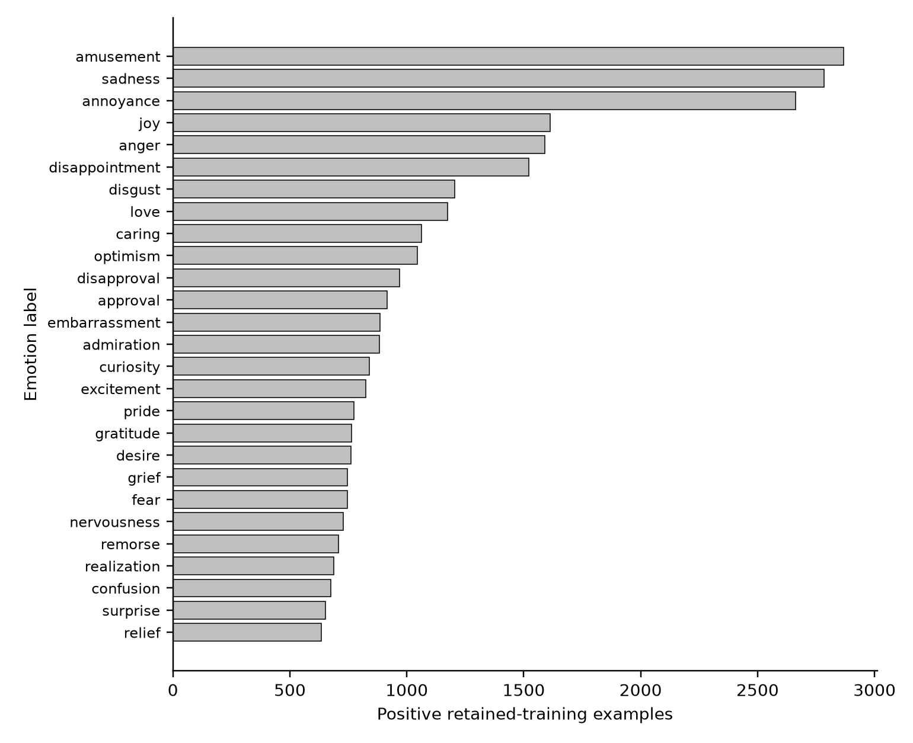
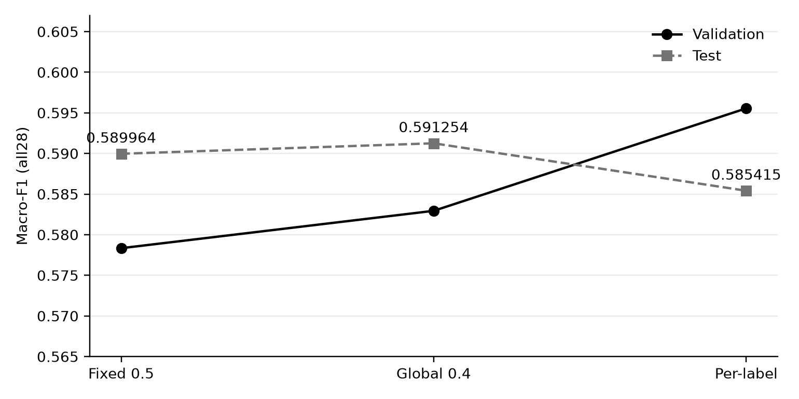
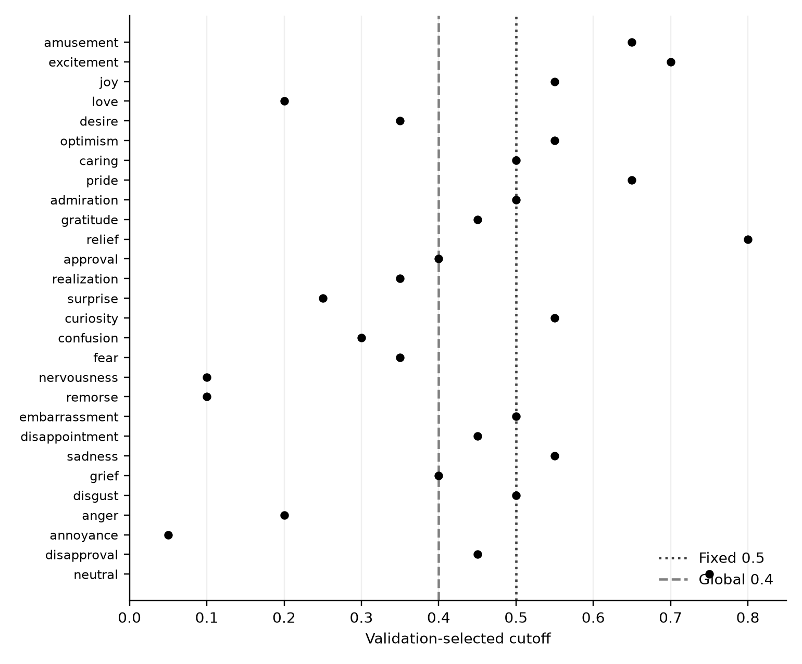

# Evaluating Threshold Transfer in 28-Label Vietnamese Emotion Recognition with PhoBERT

## Abstract

Decision thresholds affect multi-label predictions without changing the learned representation. This project studies fine-grained Vietnamese emotion recognition through Midterm baseline experiments and a controlled Final comparison of threshold decoders. The baselines are TF-IDF with One-vs-Rest Logistic Regression, BiGRU and fully fine-tuned PhoBERT under 27- and 28-output label encodings. For the Final, a single PhoBERT checkpoint with 28 independent outputs, including Neutral, is frozen. Fixed 0.5, validation-tuned global and per-label thresholds share the same probability matrices. Selection uses 2,066 validation comments, followed by evaluation on 2,067 held-out test comments. Global tuning selects 0.4 and increases all28 test Macro-F1 from 0.589964 to 0.591254, an observed gain of 0.1289 percentage points. Per-label tuning reaches validation Macro-F1 of 0.595555 but reduces test Macro-F1 to 0.585415. Fixed thresholding retains the lowest Hamming Loss. Frequency-tier, cardinality, Neutral and qualitative analyses show that gains depend on the metric and subgroup. The main limitation is evaluation of one checkpoint, seed and split, without significance testing or independent adjudication of qualitative observations. The study demonstrates that validation improvements from more flexible threshold selection do not guarantee better test F1.

**Keywords:** Vietnamese emotion recognition, multi-label classification, PhoBERT, threshold selection, reproducibility

## 1  Introduction

### 1.1  Motivation and Task

Fine-grained emotion recognition asks which emotional states are expressed in a text, rather than assigning only a positive or negative sentiment. Several states can coexist. A system may correctly detect a dominant emotion while missing another, or predict a related emotion that is absent from the reference annotation. A multi-label formulation therefore requires a set of binary decisions for each comment and an evaluation that exposes partial successes and errors.

ViGoEmotions provides a benchmark for Vietnamese social-media comments with 27 emotion categories and an explicit Neutral state [1]. The informal language is a practical challenge for the present project: short utterances, teencode, emojis, non-standard syntax and context-dependent expressions may carry affective information that is poorly represented by surface word counts. At the same time, a more complex model does not remove uncertainty in annotations or determine which score should become a positive prediction.

The project separates representation learning from decision-rule selection. At the Midterm, three model families establish reproducible baselines under 27- and 28-output encodings. PhoBERT performs best within both validation label scopes. At the Final, the trained checkpoint is held constant and only the decoder changes. This design makes a change in F1 attributable to the decision rule applied to existing scores within the experiment, rather than to an additional training run or a different encoder.

The practical objective is not to obtain a higher test score by repeatedly adapting to the test set. It is to measure whether thresholds selected on validation transfer to held-out data. A negative transfer result remains useful: it distinguishes an improvement in validation optimization from an improvement in generalization and clarifies the trade-off between recovered positives and additional false detections.

### 1.2  Research Questions and Hypotheses

The track brief asks: “Is a single uniform decision threshold (τ = 0.5) optimal across all 27 emotion labels in the presence of severe class imbalance?” We retain this motivation and disclose the group's extension to 28 outputs. The primary Final objective is Macro-F1 over all 28 labels, including Neutral. A supplementary emotion27 projection removes the Neutral column from the same scores and thresholds, without a second tuning procedure.

The operational question is whether global or per-label thresholds selected by validation F1 improve held-out all28 Macro-F1 over fixed 0.5 on a frozen PhoBERT-28 checkpoint. Optimality is restricted to the recorded validation grid; no claim is made about every possible real-valued threshold. Table 1 identifies the hypothesis and control. The hypothesis organizes the comparison; it is not presented as a preregistration preceding all Midterm observations.

**Table 1. Research questions, hypotheses and controls.**

| RQ | Question | Hypothesis | Control (Midterm) |
| --- | --- | --- | --- |
| RQ1 | Does validation-selected threshold tuning improve held-out all28 Macro-F1? | Global/per-label tuning improves test F1 over fixed 0.5. | Midterm PhoBERT-28 checkpoint, fixed threshold 0.5 for all outputs. |

The observed answer is qualified. A global cutoff yields a small test Macro-F1 increase, whereas independent per-label optimization loses its larger validation advantage. The fixed decoder has lower Hamming Loss. These results do not support a uniform benefit from replacing the default threshold with more flexible validation-selected cutoffs.

### 1.3  Contributions

- Compare lexical, recurrent and pretrained contextual baselines under 27- and 28-label encodings using fixed validation IDs.

- Compare three threshold decoders on one frozen PhoBERT-28 checkpoint using the same prediction scores for each split.

- Analyze generalization gaps, label-frequency tiers, cardinality, individual labels and Neutral using text-free prediction artifacts and executable reporting code.

The report integrates the Midterm as baseline evidence and treats Final RQ1 as the main experiment. It includes negative results and selected failure observations. Dependency-aware models, alternative loss functions, noise-robustness benchmarks and multi-seed training are not claimed as completed experiments.

## 2  Background and Related Work

### 2.1  Dataset Paper and Prior Results

The ViGoEmotions paper introduces a benchmark of manually annotated Vietnamese social-media comments and evaluates pretrained models and preprocessing alternatives [1]. In its development-set comparison, ViSoBERT reaches 62.33% Macro-F1 when emojis are kept in their original form. The benchmark's label space motivates the distinction between 27 emotion outputs and a learned Neutral output. The present project reuses the supplied corpus to examine threshold transfer under its own training and evaluation protocol.

Within this project, 28 outputs preserve Neutral-positive annotations, including comments where Neutral co-occurs with an emotion. This is an explicit modeling policy. A comparison between 27-label and 28-label aggregate scores has different denominators and cannot by itself establish an effect of adding Neutral. The shared-emotion projection provides a more comparable view while retaining the limitations of a single training run.

The project uses a supplied split rather than claiming to have reconstructed the benchmark's original partition algorithm. Checks of ordered IDs, targets, overlap and prevalence provide evidence about the retained files. They do not prove an unrecorded stratification procedure. This distinction is maintained in both the experimental protocol and the limitations.

### 2.2  Model Families

The lexical baseline uses TF-IDF features and One-vs-Rest Logistic Regression, implemented with scikit-learn [2]. Separate binary classifiers use shared unigram and bigram features. This model provides a fast reference for what can be learned from local lexical patterns, but it has limited ability to represent longer contextual interactions or a change in meaning caused by discourse context.

The recurrent baseline is a bidirectional GRU trained from scratch. GRU units use gates to update a recurrent state [3]. In the project implementation, token embeddings feed forward and backward GRUs; the final directional states are concatenated and passed through dropout and a linear classification head. Unlike the transformer baseline, its vocabulary and embedding representation are learned from the retained training data.

PhoBERT supplies a pretrained Vietnamese contextual representation [4]. We use the separately distributed PhoBERT-base-v2 artifact [5] and a sequence-classification head with independent logits. VnCoreNLP word segmentation [6] precedes the saved BPE tokenizer. Full fine-tuning updates the backbone and head during Midterm training. Freezing the checkpoint for the Final is a later experimental choice and does not mean that the backbone was frozen during training.

The encoder produces scores, while the decoder determines which scores become positive. An independent sigmoid head does not assert that emotions are statistically independent in real language: the neural outputs share an encoder and may be correlated. It does mean that the recorded decoder applies separate binary cutoffs without imposing a label graph, classifier chain or exclusivity constraint.

### 2.3  Related Studies on the Research Question

Pillai, Fumera and Roli investigate threshold optimization for multi-label classifiers [7]. Lipton, Elkan and Narayanaswamy analyze F1-oriented threshold selection and its relationship to classifier scores [8]. These studies motivate distinguishing the learned score function from the rule used to optimize a particular evaluation objective.

Our comparison uses a finite validation grid and empirical F1. It does not assume that sigmoid scores are perfectly calibrated conditional probabilities, and it does not estimate an unconstrained theoretical optimum. The term threshold tuning refers to decision-rule selection; no reliability analysis is used to claim probability calibration.

Per-label optimization is more flexible than selecting one scalar. On the same validation grid, independently maximizing each label's F1 can match or exceed the Macro-F1 of a shared cutoff. That property concerns the optimization sample. It does not ensure that the selected decisions will improve F1 on another split, especially when the positive support of individual labels is limited.

The contribution relative to this motivation is a controlled transfer evaluation on saved Vietnamese emotion scores. Architecture, weights and preprocessing remain unchanged. Reporting all three test decoders, including the unfavorable per-label result, avoids conflating a better validation fit with evidence of uniformly better recognition.

## 3  Dataset and Task Framing

### 3.1  Dataset Description

The source corpus contains 20,664 Vietnamese comments. Original split sizes are 16,531 training, 2,066 validation and 2,067 test comments. One normalized training comment overlapping held-out text was removed, leaving 16,530 training examples. Table 2 reports the counts used in the Final study. Positive assignments and mean cardinality in that table include Neutral; they differ from emotion-only counts used in the supplementary view.

**Table 2. Dataset statistics per split.**

| Split / domain | Samples | Classes or labels | Notes |
| --- | --- | --- | --- |
| Train | 16,530 | 28 | 31,544 positive assignments, including 821 Neutral positives. Mean cardinality is 1.908. |
| Validation | 2,066 | 28 | 3,958 positive assignments, including 94 Neutral positives. Mean cardinality is 1.916. |
| Test / held-out | 2,067 | 28 | 3,942 positive assignments, including 116 Neutral positives. Mean cardinality is 1.907. |

The first 27 output IDs, in canonical order, are amusement, excitement, joy, love, desire, optimism, caring, pride, admiration, gratitude, relief, approval, realization, surprise, curiosity, confusion, fear, nervousness, remorse, embarrassment, disappointment, sadness, grief, disgust, anger, annoyance and disapproval. Neutral has ID 27. Fixed label order is part of the prediction contract: an aligned matrix with the wrong column meaning would produce invalid evaluation even if its shape were correct.

The data are used under the course's restricted research and education conditions. Raw comments are kept outside public outputs. The submitted derived evidence consists of IDs, label vectors, continuous scores, aggregate tables and abstract observations. The authorized data-download and private checkpoint-access details are to be supplied by the group in Appendix A and the execution README.

### 3.2  Label Distribution and Imbalance

Training frequencies are unequal. Figure 1 shows the 27 emotions in decreasing retained-train frequency. The head, mid and tail tiers each contain nine emotions, with ties broken by label ID. Neutral is evaluated separately rather than silently added to one tier. Tier membership is fixed before inspecting test performance.



The most frequent emotion is amusement and the least frequent is relief, with an approximate frequency ratio of 4.52. This project uses rank-based tiers to examine frequency-related changes; it does not claim that those relative groups establish a universal definition of rare emotion labels. Per-label support accompanies the detailed results so that small groups are not interpreted without their denominator.

A comment may contain several positives. Primary label cardinality sums all 28 reference outputs, whereas emotion cardinality excludes Neutral. In the test split, 80 Neutral-only comments have emotion cardinality zero and all28 cardinality one. The all28 groups contain 695, 946, 360 and 66 examples for cardinalities 1, 2, 3 and at least 4, respectively; no all28 example has cardinality zero.

Informal text and co-occurring emotions provide additional difficulty. The training set contains 904 disappointment–sadness co-occurrences, 699 anger–annoyance co-occurrences and 620 sadness–grief co-occurrences. These pairs are selected from training counts for qualitative inspection. Their frequency does not establish causality or prove that independent sigmoid models preserve both labels in each example.

### 3.3  Leakage and Shortcut Risks; Split Protocol

The supplied validation and test IDs and order are retained. Vocabulary and IDF are fitted only on training data, and no label-correlation structure is constructed from test labels. After Unicode normalization and whitespace cleanup, one training comment matched held-out text. The training copy was removed, reducing the training set from 16,531 to 16,530. The supplied validation and test sets were preserved. The recorded training and sampling seed is 42. Distribution audits compare prevalence and cardinality, but they cannot establish the original multilabel stratification algorithm.

The model-selection and evaluation roles are separated. Midterm validation chooses the neural checkpoint at threshold 0.5. Final validation chooses global and per-label cutoffs for that frozen checkpoint. A pre-test lock binds sources, thresholds and implementation before the recorded test attempt. Test scores are then used to describe the planned comparison, not to revise the grid, train for more epochs or select another checkpoint.

Validation was already used for Midterm exploration, including a threshold-sensitivity analysis. Consequently, the Final protocol is not a preregistration preceding every observation. The report preserves that history and the difference between emotion27 checkpoint selection and all28 threshold selection. This is preferable to retroactively describing the checkpoint as selected under a new objective.

Possible shortcuts and reference uncertainty remain. Profanity, emojis or lexical cues may correlate with labels without determining the intended emotional stance in every comment. Mixed Neutral annotations are retained rather than corrected after observing model errors. These choices preserve a fixed evaluation target but limit claims about semantic correctness beyond the recorded reference labels.

## 4  Methods and Experimental Protocol

### 4.1  Preprocessing Pipeline

The common normalization applies Unicode NFC, collapses whitespace and trims the string. It preserves diacritics, punctuation and negation. TF-IDF uses regex tokenization with unigrams and bigrams; BiGRU uses lowercased whitespace tokens. For PhoBERT, VnCoreNLP segments Vietnamese words and segmented sentences are joined before the saved BPE tokenizer is applied.

PhoBERT sequences are padded and truncated to 256 tokens, using a batch size of 16 for the Final inference path. Token IDs and attention masks form the encoder input. Inference preserves comment order and uses evaluation mode, without dropout or gradient updates. The tokenizer, segmentation assets and model configuration are restored from the same archived run as the classifier.

The Final loader does not replace the trained classifier with a freshly initialized head or download a different backbone. Model, tokenizer, label mapping and preprocessing are treated as a bound set. A change in any of them could alter scores before thresholding, which would defeat the purpose of isolating the decoder.

### 4.2  Models and Training

The lexical baseline uses up to 40,000 TF-IDF features, sublinear term frequency, min_df=2, and unigram/bigram features. Logistic Regression is fitted separately for each label using liblinear, C=1 and max_iter=1000. TF-IDF has no neural epoch budget directly comparable to the recurrent or transformer runs.

BiGRU is trained from scratch with embedding and hidden sizes of 128, dropout 0.3, maximum length 128, batch size 64 and learning rate 0.001. The bidirectional final states feed the output head. The output dimension is 27 or 28 according to the study; both encodings use the same retained training split and original checkpoint criterion.

Neural training uses PyTorch [9], and the PhoBERT implementation uses Hugging Face Transformers [10]. Table 3 gives the recorded training configuration for the six runs. Table A.1 lists the selected epochs and measured training times. All four neural runs complete 20 epochs, after which the best checkpoint is loaded. A best epoch of 15 therefore does not mean that the training run stopped after 15 epochs.

**Table 3. Training configuration.**

| Model | Checkpoint | Input size | Epochs | Batch | LR | Params |
| --- | --- | --- | --- | --- | --- | --- |
| TF-IDF + LR-27 | From scratch | ≤40k features | N/A | N/A | N/A | 940,626 |
| BiGRU-27 | From scratch | 128 tokens | 20 | 64 | 1e-03 | 2,128,283 |
| PhoBERT-27 | vinai/phobert-base-v2 | 256 tokens | 20 | 16 | 2e-05 | 135,019,035 |
| TF-IDF + LR-28 | From scratch | ≤40k features | N/A | N/A | N/A | 975,464 |
| BiGRU-28 | From scratch | 128 tokens | 20 | 64 | 1e-03 | 2,128,540 |
| PhoBERT-28 | vinai/phobert-base-v2 | 256 tokens | 20 | 16 | 2e-05 | 135,019,804 |

The Final reuses PhoBERT-28 epoch 15. Its original training and frozen inference settings appear in Table A.2. The backbone and classification head were fully fine-tuned with unweighted BCEWithLogitsLoss, AdamW learning rate 2e-5, weight decay 0.01 and gradient clipping norm 1.0. The recorded loop uses a constant learning rate, without a newly added scheduler or warmup.

The selected checkpoint maximizes validation emotion27 Macro-F1 at 0.5, with the earlier epoch retained on a tie. The Final subsequently optimizes thresholds using all28 Macro-F1. These are different stages and scopes. Neither the checkpoint criterion nor the chosen epoch is rewritten to make the later threshold objective appear to have governed training.

For comment i and label c, the classifier produces logit z and score p. Equation (1) gives the independent sigmoid decision rule; Equation (2) gives the unweighted training objective. The shared encoder permits correlated representations, while the decoder imposes no explicit dependency or exclusivity constraint.

<!-- equation:sigmoid -->

<!-- equation:bce -->

### 4.3  Evaluation Metrics

The primary objective is test Macro-F1 across all 28 labels. For a label c, true positives, false positives and false negatives determine its positive-class F1 as in Equation (3). Macro-F1 averages that quantity over the declared label scope. It gives each label equal weight rather than weighting by the number of examples in that label.

<!-- equation:macro -->

Micro-F1 first aggregates counts over labels, as in Equation (4). It complements the macro view because frequent positives contribute more to the pooled counts. Hamming Loss in Equation (5) counts incorrect label-instance decisions and divides by the number of decisions. A sparse-label predictor can have a small Hamming Loss while missing many positives, so this metric is read alongside F1.

<!-- equation:micro -->

<!-- equation:hamming -->

Equation (6) defines continuous-score LRAP for the primary all28 scope. For comment i, Y is its set of reference-positive labels. For each positive label c, r counts all labels scored at least as high as c and r⁺ counts the reference-positive labels among them. Changing the cutoff alone leaves this ranking unchanged.

<!-- equation:lrap -->

Equation (7) gives the precision and recall reported for Neutral. Here TP, FP and FN count decisions for that label alone.

<!-- equation:precision -->

F1 uses zero_division=0. Empty cardinality groups have n=0 and undefined metrics, shown as N/A rather than invented zeros. Neutral is evaluated as a positive label; a binary macro average that also includes the negative class is not substituted for Neutral F1. All tables identify whether they refer to all28, emotion27 or a smaller declared set of labels.

### 4.4  RQ1 Protocol

The fixed decoder uses 0.5 for every output. The global decoder selects one scalar by maximizing validation all28 Macro-F1. The per-label decoder independently maximizes validation F1 for each label. Equation (8) states the selection objectives. Both tuned methods use the same 16-point grid from 0.05 to 0.80 in steps of 0.05, including the fixed cutoff.

<!-- equation:thresholds -->

An exact computed F1 tie selects the higher cutoff; selection does not use rounded display values. If a label has no positive validation example, its cutoff falls back to 0.5. No fallback is used in the actual fitted vector. Positive decisions use p ≥ cutoff. Scalar and vector thresholds are compared at the same float64 precision without changing the saved source scores.

Before fitting thresholds, actual inference reproduces all 2,066 validation probability vectors with the frozen assets. The protocol requires absolute error at most 1e-4, relative tolerance zero and identical fixed decisions. The recorded reproduction has maximum absolute error zero. Failure of this check would block fitting and test evaluation rather than justify increasing the tolerance.

The sequence is verify, restore, reproduce-val, fit, lock, infer-test and report. The lock binds the protocol, configuration, implementation, source validation predictions, checkpoint identity, reproduction and thresholds. Test inference records continuous scores before decoding. One shared 2,067-by-28 matrix supports all three decoders and both label scopes.

Completed test artifacts are retained. Subsequent analysis reads saved predictions and does not rerun the model or select new thresholds on test. The retained record identifies one completed attempt. Checksums establish consistency of that record and its inputs, not an independently observed history of every action in earlier interactive sessions.

Head/mid/tail definitions are fixed from training counts, and cardinality comes from ground truth. The generalization gap is validation F1 minus test F1 for the same metric and scope. Changes against fixed are strategy minus fixed within the same split and group. Percentage-point changes multiply an F1 difference by 100; they are not relative percentage improvements.

### 4.5  Compute Budget

The training manifests record Tesla T4 for the neural runs and CPU for TF-IDF. PhoBERT-27 training takes approximately 4.05 hours and PhoBERT-28 approximately 3.90 hours. The corresponding BiGRU runs take about 80.33 and 83.61 seconds. The four neural runs account for about 8.00 GPU-hours of recorded loop time, including per-epoch validation and checkpoint writes. Preprocessing and downloads are excluded.

The original manifests identify Python 3.13.16, Torch 2.11.0+cu130 and Transformers 4.57.3; the Final additionally records py-vncorenlp 0.1.4 and CUDA execution. The implementation uses one GPU per process even when the Kaggle interface displays two T4 devices. Exact versions and device records remain in the imported artifacts.

No new neural training or inference is performed when producing this report. The saved records support the training times above but do not provide a separate, controlled per-model inference-latency benchmark. The report therefore does not invent inference seconds, throughput or energy measurements. The cost of rebuilding tables and figures is a reporting cost, distinct from the cost of learning or applying the encoder.

## 5  Results

### 5.1  Baseline Recap

PhoBERT leads the Midterm baselines at fixed threshold 0.5, with validation Macro-F1 of 0.597410 for 27 outputs and 0.578341 for 28 outputs. Table A.3 gives the full comparison. On the shared 27 emotion columns, the PhoBERT-28 projection scores 0.583580 on validation, about 1.3830 percentage points below the separately trained PhoBERT-27. The Final adopts the 28-output checkpoint as the group's chosen label encoding.

### 5.2  RQ1 Results

Table 4 compares all28 test Macro-F1 under fixed and tuned decision rules. Table A.4 reports both validation and test metrics for all three decoders. Global tuning selects 0.4, while per-label tuning selects a 28-element vector, including Neutral cutoff 0.75. Both were selected using validation rather than test. The same saved test probabilities are reused by every row.

**Table 4. RQ1 comparison for all28 test Macro-F1 (seed 42).**

| Model | Fixed 0.5 (A) | Tuned cutoff (B) | Δ (B − A) |
| --- | --- | --- | --- |
| PhoBERT-28 (global) | 0.589964 | **0.591254** | +0.1289 pp |
| PhoBERT-28 (per-label) | 0.589964 | 0.585415 | -0.4549 pp |

Global test Macro-F1 exceeds fixed by 0.1289 percentage points, from 0.589964 to 0.591254. Per-label tuning reaches the best validation Macro-F1, 0.595555, but its test score falls to 0.585415, a decrease of 0.4549 points from fixed. Figure 2 makes the difference between validation ranking and test ranking explicit.



The metric trade-off is important. Fixed retains the lowest Hamming Loss, while global has slightly higher test Macro-F1 and Micro-F1. LRAP is identical across the three all28 test rows because score rankings are identical. Neither a small global increase nor a favorable validation result is presented as a statistically significant improvement.

Table A.5 reports the validation-to-test gap. Fixed and global have negative gaps because their observed test F1 is higher than validation F1. Per-label has a positive Macro-F1 gap of approximately 1.0140 points. A negative gap alone is not evidence of leakage; it is a descriptive relationship between two finite samples under the recorded protocol.

Table A.6 partitions the 27 emotion columns into training-frequency tiers. Per-label head Macro-F1 increases by approximately 0.4885 points, while tail Macro-F1 decreases by approximately 1.3654 points. A tier is a set of labels, not a disjoint subset of comments. These differences localize the observed changes but do not establish label frequency as their sole cause.

Table A.7 stratifies comments by all28 ground-truth cardinality. Per-label changes are not uniformly favorable for multi-emotion comments. The group with at least four positives contains only 66 examples and should be read with its support. The empty group is retained for a complete inventory and marked N/A.

Table A.8 evaluates Neutral separately on 116 positive test examples. Raising its cutoff to 0.75 increases precision but reduces recall and F1 relative to fixed. The validation benefit of the fitted Neutral cutoff does not transfer to test. Mixed Neutral annotations remain unchanged throughout evaluation.

Table A.9 removes the Neutral column while keeping the same selected thresholds. The test Macro-F1 ordering remains global, fixed, per-label. This supplementary view does not compare a new model27 checkpoint or independently optimize a global27 cutoff.

Figure A.1 shows the fitted cutoff profile, and Appendix A provides the complete label inventory with test F1. Some cutoffs are far from 0.5, but a larger movement does not itself indicate a better test decision. The profile is a validation-selected artifact, not a new rule fitted from the observed test errors.

### 5.4  Answer to the Research Questions

On held-out data, global tuning gains 0.1289 Macro-F1 percentage points over fixed 0.5, while per-label tuning loses 0.4549 points and fixed gives the lowest Hamming Loss. The results provide limited support for a global improvement in this single run and fail to support a consistent benefit from tuning across both approaches.

## 6  Error Analysis

### 6.1  Confusion and Per-Class Errors

The error analysis examines per-label FP and FN rather than a single mutually exclusive confusion matrix. Several true or predicted emotions can coexist in one comment. A selected target error therefore needs to be distinguished from the correctness of the entire predicted label set.

Per-label tuning has its largest negative F1 changes for nervousness, surprise and love: approximately −5.5699, −4.8481 and −3.1940 percentage points. For nervousness, TP increases from 41 to 51 and FN decreases from 55 to 45, but FP rises from 26 to 81. Recovering additional positives is therefore insufficient to preserve F1. For surprise, TP increases from 53 to 59 while FP rises from 44 to 77. These counts describe a precision/recall trade-off, not a linguistic cause established by ablation.

The qualitative packet contains 20 primary FN pairs, 20 primary FP pairs, two additional Neutral errors, five high-cardinality cases and 15 cases for three training-selected emotion pairs. It covers 62 distinct comments, including three with mixed Neutral. Hash ordering with seed 42 fixes selection, prioritizing distinct comments for the primary quotas.

Table A.10 compares the primary target errors across saved decoders. All 20 sampled per-label FN targets were also FN under fixed. Fifteen sampled FP targets were already errors under fixed; five appear only after changing to per-label. Thus, most selected errors cannot be attributed solely to introducing per-label cutoffs. This selected packet is not a population error-rate estimate.

### 6.2  Failure Examples

Table A.11 gives five text-free examples with the complete reference and per-label prediction sets. The descriptions below separate the recorded decisions from possible interpretations. Restricted raw comments are not reproduced, and no reference label or test metric is changed on the basis of these observations.

For you003220, the annoyance score is 0.051592, above the fitted cutoff 0.05 but below the fixed and global thresholds. The review describes a humorous tone rather than clear irritation. The new annoyance FP is directly explained at the decision-rule level; the reason the encoder assigned that score remains a hypothesis.

For tik017852, the text concerns performed or quoted self-confidence, while the model strongly predicts pride. The reference is optimism. This suggests a possible stance or attribution ambiguity, but the example does not prove a general rule about quoted language or the model's internal representation.

For you001985, the reference contains confusion and every decoder predicts sadness. The abstract review describes a request for advice in an emotionally negative situation. Sadness may be semantically plausible despite its absence from the reference. This motivates adjudication rather than treating the model's disagreement as proof that the annotation is wrong.

For 247, realization is recovered but Neutral is missed in a mixed reference annotation. The model's Neutral score is approximately 0.075352, below all selected Neutral cutoffs. The study preserves the mixed reference; it does not impose an exclusivity rule to remove the discrepancy after evaluation.

For 18169, the model recovers caring, sadness, grief and anger, but misses desire and adds disapproval. The example illustrates why detecting several correct emotions does not imply a correct complete label set. All five selected high-cardinality cases retain at least one per-label FN; five examples are insufficient to estimate a subgroup-wide semantic failure rate.

The review has not undergone independent adjudication. Label overlap, implied affect, sarcasm, negation and missing context remain interpretive categories rather than experimentally isolated mechanisms. Cases selected for their errors can reveal useful questions, but their sampling design prevents extrapolating the fraction of questionable annotations to the whole corpus.

## 7  Limitations, Ethics and Conclusion

### 7.1  Limitations and Threats to Validity

The experiment evaluates one seed, checkpoint, grid and supplied split. There are no confidence intervals, significance tests or repeated training runs. The small global F1 gain may be sensitive to the particular evaluation sample. The negative per-label result is a measured outcome, but the study cannot uniquely attribute it to threshold-selection noise, distribution differences or a property of rare labels.

Validation has several roles across the project: original checkpoint selection, Midterm exploration and Final threshold fitting. The report makes that reuse explicit. The all28 Final objective differs from the emotion27 checkpoint criterion, and the finite grid limits what optimality means. The experiment should therefore not be described as a search for a universal deployment cutoff.

Qualitative judgments are exploratory and unadjudicated. Reference-label ambiguities remain unresolved, and selected cases mix target-level and whole-comment observations. A checksum proves consistency of saved bytes, not semantic correctness or a complete history of interactive actions. Likewise, a distribution audit does not certify the original stratification algorithm.

### 7.2  Ethical Considerations

The course brief restricts use of the dataset to non-commercial academic research and education and prohibits public redistribution of raw comments. Derived artifacts are separated from private data, tokenizer assets and model weights. Failure examples use abstract descriptions and label sets. The group provides authorized dataset and checkpoint access details in the execution README.

The reported labels and scores should not be treated as authoritative judgments of an individual's emotional state. Informal language and limited context can make apparently incorrect predictions defensible or apparently correct predictions misleading. No demographic fairness analysis or safety evaluation is claimed, and the experiment does not establish suitability for consequential decisions about people.

### 7.3  Conclusion

This project establishes lexical, recurrent and pretrained baselines and then isolates threshold decoding on one frozen PhoBERT-28 checkpoint. Validation-selected global threshold 0.4 improves all28 test Macro-F1 by 0.1289 percentage points over fixed 0.5, whereas per-label tuning reduces it by 0.4549 points despite its better validation score. Fixed retains the lowest Hamming Loss. Frequency-tier, cardinality, Neutral and failure analyses show why a validation gain should not be assumed to transfer uniformly. The main lesson is to evaluate threshold transfer and metric trade-offs under fixed split and checkpoint controls, while reporting the limits of single-run and qualitative evidence.

## References

[1] T. Q. Hung, P. T. Nam, S. T. Luu, and K. V. Nguyen, “ViGoEmotions: A Benchmark Dataset For Fine-grained Emotion Detection on Vietnamese Texts,” in Proc. EACL, vol. 1, 2026, pp. 2805–2831, doi: 10.18653/v1/2026.eacl-long.129.

[2] F. Pedregosa et al., “Scikit-learn: Machine Learning in Python,” J. Mach. Learn. Res., vol. 12, pp. 2825–2830, 2011. [Online]. Available: https://jmlr.org/papers/v12/pedregosa11a.html.

[3] K. Cho et al., “Learning Phrase Representations using RNN Encoder–Decoder for Statistical Machine Translation,” in Proc. EMNLP, 2014, pp. 1724–1734, doi: 10.3115/v1/D14-1179.

[4] D. Q. Nguyen and A. T. Nguyen, “PhoBERT: Pre-trained language models for Vietnamese,” in Findings of EMNLP, 2020, pp. 1037–1042, doi: 10.18653/v1/2020.findings-emnlp.92.

[5] VinAI Research, “PhoBERT-base-v2 model artifact and model card.” [Online]. Available: https://huggingface.co/vinai/phobert-base-v2 (accessed Nov. 19, 2026). Revision: 86cd7fd4c148980922ac11a2cf5e257f2ba639e1.

[6] T. Vu, D. Q. Nguyen, D. Q. Nguyen, M. Dras, and M. Johnson, “VnCoreNLP: A Vietnamese Natural Language Processing Toolkit,” in Proc. NAACL-HLT: Demonstrations, 2018, pp. 56–60, doi: 10.18653/v1/N18-5012.

[7] I. Pillai, G. Fumera, and F. Roli, “Threshold optimisation for multi-label classifiers,” Pattern Recognit., vol. 46, no. 7, pp. 2055–2065, 2013, doi: 10.1016/j.patcog.2013.01.012.

[8] Z. C. Lipton, C. Elkan, and B. Narayanaswamy, “Thresholding Classifiers to Maximize F1 Score,” arXiv:1402.1892, 2014. [Online]. Available: https://arxiv.org/abs/1402.1892.

[9] A. Paszke et al., “PyTorch: An Imperative Style, High-Performance Deep Learning Library,” in Proc. NeurIPS, 2019. [Online]. Available: https://arxiv.org/abs/1912.01703.

[10] T. Wolf et al., “Transformers: State-of-the-Art Natural Language Processing,” in Proc. EMNLP: System Demonstrations, 2020, pp. 38–45, doi: 10.18653/v1/2020.emnlp-demos.6.

## Appendix A  Reproducibility

### A.1  Artifact Inventory and Execution

The original study configuration is configs/final_thresholds.json. The pre-test design is docs/final_protocol.md. Source and imported-member hashes are recorded in reports/final28/execution_verification.json. Validation reproduction, fitted thresholds, pre_test_lock.json and test_attempt.json bind the completed execution. The checkpoint SHA-256 is 30e09d73bd474c6c1a9d2455519af7256ce96ed12576dde9aafcff45a301c835.

The two executed Midterm notebooks are notebooks/08_kaggle_equal_20ep_27_labels_executed.ipynb and notebooks/09_kaggle_equal_20ep_28_labels_executed.ipynb. Their derived evidence supports Table 3 and Tables A.1–A.3. The Final comparison, gaps, tiers, cardinality, Neutral and cases are generated from saved Final NPZ/CSV/JSON artifacts. Table A.12 provides the complete per-label inventory behind the aggregate analysis.

Table 1 summarizes the declared RQ and control in docs/final_protocol.md. Table 2 uses the frozen split sizes and label support. Table 3 and Tables A.1–A.3 use the Midterm model_comparison.csv and saved run records. Table 4 and Table A.4 use val_comparison.csv and test_comparison.csv in reports/final28/tables/. Tables A.5–A.9 use generalization_gap.csv, test_frequency_tiers.csv, test_cardinality.csv, test_neutral.csv and the emotion27 rows of test_comparison.csv, respectively.

Table A.10 uses the target-error comparisons in the qualitative packet. Table A.11 uses the five selected rows of human_audit/cases.csv. Table A.12 joins threshold_profile.csv with test_per_label.csv. Figures 1 and A.1 use threshold_profile.csv. Figure 2 uses val_comparison.csv and test_comparison.csv. The report builder checks the source evidence, recomputes baseline metrics from saved scores and renders the tables and grayscale figures.

```bash
python -m pip install -r requirements.txt
python scripts/build_final_figures.py
python scripts/build_ati_report.py
```

These reporting commands do not run PhoBERT. The original model workflow uses verify, restore, reproduce-val, fit, lock, infer-test and report as described in docs/final_execution.md. It needs authorized CSVs and the recorded neural runtime. Technical reproduction must use an isolated workspace and preserve the completed study; it must not overwrite the existing test attempt or select new cutoffs using test results.

Dataset access is provided through https://huggingface.co/datasets/uitnlp/vigoemotions, subject to the dataset terms and course restrictions. The project repository is https://github.com/DwaftPainter/vigoemotions. The submission README and table–figure mapping belong in code/README.md. Private checkpoint access: [CHECKPOINT LINK, IF REQUIRED]. Executed Final notebook in the submission: [FINAL EXECUTED NOTEBOOK PATH]. The private URL and final notebook filename remain for the group to complete; no execution record is invented.

### A.2  Supplementary Training and Results Tables

**Table A.1. Recorded baseline budgets, selected epochs, parameters and training time.**

| Model | Selected epoch | Params | Training time (s) |
| --- | --- | --- | --- |
| TF-IDF + LR-27 | N/A | 940,626 | 2.752 |
| BiGRU-27 | 17 | 2,128,283 | 80.331 |
| PhoBERT-27 | 14 | 135,019,035 | 14589.618 |
| TF-IDF + LR-28 | N/A | 975,464 | 2.525 |
| BiGRU-28 | 20 | 2,128,540 | 83.605 |
| PhoBERT-28 | 15 | 135,019,804 | 14057.719 |

**Table A.2. PhoBERT-28 training and frozen inference configuration.**

| Setting | Recorded value |
| --- | --- |
| Pretrained artifact | vinai/phobert-base-v2 |
| Outputs / seed | 28 / 42 |
| Completed / selected epoch | 20 / 15 |
| Checkpoint selection | Validation emotion27 Macro-F1 at 0.5 |
| Optimizer / loss | AdamW / unweighted BCEWithLogitsLoss |
| Learning rate / weight decay | 2e-05 / 0.01 |
| Batch / maximum tokens | 16 / 256 |
| Gradient clipping norm | 1.0 |
| Parameter count | 135019804 |
| Original training device | Tesla T4 |
| Training loop time (seconds) | 14057.719 |
| Frozen inference | eval mode; sigmoid; no shuffle; batch 16 |

**Table A.3. Midterm baselines: validation results at fixed 0.5, seed 42.**

| Model | Outputs | Macro-F1 | Micro-F1 | Hamming | LRAP |
| --- | --- | --- | --- | --- | --- |
| TF-IDF + LR | 27 | 0.238825 | 0.271238 | 0.060593 | 0.640745 |
| BiGRU | 27 | 0.421976 | 0.459037 | 0.062619 | 0.619133 |
| PhoBERT | 27 | 0.597410 | 0.599582 | 0.055000 | 0.741945 |
| TF-IDF + LR | 28 | 0.231040 | 0.266160 | 0.060054 | 0.609645 |
| BiGRU | 28 | 0.408615 | 0.448328 | 0.062751 | 0.585070 |
| PhoBERT | 28 | 0.578341 | 0.582894 | 0.057496 | 0.707656 |

**Table A.4. Primary all28 validation and test comparison.**

| Decoder | Val Macro-F1 | Test Macro-F1 | Test Micro-F1 | Hamming Loss | LRAP | Δ Macro (pp) |
| --- | --- | --- | --- | --- | --- | --- |
| Fixed 0.5 | 0.578341 | 0.589964 | 0.597350 | 0.055135 | 0.719074 | +0.0000 |
| Global | 0.582941 | 0.591254 | 0.598233 | 0.057347 | 0.719074 | +0.1289 |
| Per-label | 0.595555 | 0.585415 | 0.594666 | 0.058297 | 0.719074 | -0.4549 |

**Table A.5. Generalization gaps, defined as validation minus test, in percentage points.**

| Decoder | Macro-F1 gap (pp) | Micro-F1 gap (pp) |
| --- | --- | --- |
| Fixed 0.5 | -1.1623 | -1.4456 |
| Global | -0.8312 | -1.3577 |
| Per-label | +1.0140 | +0.3769 |

**Table A.6. Test emotion-tier Macro-F1 and changes against fixed. Neutral is separate.**

| Tier | Fixed 0.5 F1 | Global F1 | Per-label F1 | Δ global (pp) | Δ per-label (pp) |
| --- | --- | --- | --- | --- | --- |
| head | 0.578569 | 0.584597 | 0.583454 | +0.6029 | +0.4885 |
| mid | 0.644118 | 0.642867 | 0.640013 | -0.1251 | -0.4105 |
| tail | 0.564577 | 0.563558 | 0.550923 | -0.1019 | -1.3654 |

**Table A.7. Test Macro-F1 by all28 reference cardinality.**

| Cardinality | n | Fixed 0.5 F1 | Global F1 | Per-label F1 |
| --- | --- | --- | --- | --- |
| 0 | 0 | N/A | N/A | N/A |
| 1 | 695 | 0.459668 | 0.446783 | 0.449004 |
| 2 | 946 | 0.597258 | 0.603888 | 0.593143 |
| 3 | 360 | 0.603230 | 0.610477 | 0.609866 |
| >=4 | 66 | 0.584676 | 0.583418 | 0.572108 |

**Table A.8. Positive-class Neutral metrics on test.**

| Decoder | τ | TP | FP | FN | Precision | Recall | F1 |
| --- | --- | --- | --- | --- | --- | --- | --- |
| Fixed 0.5 | 0.50 | 49 | 61 | 67 | 0.445455 | 0.422414 | 0.433628 |
| Global | 0.40 | 51 | 67 | 65 | 0.432203 | 0.439655 | 0.435897 |
| Per-label | 0.75 | 42 | 41 | 74 | 0.506024 | 0.362069 | 0.422111 |

**Table A.9. Supplementary emotion27 test projection, without retuning.**

| Decoder | Macro-F1 | Micro-F1 | Hamming Loss | LRAP |
| --- | --- | --- | --- | --- |
| Fixed 0.5 | 0.595755 | 0.602156 | 0.054884 | 0.740627 |
| Global | 0.597007 | 0.602965 | 0.057105 | 0.740627 |
| Per-label | 0.591463 | 0.598892 | 0.058396 | 0.740627 |

**Table A.10. Target errors among the 40 primary audited label-instance pairs.**

| Core sample | Already errors at fixed | New errors vs fixed | Total |
| --- | --- | --- | --- |
| FN | 20 | 0 | 20 |
| FP | 15 | 5 | 20 |

**Table A.11. Selected failure cases: reference labels and per-label predictions.**

| Case ID | Reference labels | Per-label prediction |
| --- | --- | --- |
| you003220 | amusement, joy | amusement, annoyance |
| tik017852 | optimism | amusement, joy, love, pride |
| you001985 | confusion | sadness |
| 247 | realization, neutral | realization |
| 18169 | desire, caring, sadness, grief, anger | caring, sadness, grief, anger, disapproval |

### A.3  Full Label and Threshold Inventory



**Table A.12. Canonical label order, retained-train support, selected cutoffs and test per-label F1.**

| Label | Tier | Train n | τ | Fixed F1 | Global F1 | Per-label F1 |
| --- | --- | --- | --- | --- | --- | --- |
| amusement | head | 2868 | 0.65 | 0.683887 | 0.677844 | 0.690629 |
| excitement | mid | 824 | 0.70 | 0.483516 | 0.497462 | 0.455090 |
| joy | head | 1614 | 0.55 | 0.548544 | 0.563510 | 0.559406 |
| love | head | 1175 | 0.20 | 0.646465 | 0.628931 | 0.614525 |
| desire | tail | 762 | 0.35 | 0.523490 | 0.532468 | 0.528302 |
| optimism | mid | 1046 | 0.55 | 0.726115 | 0.699387 | 0.712418 |
| caring | head | 1062 | 0.50 | 0.651466 | 0.658307 | 0.651466 |
| pride | mid | 774 | 0.65 | 0.690476 | 0.690058 | 0.700000 |
| admiration | mid | 883 | 0.50 | 0.584158 | 0.598131 | 0.584158 |
| gratitude | mid | 765 | 0.45 | 0.853081 | 0.853081 | 0.853081 |
| relief | tail | 635 | 0.80 | 0.573529 | 0.567376 | 0.551724 |
| approval | mid | 916 | 0.40 | 0.634361 | 0.628099 | 0.628099 |
| realization | tail | 687 | 0.35 | 0.429319 | 0.443350 | 0.451923 |
| surprise | tail | 651 | 0.25 | 0.582418 | 0.562500 | 0.533937 |
| curiosity | mid | 840 | 0.55 | 0.631111 | 0.629310 | 0.633929 |
| confusion | tail | 676 | 0.30 | 0.448276 | 0.449198 | 0.443350 |
| fear | tail | 745 | 0.35 | 0.670391 | 0.681081 | 0.673797 |
| nervousness | tail | 728 | 0.10 | 0.503067 | 0.497110 | 0.447368 |
| remorse | tail | 707 | 0.10 | 0.736842 | 0.743590 | 0.732558 |
| embarrassment | mid | 885 | 0.50 | 0.826531 | 0.825871 | 0.826531 |
| disappointment | head | 1522 | 0.45 | 0.462287 | 0.482916 | 0.468085 |
| sadness | head | 2785 | 0.55 | 0.671035 | 0.664132 | 0.670199 |
| grief | tail | 747 | 0.40 | 0.613861 | 0.595349 | 0.595349 |
| disgust | head | 1206 | 0.50 | 0.429091 | 0.432624 | 0.429091 |
| anger | head | 1589 | 0.20 | 0.576271 | 0.587258 | 0.593350 |
| annoyance | head | 2662 | 0.05 | 0.538071 | 0.565854 | 0.574333 |
| disapproval | mid | 969 | 0.45 | 0.367713 | 0.364407 | 0.366812 |
| neutral | neutral | 821 | 0.75 | 0.433628 | 0.435897 | 0.422111 |

## Appendix B  Member Contributions

**Table 5. Contribution of each member.**

| Student ID | Full name | Main tasks | % |
| --- | --- | --- | --- |
| [Student ID] | [Full name] | [Main tasks] | [%] |
| [Student ID] | [Full name] | [Main tasks] | [%] |
| [Student ID] | [Full name] | [Main tasks] | [%] |

## Appendix C  Use of Generative AI Tools

| Tool | Purpose | Sections or files affected |
| --- | --- | --- |
| [Tool and version] | [Purpose] | [Sections or files] |
