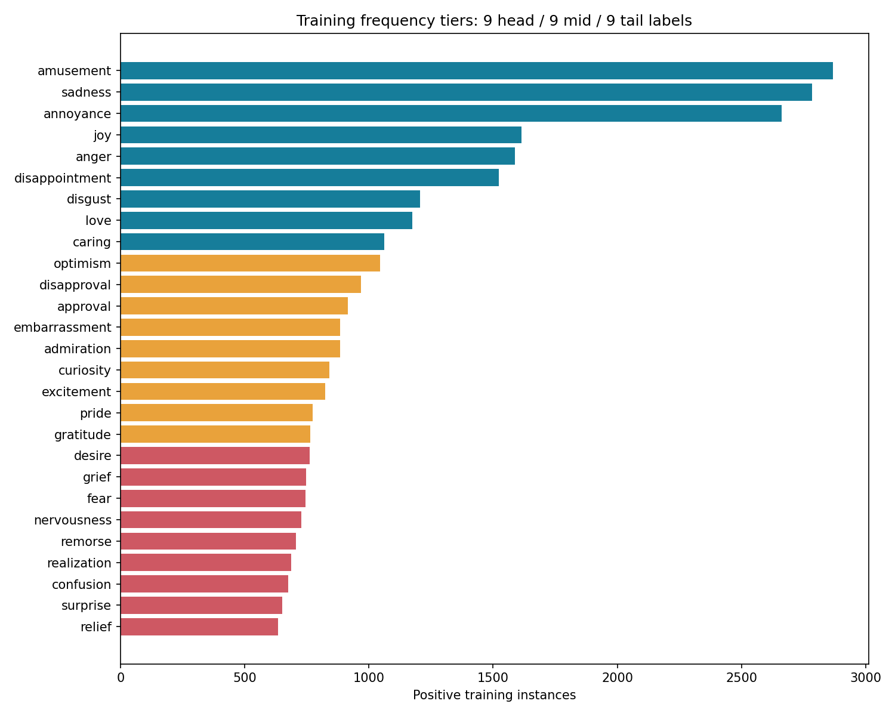
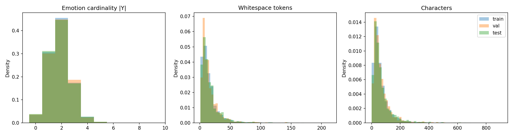
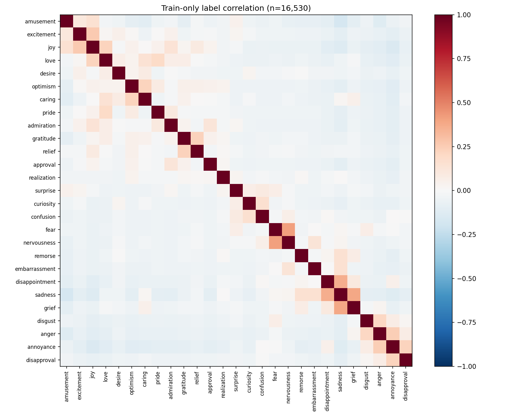
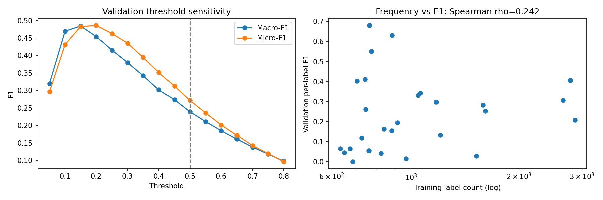

# ViGoEmotions — Báo cáo giữa kỳ

ATI Course Project 2026 • Nhận diện đa nhãn cảm xúc tiếng Việt

**Trạng thái:** Đã có kết quả của cả ba mô hình; cần rà soát diễn giải và thông tin nhóm trước nộp.

## 1. Mục tiêu và phạm vi

Đầu vào là một bình luận tiếng Việt; đầu ra là tập con của 27 cảm xúc. Một bình luận có thể biểu đạt nhiều cảm xúc đồng thời. Vì vậy mô hình dùng 27 quyết định nhị phân độc lập, không dùng softmax để buộc chọn một lớp. Neutral được biểu diễn bằng vector cảm xúc bằng 0 theo quy ước project.

Midterm chiếm 30% điểm môn học và là checkpoint thuyết trình. Hai tài liệu yêu cầu mô tả dữ liệu, EDA, split/preprocessing hợp lệ, ba baseline, các chỉ số phù hợp, phân tích lỗi, câu hỏi nghiên cứu Final và mã tái lập. Báo cáo này bám mục Midterm A–E của đề; phần Final chỉ trình bày thiết kế, không nhận là đã thực hiện thí nghiệm Final.

**Câu hỏi thực nghiệm giữa kỳ:** Baseline dựa trên từ vựng nhận diện tốt/khó những nhãn nào, có giữ được các cặp cảm xúc đồng xuất hiện không, và ngưỡng 0,5 ảnh hưởng thế nào đến kết quả?

## 2. Dữ liệu, quyền truy cập và kiểm tra chất lượng

Bộ dữ liệu được cấp trong thư mục data gồm 20.664 bình luận: train 16.531, validation 2.066, test 2.067. Ba cột là id (định danh), text (bình luận), labels (danh sách ID). Dữ liệu nguồn thuộc phạm vi nghiên cứu/học thuật phi thương mại theo đề. Người dùng cần xin quyền và chấp nhận điều khoản tại https://huggingface.co/datasets/uitnlp/vigoemotions. Không đính kèm CSV nguồn, văn bản gốc hay vocabulary vào gói công khai.

Không có trường thiếu hoặc ID trùng. Một văn bản xuất hiện ở train ID 1698 và test ID red000094, cùng nhãn approval. Pipeline so sánh NFC + gom khoảng trắng, loại bản train và giữ nguyên bản test; train thực nghiệm còn 16.530 mẫu. CSV gốc không bị sửa. Việc dò trùng chỉ dùng text, không dùng nhãn test để huấn luyện.

Có 306 mẫu neutral + cảm xúc (251 train, 19 validation, 36 test), 725 mẫu chỉ neutral và 1 mẫu test lặp ID nhãn. Neutral riêng lẻ thành vector 0; với mẫu mixed-neutral, bỏ ID 27 và giữ các cảm xúc. Nhãn lặp được gộp. Đây là quyết định xử lý nhất quán, không khẳng định đã sửa đúng ý định người gán nhãn. Notebook ban đầu đếm sai mixed-neutral do dùng print trong biểu thức boolean; đã sửa và kiểm tra lại.

| split | samples | cardinality_mean | cardinality_max | neutral_only | neutral_mixed | repeated_label_rows |
| --- | --- | --- | --- | --- | --- | --- |
| train | 16530 | 1.8586 | 5 | 570 | 251 | 0 |
| val | 2066 | 1.8703 | 5 | 75 | 19 | 0 |
| test | 2067 | 1.8510 | 5 | 80 | 36 | 1 |

Thứ tự ID 0–26 được kế thừa từ notebook kiểm tra dữ liệu ban đầu; ID 27 là neutral. Dataset card đang yêu cầu quyền truy cập nên vẫn cần người sở hữu dữ liệu đối chiếu mapping này với metadata gốc được cấp quyền. Không sắp nhãn lại theo alphabet.

### 2.1. Danh mục đủ 27 nhãn và tần suất

| label_id | label | train_count | val_count | test_count | tier |
| --- | --- | --- | --- | --- | --- |
| 0 | amusement | 2868 | 327 | 374 | head |
| 1 | excitement | 824 | 91 | 98 | mid |
| 2 | joy | 1614 | 168 | 204 | head |
| 3 | love | 1175 | 148 | 143 | head |
| 4 | desire | 762 | 102 | 80 | tail |
| 5 | optimism | 1046 | 122 | 142 | mid |
| 6 | caring | 1062 | 131 | 150 | head |
| 7 | pride | 774 | 87 | 86 | mid |
| 8 | admiration | 883 | 107 | 101 | mid |
| 9 | gratitude | 765 | 96 | 108 | mid |
| 10 | relief | 635 | 58 | 60 | tail |
| 11 | approval | 916 | 119 | 115 | mid |
| 12 | realization | 687 | 96 | 95 | tail |
| 13 | surprise | 651 | 87 | 85 | tail |
| 14 | curiosity | 840 | 112 | 100 | mid |
| 15 | confusion | 676 | 89 | 84 | tail |
| 16 | fear | 745 | 117 | 98 | tail |
| 17 | nervousness | 728 | 109 | 96 | tail |
| 18 | remorse | 707 | 96 | 87 | tail |
| 19 | embarrassment | 885 | 137 | 107 | mid |
| 20 | disappointment | 1522 | 211 | 197 | head |
| 21 | sadness | 2785 | 354 | 345 | head |
| 22 | grief | 747 | 97 | 86 | tail |
| 23 | disgust | 1206 | 164 | 141 | head |
| 24 | anger | 1589 | 185 | 189 | head |
| 25 | annoyance | 2662 | 331 | 343 | head |
| 26 | disapproval | 969 | 123 | 112 | mid |

Phân tầng theo thứ hạng tần suất train: head là hạng 1–9, mid là 10–18, tail là 19–27; nếu bằng nhau thì ưu tiên ID nhỏ. Tier chỉ dùng train, cố định trước đánh giá test. Tail là khái niệm tương đối trong bộ dữ liệu này, không hàm ý chỉ có vài mẫu.

| tier | labels | minimum | maximum |
| --- | --- | --- | --- |
| head | 9 | 1062 | 2868 |
| mid | 9 | 765 | 1046 |
| tail | 9 | 635 | 762 |

Tỷ lệ nhãn phổ biến nhất/hiếm nhất là 4.52 lần. Mức lệch giữa các lớp không quá cực đoan; thách thức khác là nhãn dương thưa: trung bình 6.88% trong 27 đầu ra là dương trên train. Không nên lặp lại nhận định “mất cân bằng nghiêm trọng” mà không phân biệt hai dạng này.

### 2.2. Cardinality và độ dài văn bản

Label cardinality là số cảm xúc dương sau khi bỏ neutral và gộp nhãn lặp. Trung bình train 1.859, validation 1.870, test 1.851; lớn nhất 5. Có nhóm cardinality 0 nên cần quy ước metric rõ ràng.

| split | unit | mean | median | p95 | p99 | minimum | maximum |
| --- | --- | --- | --- | --- | --- | --- | --- |
| train | whitespace_tokens | 16.0551 | 11.0000 | 44.0000 | 84.0000 | 1 | 214 |
| train | characters | 66.4320 | 47.0000 | 185.0000 | 353.4200 | 1 | 906 |
| val | whitespace_tokens | 16.0595 | 12.0000 | 44.0000 | 88.0000 | 1 | 143 |
| val | characters | 66.4802 | 47.0000 | 187.7500 | 363.4000 | 1 | 641 |
| test | whitespace_tokens | 16.8200 | 11.0000 | 47.0000 | 90.6800 | 1 | 171 |
| test | characters | 69.4601 | 47.0000 | 193.7000 | 380.0400 | 1 | 693 |

Độ dài token trong EDA đo bằng tách khoảng trắng, không phải số từ sau tách từ tiếng Việt hay số BPE token của PhoBERT. Trung vị train là 11 đơn vị khoảng trắng, 47 ký tự; đuôi dài đến 214 đơn vị và 906 ký tự. GRU giới hạn 128 token; PhoBERT giới hạn 256 BPE token. Pipeline neural ghi tỷ lệ bị cắt riêng, không suy ra nó từ số token khoảng trắng.

### 2.3. Đồng xuất hiện và tương quan

Ma trận co-occurrence dùng Y_train.T × Y_train; đường chéo là tần suất nhãn. Ma trận correlation dùng Pearson trên biến nhị phân (phi). Hai ma trận chỉ xây từ train. Đếm đồng xuất hiện lớn có thể do nhãn vốn phổ biến; vì vậy cần xem cả phi, không suy ra quan hệ nhân quả.

| label_a | label_b | count | phi |
| --- | --- | --- | --- |
| disappointment | sadness | 904 | 0.3620 |
| anger | annoyance | 699 | 0.2474 |
| sadness | grief | 620 | 0.3845 |
| amusement | joy | 568 | 0.1550 |
| annoyance | disapproval | 469 | 0.2193 |
| joy | love | 395 | 0.2223 |
| disgust | anger | 379 | 0.2076 |
| embarrassment | sadness | 366 | 0.1557 |

### 2.4. Văn phong tiếng Việt phi chuẩn

Kiểm tra các ca validation cho thấy viết tắt/teencode, từ vay mượn, thiếu dấu câu, dấu lặp và emoji có thể góp nghĩa cảm xúc. Emoji có thể bổ sung sắc thái vui vào một phát biểu hối tiếc; cách viết gần giống một cụm từ quen thuộc có thể làm mô hình từ vựng dự đoán sai. Câu rất ngắn và câu hỏi lịch sự thường cần ngữ cảnh. Đây là nhận xét từ mẫu đã đọc, không phải thống kê gán nhãn ngôn ngữ toàn tập.

Để so sánh định lượng: short có ≤5 token khoảng trắng; emoji-heavy có ≥2 ký tự trong các dải Unicode emoji định nghĩa ở common.py; teencode có ít nhất một token trong từ điển heuristic. Các nhóm có thể chồng lấn. Regex có thể bắt nhầm từ hợp lệ và bỏ sót nhiều dạng mới; số đếm emoji là ký tự mã hóa, không phải cụm grapheme hoàn chỉnh.

## 3. Split và pipeline tiền xử lý

Giữ ba split được cung cấp, tỷ lệ xấp xỉ 80/10/10; xuất ID cố định ở splits/ và SHA-256 của CSV trong run JSON. Tất cả mô hình dùng cùng train sau loại trùng và cùng validation. Chuẩn hóa NFC, gom khoảng trắng, giữ dấu tiếng Việt, emoji, phủ định và teencode ở bước chung; không học từ vựng/IDF trên validation hoặc test.

TF-IDF và GRU dùng lowercase. TF-IDF lấy word unigram/bigram, min_df=2, tối đa 40.000 features, sublinear TF; regex token một ký tự trở lên. Do regex word-token, emoji/dấu câu không trở thành feature TF-IDF: đây là hạn chế có chủ đích được công bố. GRU học vocab trên train, dùng PAD=0, UNK=1, tối đa 30.000 mục. PhoBERT tách từ bằng VnCoreNLP rồi BPE, không lowercase thủ công.

**Giới hạn stratification:** chưa có mã tạo split ban đầu nên không thể chứng nhận chúng được iterative multi-label stratified. Audit tỷ lệ từng nhãn theo split đã có trong label_frequency.csv; chênh lệch tuyệt đối lớn nhất so với train là 1.63 điểm phần trăm ở validation và 0.94 ở test. Đây là kiểm tra mô tả, không chứng minh stratification. Cần xác nhận với nguồn cấp dữ liệu/giảng viên rằng giữ official split có đáp ứng mục A hay không. Nếu phải tạo split mới: nhóm văn bản trùng trước, dùng iterative multi-label stratification 80/10/10 với seed 42, khóa ID, rồi chạy lại tất cả mô hình; không trộn kết quả hai giao thức.

Test chỉ được audit schema/phân bố biên/trùng lặp; chưa dùng để tính kết quả mô hình hay chọn ngưỡng. Midterm dùng validation cho so sánh thăm dò để bảo toàn test cho RQ Final. Validation đã dùng chọn checkpoint/ngưỡng nên điểm này không phải ước lượng độc lập của khả năng tổng quát hóa.

## 4. Mô hình và giao thức thực nghiệm

TF-IDF + OvR Logistic Regression: C=1, solver liblinear, max_iter=1000, seed=42, 27 bộ phân loại nhị phân. Có 34,837 features thực tế, 940,626 tham số hệ số + bias; số IDF và từ điển không tính vào số tham số. Nếu tối ưu không hội tụ, script báo lỗi thay vì âm thầm xuất kết quả.

BiGRU: embedding 128, hidden 128 mỗi hướng, nối trạng thái cuối hai chiều, dropout 0,3, linear head 27 logits; pack sequence theo độ dài thật để padding không trở thành tín hiệu. AdamW, lr=0,001, batch=64, 10 epoch, gradient clip=1. Chọn checkpoint có Macro-F1 validation cao nhất tại ngưỡng 0,5, hòa chọn epoch sớm hơn.

PhoBERT: vinai/phobert-base-v2, revision khóa trong configs/midterm.json; head 27 logits, AdamW lr=2e-5, weight_decay=0,01, batch=16, 4 epoch, max_length=256, cùng quy tắc chọn checkpoint. Tách từ VnCoreNLP trước tokenizer theo model card. Cả hai neural model dùng BCEWithLogitsLoss rồi sigmoid, không dùng cross-entropy một nhãn. Chưa chạy sweep kiến trúc hoặc weighted loss để giữ baseline đơn giản.

Seed 42 được đặt cho Python, NumPy, PyTorch và DataLoader; cuDNN deterministic và tắt benchmark. Không hứa bitwise-identical giữa loại GPU hoặc phiên bản thư viện khác nhau. Run JSON ghi hardware, package versions, config, checkpoint epoch, thời gian và checksum dữ liệu. Máy chạy TF-IDF: Linux-6.6.122+-x86_64-with-glibc2.39; Python 3.13.15.

### 4.1. Chỉ số

- Macro-F1: trung bình F1 của đủ 27 nhãn, nhãn không có dự đoán đúng lấy 0 theo zero_division=0; nhấn mạnh các lớp ít gặp.
- Micro-F1: gộp TP/FP/FN trên tất cả nhãn rồi tính F1; lớp phổ biến đóng góp nhiều hơn.
- Per-label F1: báo cáo riêng từng cảm xúc, kèm precision, recall, support trong CSV.
- Hamming Loss: số quyết định nhãn sai chia N × 27; càng thấp càng tốt. Có thể thấp dù recall kém do nhiều nhãn âm.
- LRAP: đánh giá thứ hạng từ xác suất liên tục, không dùng dự đoán đã nhị phân. Với mẫu không có nhãn dương, sklearn trả 1; cần đọc cùng F1 và Hamming, không diễn giải là neutral đã dự đoán đúng.
- Số tham số và thời gian train: đếm trực tiếp và đo wall-clock. TF-IDF gồm fit vectorizer + fit LR; neural gồm training, validation mỗi epoch và lưu checkpoint, không gồm tải mô hình/tách từ. Khác phần cứng và phạm vi đo nên không kết luận tốc độ tương đối tuyệt đối.

Subset accuracy không là metric chính vì sai một nhãn làm toàn bộ mẫu bị tính sai. Hamming Loss cũng không dùng độc lập: dự đoán mọi nhãn âm có thể có loss thấp nhưng F1 bằng 0.

## 5. Kết quả thực nghiệm trên validation

Tất cả dòng baseline dưới đây dùng threshold=0,5. Dấu “—” nghĩa là chưa có thực nghiệm, không phải điểm 0.

| model | status | macro_f1 | micro_f1 | hamming_loss | lrap | parameter_count | train_seconds |
| --- | --- | --- | --- | --- | --- | --- | --- |
| TF-IDF + OvR LR | Đã chạy | 0.2388 | 0.2712 | 0.0606 | 0.6407 | 940,626 | 2.5210 |
| BiGRU | Đã chạy | 0.4060 | 0.4526 | 0.0604 | 0.6322 | 2,128,283 | 37.4955 |
| PhoBERT | Đã chạy | 0.4393 | 0.5160 | 0.0533 | 0.7158 | 135,019,035 | 3047.1092 |

BiGRU chạy 10 epoch, checkpoint tốt nhất epoch 10, thời gian 37.50 giây. PhoBERT chạy 4 epoch, checkpoint tốt nhất epoch 4, thời gian 50.79 phút. Thiết bị neural: Tesla T4. PhoBERT có Macro-F1 validation cao nhất trong ba baseline tại ngưỡng 0,5. Cả hai chọn epoch cuối, nên chưa khẳng định đã hội tụ. Kết quả Colab đã được đối chiếu checksum dữ liệu, ID, nhãn và tính lại metric từ xác suất; không huấn luyện lại khi nhập kết quả. ZIP không chứa checkpoint/vocab nên cần lưu riêng chúng.

### 5.1. Per-label F1: TF-IDF tại 0,5

| label | support | precision | recall | f1 |
| --- | --- | --- | --- | --- |
| amusement | 327 | 0.7143 | 0.1223 | 0.2089 |
| excitement | 91 | 0.6667 | 0.0220 | 0.0426 |
| joy | 168 | 0.8333 | 0.1488 | 0.2525 |
| love | 148 | 0.8182 | 0.1824 | 0.2983 |
| desire | 102 | 0.6000 | 0.0294 | 0.0561 |
| optimism | 122 | 0.8621 | 0.2049 | 0.3311 |
| caring | 131 | 0.8750 | 0.2137 | 0.3436 |
| pride | 87 | 1.0000 | 0.3793 | 0.5500 |
| admiration | 107 | 1.0000 | 0.0841 | 0.1552 |
| gratitude | 96 | 0.9123 | 0.5417 | 0.6797 |
| relief | 58 | 0.6667 | 0.0345 | 0.0656 |
| approval | 119 | 0.9286 | 0.1092 | 0.1955 |
| realization | 96 | 0.0000 | 0.0000 | 0.0000 |
| surprise | 87 | 1.0000 | 0.0230 | 0.0449 |
| curiosity | 112 | 0.9091 | 0.0893 | 0.1626 |
| confusion | 89 | 0.7500 | 0.0337 | 0.0645 |
| fear | 117 | 0.9118 | 0.2650 | 0.4106 |
| nervousness | 109 | 0.7000 | 0.0642 | 0.1176 |
| remorse | 96 | 0.8929 | 0.2604 | 0.4032 |
| embarrassment | 137 | 0.9420 | 0.4745 | 0.6311 |
| disappointment | 211 | 1.0000 | 0.0142 | 0.0280 |
| sadness | 354 | 0.8136 | 0.2712 | 0.4068 |
| grief | 97 | 0.8333 | 0.1546 | 0.2609 |
| disgust | 164 | 0.8000 | 0.0732 | 0.1341 |
| anger | 185 | 0.6182 | 0.1838 | 0.2833 |
| annoyance | 331 | 0.6535 | 0.1994 | 0.3056 |
| disapproval | 123 | 0.5000 | 0.0081 | 0.0160 |

**Q1 — Nhãn tốt nhất/kém nhất:** gratitude có F1=0.6797; tiếp theo embarrassment và pride. Realization có F1=0, rồi disapproval và disappointment ở mức rất thấp. Disappointment khá phổ biến nhưng recall rất thấp, cho thấy chỉ có nhiều dữ liệu chưa đảm bảo mô hình tuyến tính nhận diện tốt.

**Q2 — Tần suất liên hệ với hiệu năng thế nào?** Spearman giữa số mẫu dương train và F1 validation trên 27 nhãn là rho=0.242, p=0.223. Quan hệ dương yếu; với thiết kế này chưa có bằng chứng thống kê mạnh về quan hệ đơn điệu. Đây là tương quan mô tả trên 27 nhãn phụ thuộc nhau, không phải chứng minh quan hệ nhân quả.

### 5.2. Phụ thuộc nhãn và cardinality

**Q3 — Baseline có giữ đồng xuất hiện?** Chọn 10 cặp phổ biến nhất chỉ từ train; sau đó đo cùng cặp trên validation. Joint recall là số mẫu dự đoán đúng cả hai nhãn / số mẫu thật có cả hai. Không xây ma trận test.

| label_a | label_b | train_count | val_true_count | val_pred_count | joint_true_positive | joint_recall |
| --- | --- | --- | --- | --- | --- | --- |
| disappointment | sadness | 904 | 122 | 2 | 2 | 0.0164 |
| anger | annoyance | 699 | 77 | 26 | 6 | 0.0779 |
| sadness | grief | 620 | 81 | 18 | 15 | 0.1852 |
| amusement | joy | 568 | 48 | 5 | 1 | 0.0208 |
| annoyance | disapproval | 469 | 67 | 2 | 1 | 0.0149 |
| joy | love | 395 | 50 | 9 | 6 | 0.1200 |

Disappointment–sadness có 904 mẫu train; trên validation chỉ 2/122 ca thật được dự đoán đủ hai nhãn. OvR có thể tạo phụ thuộc gián tiếp qua đặc trưng chung nhưng không tối ưu cấu trúc nhãn; ngưỡng 0,5 đang bỏ sót nhiều cặp. Không kết luận mô hình “không học được bất kỳ phụ thuộc nào” chỉ từ thống kê này.

| cardinality | n | macro_f1 | micro_f1 | hamming_loss |
| --- | --- | --- | --- | --- |
| 0 | 75 | 0.0000 | 0.0000 | 0.0020 |
| 1 | 622 | 0.2543 | 0.3407 | 0.0320 |
| 2 | 927 | 0.2459 | 0.2842 | 0.0638 |
| 3 | 387 | 0.1730 | 0.2155 | 0.0996 |
| >=4 | 55 | 0.1695 | 0.2308 | 0.1347 |

Nhóm ≥4 cảm xúc chỉ có 55 mẫu validation, nên kết quả biến động lớn. Nhóm cardinality=0 không có cảm xúc dương; F1=0 theo quy ước thư viện không đo trực tiếp chất lượng nhận diện neutral. Cần đọc Hamming cho nhóm này.

### 5.3. Phong cách văn bản

| style | n | macro_f1 | micro_f1 | hamming_loss | lrap |
| --- | --- | --- | --- | --- | --- |
| all | 2066 | 0.2388 | 0.2712 | 0.0606 | 0.6407 |
| short_le_5 | 343 | 0.3310 | 0.4050 | 0.0460 | 0.6754 |
| emoji_heavy_ge_2 | 199 | 0.1690 | 0.1938 | 0.0681 | 0.5839 |
| teencode | 307 | 0.1671 | 0.2558 | 0.0660 | 0.6033 |

TF-IDF có Macro-F1 thấp hơn trên emoji-heavy và teencode so với toàn validation. Đây là mô tả theo nhóm, chưa chứng minh các đặc trưng này là nguyên nhân vì phân bố nhãn/cỡ mẫu giữa các nhóm khác nhau. Tập short lại đạt điểm cao hơn tổng thể, nên không nên mặc định mọi câu ngắn đều khó.

**Q4 — PhoBERT vượt GRU rõ nhất ở nhóm nào?**

| style | n | gru_macro_f1 | phobert_macro_f1 | delta_macro_f1 |
| --- | --- | --- | --- | --- |
| all | 2066 | 0.4060 | 0.4393 | 0.0333 |
| short_le_5 | 343 | 0.4290 | 0.4505 | 0.0215 |
| emoji_heavy_ge_2 | 199 | 0.3255 | 0.3479 | 0.0224 |
| teencode | 307 | 0.3170 | 0.4111 | 0.0941 |

Chênh lệch lớn nhất trong các nhóm khảo sát: teencode, delta Macro-F1 = 0.0941. Delta dương nghĩa là PhoBERT cao hơn GRU; nếu không có delta dương thì không có bằng chứng PhoBERT vượt GRU trong các nhóm này. Đây là chênh lệch mô tả, chưa kiểm định ý nghĩa thống kê.

### 5.4. Độ nhạy của ngưỡng

**Q5 — Threshold 0,5 có nhạy không?** Thử lưới 0,05–0,80, bước 0,05 trên cùng xác suất validation, không huấn luyện lại. Trong lưới này, Macro-F1 tốt nhất tại 0.15: 0.4844 thay vì 0.2388, tăng 24.55 điểm phần trăm. Micro-F1 là 0.4827; Hamming Loss tăng từ 0.0606 lên 0.0867. Hạ ngưỡng cải thiện F1 nhưng đánh đổi thêm quyết định nhãn sai. LRAP giữ nguyên vì thứ hạng xác suất không đổi.

| threshold | macro_f1 | micro_f1 | hamming_loss | lrap |
| --- | --- | --- | --- | --- |
| 0.1000 | 0.4696 | 0.4314 | 0.1321 | 0.6407 |
| 0.1500 | 0.4844 | 0.4827 | 0.0867 | 0.6407 |
| 0.2000 | 0.4542 | 0.4859 | 0.0692 | 0.6407 |
| 0.3500 | 0.3421 | 0.3945 | 0.0581 | 0.6407 |
| 0.5000 | 0.2388 | 0.2712 | 0.0606 | 0.6407 |

Không gọi 0,15 là ngưỡng tối ưu tổng quát: nó chỉ tốt nhất trên lưới và validation đã dùng để chọn. Cần khóa ngưỡng rồi kiểm tra trên test ở Final.

### 5.5. Ablation xử lý nhãn mixed-neutral

**Câu hỏi bổ sung cho Midterm:** Giữ lại nhãn cảm xúc của các mẫu mixed-neutral trong train có cải thiện hiệu năng so với loại bỏ hoàn toàn các mẫu đó không?

Neutral (ID 27) đôi khi xuất hiện cùng cảm xúc, tạo mâu thuẫn theo quy ước 27 đầu ra của project. Thí nghiệm A giữ toàn bộ 16.530 mẫu train đã loại trùng, bỏ ID 27 và giữ nhãn cảm xúc. Thí nghiệm B xuất phát từ cùng tập train nhưng loại đúng 251 mẫu mixed-neutral, còn 16.279 mẫu. Cả hai giữ mẫu neutral-only với vector 27 chiều bằng 0. Đây là kiểm tra bổ sung cho quyết định tiền xử lý tại mục 2.

Giữ cố định chuẩn hóa, cấu hình TF-IDF + OvR Logistic Regression từ configs/midterm.json, seed 42 và threshold 0,5. Mỗi điều kiện fit vocabulary và IDF riêng, chỉ trên train tương ứng. Hai điều kiện dùng chính xác cùng 2.066 ID và vector nhãn validation, giữ nguyên cả 19 mẫu mixed-neutral. Không tìm ngưỡng và không đánh giá, tuning hay chọn mô hình bằng test; test chỉ tham gia kiểm tra trùng lặp sẵn có. CSV gốc không thay đổi.

| Chỉ số | A | B | B − A |
| --- | --- | --- | --- |
| macro_f1 | 0.238825 | 0.240414 | +0.001588 |
| micro_f1 | 0.271238 | 0.272904 | +0.001666 |
| hamming_loss | 0.060593 | 0.060468 | -0.000125 |
| lrap | 0.640745 | 0.640218 | -0.000527 |
| train_seconds | 3.145404 | 2.976026 | -0.169378 |
| training_samples | 16530 | 16279 | -251 |
| tfidf_features | 34837 | 34403 | -434 |

B − A là chênh lệch trên thang đo gốc, không phải tỷ lệ phần trăm tương đối. F1/LRAP càng cao càng tốt; Hamming Loss càng thấp càng tốt. Thời gian tính bằng giây, gồm fit TF-IDF và classifier, không gồm tải dữ liệu hay dự đoán validation; chỉ là một lượt đo trên máy chạy ablation. A tái lập cả bốn metric baseline hiện có, nhưng thời gian đo mới không thay thế thời gian baseline ở mục 5.

**Diễn giải:** Loại mixed-neutral làm Macro-F1 tăng khoảng 0.159 điểm phần trăm; Micro-F1 và Hamming Loss cũng cải thiện nhẹ, trong khi LRAP giảm nhẹ. Vì vậy kết quả không ủng hộ giả thuyết rằng giữ các mẫu này cải thiện F1 trong cấu hình đang xét, nhưng cũng chưa cho thấy loại mẫu tốt hơn trên mọi chỉ số. Giữ nguyên baseline chính để so sánh ba mô hình; không thay đổi quy tắc tiền xử lý chung từ thí nghiệm nhỏ này.

| Nhóm | A Macro-F1 | B Macro-F1 | B − A |
| --- | --- | --- | --- |
| head | 0.251232 | 0.255629 | +0.004397 |
| mid | 0.307083 | 0.307450 | +0.000367 |
| tail | 0.158161 | 0.158161 | +0.000000 |
| mixed_neutral | 0.051852 | 0.051852 | +0.000000 |
| non_mixed_neutral | 0.239235 | 0.240823 | +0.001587 |

Head/mid/tail được cố định theo tần suất train của A: xếp giảm dần, hòa theo ID, chín nhãn mỗi nhóm. Head và mid tăng nhẹ Macro-F1, tail không đổi. Phân tích validation tách 19 mẫu mixed-neutral và 2.047 mẫu còn lại; F1 và Hamming Loss trên nhóm 19 mẫu không đổi. Nhóm nhỏ này chỉ mang tính bổ sung, không đủ cơ sở cho kết luận thống kê. Bảng đầy đủ theo tier/nhóm và precision, recall, F1 từng nhãn nằm trong reports/ablation_mixed_neutral/.

**Giới hạn:** Chỉ một split, một seed, một mô hình và một ngưỡng; chưa kiểm định ý nghĩa thống kê. Loại mẫu đồng thời giảm lượng dữ liệu, thay đổi tần suất nhãn và vocabulary. Chưa chạy random-exclusion control nên chưa tách được ảnh hưởng của mâu thuẫn nhãn khỏi ảnh hưởng giảm dữ liệu. Ground truth validation vẫn dùng quy ước ưu tiên cảm xúc. Điểm dự đoán tốt hơn không chứng minh nhãn gốc nào đúng. Ablation này không thay thế câu hỏi nghiên cứu Final về tối ưu ngưỡng tại mục 7.

**Tái lập:** Chạy .venv/bin/python scripts/ablate_mixed_neutral.py --output reports/ablation_mixed_neutral/rerun_01 với thư mục đầu ra chưa tồn tại. Cấu hình, checksum dữ liệu, ID train và xác suất validation liên tục được lưu cùng kết quả; không xuất bình luận gốc. Chi tiết tại reports/ablation_mixed_neutral/experiment_summary.md.

### 5.6. Fine-tuning và thử nghiệm learning rate PhoBERT

**Đã thực hiện:** PhoBERT pretrained được fine-tune toàn bộ backbone cùng head 27 logits trên train; AdamW lr=2e-5, batch=16, weight_decay=0,01, 4 epoch, max_length=256 BPE tokens, BCEWithLogitsLoss. Chọn checkpoint bằng Macro-F1 validation tại ngưỡng 0,5. BiGRU được huấn luyện từ đầu. Fine-tuning pretrained và tìm kiếm hyperparameter là hai công việc khác nhau.

**Thiết kế bổ sung:** So sánh learning rate 1e-5, 2e-5 và 3e-5; giữ nguyên seed 42, split, preprocessing, checkpoint revision, batch size, số epoch, optimizer và loss. Chạy lại cả 2e-5 trong cùng runtime làm đối chứng; kết quả baseline gốc ở mục 5 được giữ riêng. Chọn learning rate bằng Macro-F1 validation tại 0,5, hòa chọn learning rate nhỏ hơn; checkpoint trong mỗi lượt hòa chọn epoch sớm hơn. Không chọn learning rate bằng điểm đã tune threshold. Không đánh giá hay điều chỉnh bằng test.

**Trạng thái: đã chuẩn bị code/notebook, chưa có kết quả GPU của sweep.** Cả ba learning rate đang chờ chạy; chưa chọn được cấu hình tốt nhất và chưa có insight về tác động của learning rate. Chạy notebook 05 trên Colab; script lưu config, run JSON, xác suất, biểu đồ train loss/validation F1, bảng per-label/style và mẫu ca lỗi riêng cho từng lượt.

Sau khi chạy, cần đọc đường học và chênh lệch từng nhãn/phong cách, điền neural_error_review.csv bằng quan sát thủ công rồi viết insight. Không coi danh sách lỗi tự sinh là đã audit. Một seed và bốn epoch không đủ để kết luận ý nghĩa thống kê hoặc hội tụ. Chi tiết và cách chạy: docs/phobert_tuning.md.

## 6. Phân tích lỗi và trường hợp biên

File tfidf_lr_error_cases_val.csv chứa 20 FN có xác suất thấp nhất và 20 FP có xác suất cao nhất, kèm ID, nhãn thật, nhãn dự đoán, xác suất, cardinality và style flags. Một mẫu có thể xuất hiện nhiều lần vì lỗi tính theo cặp mẫu–nhãn. Mẫu này ưu tiên lỗi tự tin, không đại diện ngẫu nhiên cho toàn bộ lỗi. Đã đọc thủ công 10 bình luận khác nhau trong danh sách; bảng dưới dùng mô tả trừu tượng, không chép nguyên bình luận.

| ID validation | Lỗi quan sát | Diễn giải thận trọng |
| --- | --- | --- |
| 3069 | FN pride; true cardinality 4 | Lời khen thân mật/slang; baseline bắt được một số cảm xúc tích cực nhưng thiếu pride/admiration. Có thể cần quan hệ giữa người nói và đối tượng. |
| 4712 | FN approval | Lời khen pha yêu cầu so sánh; mô hình không vượt ngưỡng ở nhãn nào. Chưa đủ bằng chứng để quy lỗi riêng cho ngưỡng. |
| 1930 | FN realization | Nhận xét mang ý suy ra nguyên nhân, có viết phi chuẩn; nét nghĩa suy luận không dễ biểu diễn bằng n-gram. |
| 2159 | FN caring | Câu hỏi ngắn kèm emoticon; ngữ cảnh thiếu nên caring khó tách khỏi sắc thái đùa. |
| tik011933 | FN amusement, giữ được remorse | Emoji bổ sung cảm xúc ngoài từ chính; word-token TF-IDF bỏ emoji, là giả thuyết nguyên nhân phù hợp. |
| 1148 | FP annoyance, giữ được anger | Đoạn dài với từ ngữ mạnh; annoyance gần anger/disgust về ngữ nghĩa nhưng không có trong nhãn chuẩn của mẫu. Không tự sửa ground truth. |
| tik014999 | FP remorse | Biểu đạt mong muốn/hối tiếc rất ngắn; nhầm các cảm xúc gần nhau khi thiếu ngữ cảnh. |
| tik008648 | FP gratitude, ground truth sadness | Viết phi chuẩn và nhiều emoji; khả năng mô hình dựa quá mạnh vào tín hiệu từ vựng gần nghĩa. |
| 1031 | FP love | Lời khen đối tượng được gán joy/admiration; mô hình dự đoán cảm xúc tích cực gần nhưng không khớp nhãn. |
| tik003388 | FP curiosity | Câu hỏi phục vụ đề nghị giúp đỡ; hình thức hỏi không nhất thiết biểu đạt tò mò. |

Các nhận định trên là giả thuyết từ đọc ca lỗi, chưa phải kết quả ablation. Có thể kiểm chứng ở Final bằng so sánh xử lý emoji, masking từ khóa hoặc phân tích attention chỉ như bằng chứng phụ; ưu tiên hoàn tất RQ bắt buộc trước.

## 7. Câu hỏi nghiên cứu cho Final và thiết kế kiểm chứng

**RQ1:** Một ngưỡng chung 0,5 có tối ưu cho đủ 27 cảm xúc khi phân bố nhãn khác nhau và nhãn dương thưa không?

Giả thuyết: ngưỡng global/per-label được chọn trên validation có thể tăng Macro-F1, nhưng per-label dễ overfit ở nhãn ít mẫu. Kết quả TF-IDF giữa kỳ chỉ là động lực khảo sát, không thay thế thí nghiệm trên neural backbone.

- Chọn kiến trúc neural có Macro-F1 validation cao nhất theo giao thức midterm và đóng băng checkpoint. Không chọn bằng test, không retrain backbone khi đổi decoder.
- Lưu xác suất validation. So sánh fixed 0,5; global tuned tối đa Macro-F1; per-label tuned tối đa F1 từng nhãn. Khóa lưới và quy tắc hòa trước khi chạy; mặc định hòa chọn ngưỡng cao hơn để giảm FP.
- Chốt toàn bộ ngưỡng trước khi chạy test. Thực hiện một lần inference trên test và chấm cả ba decoder từ cùng xác suất; không thử nhiều vòng trên test.
- Báo cáo Macro/Micro/per-label F1, Hamming, theo tier và cardinality 1/2/3/≥4; tách thêm nhóm neutral-only. Vẽ profile 27 ngưỡng và gap F1 validation − test để quan sát overfitting.
- Audit ít nhất 20 FN, 20 FP của neural model, mẫu nhiều cảm xúc và cặp nhãn dễ lẫn; không thay audit TF-IDF hiện tại cho yêu cầu Final.
- Lưu ID, true vector, probability vector và ba vector decoded cùng cardinality; chia sẻ theo giới hạn giấy phép, không kèm raw text. Nếu đi paper-track, chạy ≥3 seed và báo cáo độ lệch chuẩn.

## 8. Tái lập, giới hạn và đối chiếu yêu cầu

Chạy README theo thứ tự: tests → analyze_data.py → train_tfidf.py → build_report.py. Notebook 04 xử lý setup Colab, GRU/PhoBERT, xuất bảng/hình/probability và tạo lại báo cáo/slide. Đã có và kiểm chứng run JSON/xác suất của cả hai mô hình neural chạy trên Colab GPU.

| Yêu cầu | Minh chứng / trạng thái |
| --- | --- |
| A: số mẫu, 27 nhãn, frequency, cardinality, length | CSV và hình trong reports/tables, reports/figures; đã chạy |
| A: co-occurrence, correlation, văn phong | Ma trận train-only và mô tả/heuristic; đã chạy |
| A: stratified split protocol | ID cố định + prevalence audit; nguồn thuật toán split gốc chưa được xác minh |
| B: TF-IDF, recurrent, PhoBERT | TF-IDF đã chạy; neural đã có file kết quả |
| C: đủ metric, per-label, tham số, thời gian | Có cho mô hình đã chạy; tự sinh từ evaluator chung khi neural hoàn tất |
| D: năm câu hỏi | Q1–Q3/Q5 có bằng chứng TF-IDF; Q4 có bảng chênh lệch neural |
| E: slide, code, EDA, error analysis, RQ, README | Đã tạo; cần rà soát ca lỗi neural và điền thông tin nhóm khi nộp |

Giới hạn chính: một seed, validation đã dùng chọn cấu hình/ngưỡng, chưa đo tổng quát hóa test, heuristic style chưa được gán nhãn thủ công, mapping ID cần đối chiếu metadata gốc, nguồn split chưa xác minh stratification. Quy ước 27 output khác thiết lập 28 output có neutral riêng trong bài báo gốc; không so sánh trực tiếp số điểm hai giao thức. Các nhãn cùng mẫu phụ thuộc nhau nên F1 theo nhãn và kiểm định tương quan cần được diễn giải thận trọng.

## Tài liệu tham khảo

[1] Đề môn học: 02-vigoemotions-vietnamese-emotion.pdf, mục Midterm A–E (tr. 1–2), Reproducibility Rules (tr. 4).

[2] ATI Course Project 2026 — Scoring & Submission Guide: student-guide.pdf, tr. 1–2.

[3] Hung, T. Q., Nam, P. T., Luu, S. T., Nguyen, K. V. (2026). ViGoEmotions: A Benchmark Dataset For Fine-grained Emotion Detection on Vietnamese Texts. EACL. https://aclanthology.org/2026.eacl-long.129/

[4] Nguyen, D. Q., Nguyen, A. T. (2020). PhoBERT: Pre-trained language models for Vietnamese. https://aclanthology.org/2020.findings-emnlp.92/ ; checkpoint/model card: https://huggingface.co/vinai/phobert-base-v2

[5] scikit-learn: OneVsRestClassifier và multilabel metrics. https://scikit-learn.org/stable/modules/multiclass.html ; https://scikit-learn.org/stable/modules/model_evaluation.html

[6] Hugging Face Transformers v4.57.3: model loading/classification. https://huggingface.co/docs/transformers/v4.57.3/en/model_doc/auto ; VnCoreNLP: https://github.com/vncorenlp/VnCoreNLP

Mã và tài liệu có hỗ trợ AI trong phiên hoàn thiện; số liệu TF-IDF/EDA lấy từ chạy thực tế. Nhóm cần tự đọc, xác nhận diễn giải và tuân thủ quy định khai báo hỗ trợ AI của học phần.
