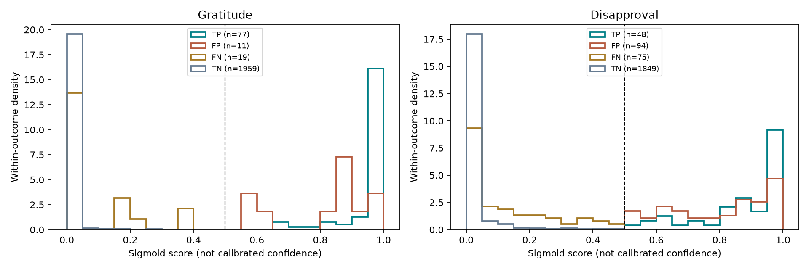
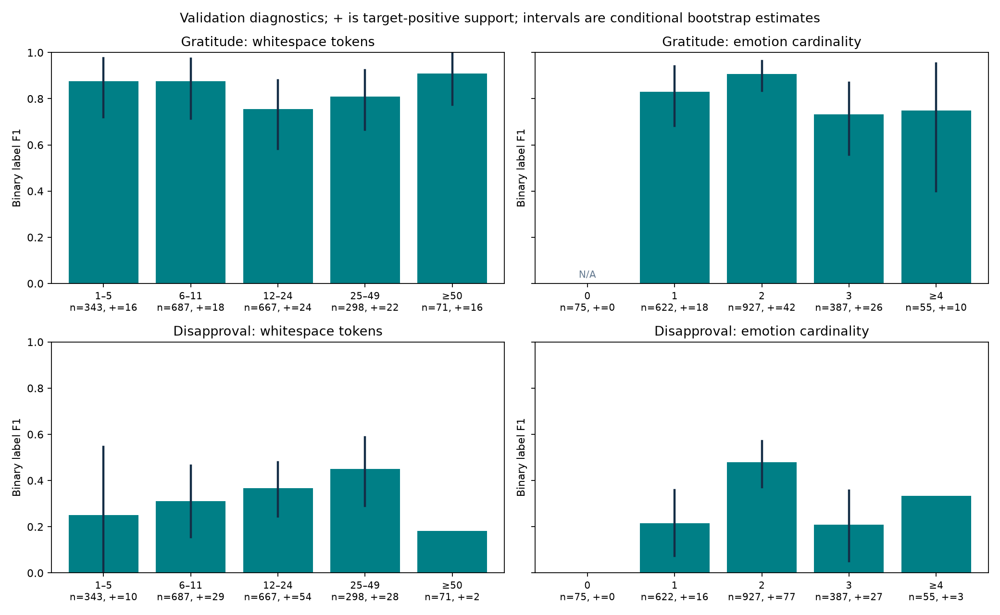

# Q1: Gratitude versus Disapproval — supplementary research

## Scope and reproducibility

Experiment A is completed on the saved PhoBERT **27-output** validation predictions at **threshold 0.5**. The backbone is unchanged: 20 epochs trained, checkpoint epoch 14 selected in the original Kaggle run. No inference, retraining, threshold selection, test predictions or official-report updates are performed. Experiments B and C are **pending actual human reviews and verified interventions**.

Sources and SHA-256 checksums are recorded in `provenance.json`; fixed train/validation ID order and NPZ label order/targets are verified using the repository contracts. Only train supplies training-frequency statistics. Raw CSVs are read locally but never copied to public outputs.

## Reproduced reference metrics

| label | train_count | positive_support | tp | fp | fn | tn | precision | recall | f1 |
| --- | --- | --- | --- | --- | --- | --- | --- | --- | --- |
| gratitude | 765 | 96 | 77 | 11 | 19 | 1959 | 0.8750 | 0.8021 | 0.8370 |
| disapproval | 969 | 123 | 48 | 94 | 75 | 1849 | 0.3380 | 0.3902 | 0.3623 |

The F1 gap is **47.47 percentage points**, with a paired-comment bootstrap 95% interval [37.98, 56.62] pp. Disapproval has more training positives (969 versus 765), so a simple lower-frequency explanation is insufficient for this pair. This does not isolate linguistic difficulty, annotation quality or a causal mechanism.

Precision uses TP/(TP+FP); recall uses TP/(TP+FN); prevalence uses positives/all comments. F1 is 2TP/(2TP+FP+FN). Undefined denominators are N/A, not zero. The reference values match both published tables and saved predictions.

## Error scores and threshold proximity

| label | outcome | n | median | q10 | q90 | near_threshold | very_low | very_high |
| --- | --- | --- | --- | --- | --- | --- | --- | --- |
| gratitude | TP | 77 | 0.9895 | 0.8523 | 0.9980 | 0 | 0 | 67 |
| gratitude | FP | 11 | 0.8586 | 0.5868 | 0.9954 | 2 | 0 | 3 |
| gratitude | FN | 19 | 0.0332 | 0.0006 | 0.2705 | 0 | 13 | 0 |
| gratitude | TN | 1959 | 0.0006 | 0.0001 | 0.0040 | 3 | 1927 | 0 |
| disapproval | TP | 48 | 0.9317 | 0.6327 | 0.9920 | 3 | 0 | 26 |
| disapproval | FP | 94 | 0.8476 | 0.5654 | 0.9751 | 13 | 0 | 34 |
| disapproval | FN | 75 | 0.0612 | 0.0050 | 0.3748 | 5 | 43 | 0 |
| disapproval | TN | 1849 | 0.0021 | 0.0002 | 0.0519 | 16 | 1732 | 0 |

Near-threshold means 0.4 ≤ score ≤ 0.6; very low is <0.1; very high is ≥0.9. These are descriptive score bands, not tuned decision thresholds. A sigmoid score is not a calibrated probability of correctness. FP and FN are shown separately; their denominators differ.

- **gratitude:** 3/11 false positives score ≥0.9; 13/19 false negatives score <0.1. Only 2/11 FP and 0/19 FN lie in [0.4, 0.6].
- **disapproval:** 34/94 false positives score ≥0.9; 43/75 false negatives score <0.1. Only 13/94 FP and 5/75 FN lie in [0.4, 0.6].

Thus errors are not confined to a narrow band near 0.5. This observation does not establish whether an error comes from wording, semantics, annotation or missing context.



## H3: text characteristics (observational)

Bins and lexical probes are fixed in the script; this supplementary exploratory study is not preregistered. `tables/subgroups.csv` includes **every** group, sample size, target-positive support, predicted-positive count, TP/FP/FN/TN, prevalence, precision/recall/F1 and uncertainty intervals. Length and cardinality bins partition their own families; style, punctuation, negation and public lexical probes overlap and must not be treated as independent samples.

| label | family | group | n | positive_support | predicted_positive | precision | recall | f1 |
| --- | --- | --- | --- | --- | --- | --- | --- | --- |
| gratitude | teencode | yes | 307 | 11 | 10 | 0.7000 | 0.6364 | 0.6667 |
| gratitude | teencode | no | 1759 | 85 | 78 | 0.8974 | 0.8235 | 0.8589 |
| gratitude | emoji_heavy_ge_2 | yes | 199 | 16 | 16 | 0.8125 | 0.8125 | 0.8125 |
| gratitude | emoji_heavy_ge_2 | no | 1867 | 80 | 72 | 0.8889 | 0.8000 | 0.8421 |
| gratitude | public_lexical_probe | yes | 64 | 58 | 61 | 0.9344 | 0.9828 | 0.9580 |
| gratitude | public_lexical_probe | no | 2002 | 38 | 27 | 0.7407 | 0.5263 | 0.6154 |
| disapproval | teencode | yes | 307 | 24 | 36 | 0.3056 | 0.4583 | 0.3667 |
| disapproval | teencode | no | 1759 | 99 | 106 | 0.3491 | 0.3737 | 0.3610 |
| disapproval | emoji_heavy_ge_2 | yes | 199 | 5 | 8 | 0.0000 | 0.0000 | 0.0000 |
| disapproval | emoji_heavy_ge_2 | no | 1867 | 118 | 134 | 0.3582 | 0.4068 | 0.3810 |
| disapproval | public_lexical_probe | yes | 1 | 0 | 1 | 0.0000 | N/A | 0.0000 |
| disapproval | public_lexical_probe | no | 2065 | 123 | 141 | 0.3404 | 0.3902 | 0.3636 |



Cardinality uses the 27-emotion ground-truth vector and excludes Neutral. Style heuristics reuse `common.style_masks`; whitespace-token length is not BPE length. Subgroup differences do not control for other characteristics and are not evidence of causality.

Outcome-specific length/cardinality summaries provide a separate view of false positives and false negatives. These are characteristics conditional on each outcome, not error probabilities for a characteristic.

| label | outcome | feature | n | mean | median |
| --- | --- | --- | --- | --- | --- |
| gratitude | TP | tokens | 77 | 28.0779 | 18.0000 |
| gratitude | TP | emotion_cardinality | 77 | 2.1818 | 2.0000 |
| gratitude | FP | tokens | 11 | 30.5455 | 20.0000 |
| gratitude | FP | emotion_cardinality | 11 | 1.4545 | 1.0000 |
| gratitude | FN | tokens | 19 | 22.0000 | 14.0000 |
| gratitude | FN | emotion_cardinality | 19 | 3.0526 | 3.0000 |
| disapproval | TP | tokens | 48 | 20.9792 | 16.0000 |
| disapproval | TP | emotion_cardinality | 48 | 2.0208 | 2.0000 |
| disapproval | FP | tokens | 94 | 24.3404 | 18.5000 |
| disapproval | FP | emotion_cardinality | 94 | 1.7447 | 2.0000 |
| disapproval | FN | tokens | 75 | 15.9733 | 13.0000 |
| disapproval | FN | emotion_cardinality | 75 | 2.2133 | 2.0000 |

## H1 and H2: hypotheses requiring human evidence

The public lexical probes are a small, pre-specified proxy, not an explicit/implicit classifier. Cue absence does not imply implicit emotion; negation, quotations and targets can invalidate a cue. `tables/train_lexical_probes.csv` reports their training coverage separately. The label-specific cue lists are unequal, incomplete and not validated for sensitivity, so their coverage is not an unbiased cross-label explicitness comparison. Only the blinded annotation study can assess the intended categories; no completed human annotations are claimed.

`tables/overlaps.csv` reports, separately within TP/FP/FN/TN, how often every other label is in the ground truth, predicted, predicted without that other label in ground truth, or both true and predicted. A correct prediction of another co-occurring emotion is **not** automatically semantic confusion. Even an unsupported other-label prediction is only an error pattern; human review is needed to identify ambiguity, annotation issues or a shared cue.

The following are the three most frequent **unsupported** other-label predictions within each target’s FN set, not a single-label confusion matrix. Rows overlap; n is the target-FN denominator, not the count of true instances of the other emotion.

| label | other_label | n | other_true | other_predicted_without_gt | other_true_and_predicted |
| --- | --- | --- | --- | --- | --- |
| gratitude | joy | 19 | 5 | 3 | 1 |
| gratitude | optimism | 19 | 5 | 3 | 4 |
| gratitude | desire | 19 | 0 | 2 | 0 |
| disapproval | annoyance | 75 | 39 | 12 | 23 |
| disapproval | anger | 75 | 12 | 7 | 6 |
| disapproval | disgust | 75 | 7 | 6 | 3 |

## Uncertainty and interpretation

Precision, recall, prevalence and false-positive rate receive 95% Wilson intervals with their own denominators. F1 uses 2,000 ordinary nonparametric bootstrap replicates (or the explicitly recorded CLI count), seed 42/deterministic derived seeds. Binary-category multinomial resampling is equivalent to row resampling for single-label F1. F1 intervals are omitted when n<20, positive support<5 or predicted positives<5; point estimates and denominators remain visible. The label-gap bootstrap samples the **same comments for both labels**. These intervals condition on one selected checkpoint and this validation sample; they do not include training-seed variation, annotation uncertainty, repeated validation selection or multiple subgroup comparisons. No significance test or test-set improvement is claimed.

## Study status and implications for Final

- **Observed:** the verified label gap, different FP/FN counts, score distributions, subgroup patterns and label overlaps.
- **H1 unresolved:** explicitness must be human-annotated; lexical-probe associations are insufficient.
- **H2 unresolved:** overlap diagnostics do not establish semantic confusion.
- **H3 descriptive evidence only:** measured error associations are available; confounding, small groups and overlapping masks prevent causal claims.
- **H4 pending:** no verified paraphrase intervention has been evaluated.
- **Final:** use the proposed blinded review to prioritize errors and then evaluate human-verified, paired wording changes with fixed weights. Do not revise the official midterm results or silently replace its threshold based on these diagnostics.

## Reproduce

```bash
.venv/bin/python scripts/analyze_q1_difficulty.py
```

See `experiments/q1_label_difficulty/README.md` for the annotation and optional intervention commands. Private authorized train/val CSVs and the verified evidence directory are required; no test CSV is needed.

## Method sources

- [NIST: binomial confidence intervals and Wilson score intervals](https://www.itl.nist.gov/div898/software/dataplot/refman2/auxillar/exacbici.htm).
- [Cohen (1960): A coefficient of agreement for nominal scales](https://doi.org/10.1177/001316446002000104). Agreement is reserved for actual independent reviews, not generated labels.
